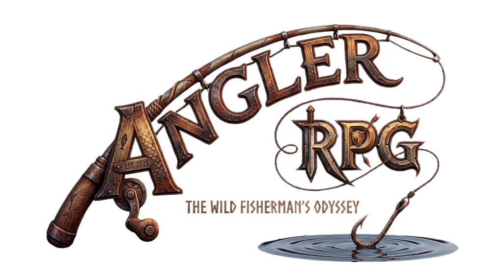
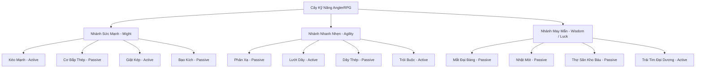

<p align="center">
  
</p>

<h1 align="center">🎣 AnglerRPG — Hải Trình Cần Thủ</h1>

<p align="center">
  <b>Tựa Game Nhập Vai Câu Cá Hành Động 2D Thời Gian Thực Trên Nền Tảng Java & LibGDX</b>
</p>

<p align="center">
  <a href="#-tính-năng-nổi-bật"></a>
  <a href="https://libgdx.com/"></a>
  <a href="https://openjdk.org/"></a>
  <a href="https://www.lwjgl.org/"></a>
  <a href="LICENSE"></a>
</p>

---

## 📖 Mục Lục

- [Giới Thiệu Tổng Quan](#-giới-thiệu-tổng-quan)
- [Tính Năng Nổi Bật](#-tính-năng-nổi-bật)
  - [1. Hệ Thống Câu Cá Đối Kháng Thời Gian Thực](#1-hệ-thống-câu-cá-đối-kháng-thời-gian-thực-action-fishing)
  - [2. Trí Tuệ Cá & Thủy Quái Đại Dương](#2-trí-tuệ-cá--thủy-quái-đại-dương-fish-ai--boss-battles)
  - [3. Cây Kỹ Năng Đa Nhánh](#3-cây-kỹ-năng-đa-nhánh-3-branch-skill-tree)
  - [4. Hệ Thống Trang Bị & Hiệu Ứng Bộ](#4-hệ-thống-trang-bị--hiệu-ứng-bộ-equipment--set-bonuses)
  - [5. Vòng Quay May Mắn & Cơ Chế Bảo Hiểm](#5-vòng-quay-may-mắn--cơ-chế-bảo-hiểm-gacha--pity-system)
  - [6. Bách Khoa Toàn Thư & Kỷ Lục Sinh Thái](#6-bách-khoa-toàn-thư--kỷ-lục-sinh-thái-catalog--bestiary)
  - [7. Bản Đồ Hải Trình Đa Dạng](#7-bản-đồ-hải-trình-đa-dạng-exploration-maps)
  - [8. Nhiệm Vụ & Sự Kiện Hấp Dẫn](#8-nhiệm-vụ--sự-kiện-hấp-dẫn-quests--events)
- [Bảng Điều Khiển & Phím Tắt](#-bảng-điều-khiển--phím-tắt)
- [Kiến Trúc Kỹ Thuật & Cấu Trúc Dự Án](#-kiến-trúc-kỹ-thuật--cấu-trúc-dự-án)
- [Yêu Cầu Hệ Thống & Hướng Dẫn Cài Đặt](#-yêu-cầu-hệ-thống--hướng-dẫn-cài-đặt)
- [Quản Lý Dữ Liệu Lưu Trữ (Save System & Reset Data)](#-quản-lý-dữ-liệu-lưu-trữ-save-system--reset-data)
- [Nhật Ký Cập Nhật (Changelog)](#-nhật-ký-cập-nhật-changelog)
- [Tác Giả & Bản Quyền](#-tác-giả--bản-quyền)

---

## 🌊 Giới Thiệu Tổng Quan

**AnglerRPG (Hải Trình Cần Thủ)** là tựa game 2D Fishing Action-RPG độc đáo được xây dựng từ nền tảng với **Java** và **libGDX**. 

Khác biệt hoàn toàn với các tựa game câu cá nhàn rỗi (idle/clicker) truyền thống, **AnglerRPG** biến mỗi lần vung cần thành một cuộc đấu trí và kỹ năng thời gian thực đầy kịch tính giữa cần thủ và thủy quái dưới lòng đại dương. Game kết hợp hài hòa giữa cơ chế phản xạ bấm nhả dây câu, kiểm soát lực căng (Tension), quản lý thể lực (Stamina) và chiều sâu nhập vai phong phú: nâng cấp kỹ năng, săn tìm trang bị huyền thoại với dòng chỉ số ngẫu nhiên, mở khóa danh hiệu bách khoa toàn thư và chinh phục những vùng biển xa xôi.

---

## 🌟 Tính Năng Nổi Bật

### 1. Hệ Thống Câu Cá Đối Kháng Thời Gian Thực (Action Fishing)

- **Cơ chế Quăng Cần Chuẩn Xác (Timing Cast)**:
  - Thanh đo lực động với con trỏ dao động liên tục.
  - 4 mốc thời điểm căn chỉnh: `MISS / BAD`, `NORMAL`, `GOOD` (+10% tỷ lệ cá hiếm, cắn nhanh 20%) và `PERFECT` (+25% tỷ lệ cá hiếm, cắn nhanh 50%).
  - Bảng HUD hiển thị thời gian thực thẻ hiệu ứng kích hoạt từ quăng cần (`✦ HIỆU ỨNG TỶ LỆ CÂU KÍCH HOẠT ✦`).

- **Cơ Chế Giằng Co & Lực Căng Dây (Tension Management)**:
  - **Kéo Dây (`SPACE` / Chuột Trái)**: Rút cạn thể lực của cá, nhưng làm gia tăng nhanh chóng Lực Căng Dây (Tension).
  - **Nhả Dây**: Cho phép Tension hạ nhiệt an toàn, nhưng cá sẽ có cơ hội hồi phục hoặc bơi ra xa.
  - **Cảnh báo đứt dây (Line Break)**: Khi Tension vượt quá 100%, dây câu sẽ phát nổ và đứt, cá trốn thoát kèm hiệu ứng rung lắc màn hình (Screen Shake).

- **Hoạt Ảnh Cá Chuyển Động Chiến Đấu Sống Động (Dynamic Combat Animations)**:
  - Cá bơi lùi ra xa khi giằng co mạnh (thu nhỏ tỷ lệ, dịch chuyển về phía xa mặt nước).
  - Cá được kéo lại gần khi cần thủ ghì dây thành công (phóng to tỷ lệ sắc nét).
  - Quẫy đuôi tốc độ cao tạo bọt nước sủi bọt, nhảy vọt trên không (`nhay_vot`), lặn sâu (`lan_sau`), hoặc bứt tốc xé nước (`but_toc`).

---

### 2. Trí Tuệ Cá & Thủy Quái Đại Dương (Fish AI & Boss Battles)

Mỗi loài cá sở hữu cá tính, độ hung hãn và bộ kỹ năng đặc trưng riêng biệt theo cấp độ hiếm:

| Phân Cấp | Màu Sắc | Đặc Trưng Hành Vi | Kỹ Năng Tiêu Biểu |
| :--- | :---: | :--- | :--- |
| **Thường (Common)** | ⚪ Trắng | Kháng cự căn bản, tốc độ giằng co chậm | Bơi lội tự nhiên |
| **Hiếm (Rare)** | 🟢 Xanh lục | Thể lực dồi dào, phản kháng gián đoạn | *Lướt Sóng*, *Bứt Tốc* |
| **Sử Thi (Epic)** | 🟣 Tím | Kháng cự dữ dội, gây đột biến lực căng | *Lặn Sâu*, *Phản Đòn*, *Sát Thương Ngược* |
| **Huyền Thoại (Legendary)** | 🟡 Vàng | Tốc độ cao, liên tục tung chiêu hiểm hóc | *Nhảy Vọt*, *Sốc Điện*, *Vùng Vẫy Điên Cuồng* |
| **Trùm (Boss)** | 🔴 Đỏ | Máu cực lớn, thanh kỹ năng cuồng nộ và tuyệt kỹ | *Mực Mù Hút Máu*, *Quét Xúc Tu*, *Bão Tố*, *Sóng Thần* |

> **Đại Chiến Trùm Bạch Tuộc Khổng Lồ**: Sở hữu tuyệt kỹ dung hợp `Mực Mù Hút Máu` — che khuất tầm nhìn toàn bộ giao diện bằng hắc ám vực sâu, đồng thời rút cạn thể lực cần thủ để hồi phục HP cho bản thân.

---

### 3. Cây Kỹ Năng Đa Nhánh (3-Branch Skill Tree)

Hệ thống nâng cấp đồ sộ với 3 nhánh chiến thuật chuyên biệt, cho phép tự do định hình lối chơi:



- **4 Ô Kỹ Năng Chủ Động (Q, W, E, R)**: Thi triển trong lúc giằng co để lật ngược tình thế (VFX lưỡi liềm kéo động năng, vệt hào quang trói buộc, sóng chấn động mặt nước).
- **2 Ô Kỹ Năng Bị Động**: Tối ưu hóa chỉ số thể lực hồi phục, giảm sốc tension và tăng tỷ lệ bắt cá quý hiếm.

---

### 4. Hệ Thống Trang Bị & Hiệu Ứng Bộ (Equipment & Set Bonuses)

- **3 Vị Trí Trang Bị Thiết Yếu**:
  - 🎣 **Cần Câu (Rod)**: Gia tăng Lực Kéo (Pull Power) và Sát Thương Giật.
  - 🧵 **Dây Câu (Line)**: Gia tăng Giới Hạn Lực Căng (Max Tension) và Độ Bền.
  - 🪝 **Lưỡi Câu (Hook)**: Gia tăng Tốc Độ Cắn Câu và Khả Năng Giữ Cá.
- **Hệ Thống 8 Bộ Set Thần Thoại**:
  - `Tập Sự` • `Hải Tặc` • `Thợ Săn` • `Băng Giá` • `Vực Thẳm` • `Thời Không` • `Quang Minh` • `Lạc Hồng`.
  - Kích hoạt **Hiệu Ứng Bộ (Set Bonus)** độc quyền khi trang bị đủ bộ (Tăng mạnh EXP, Vàng, Kháng đứt dây, Sát thương bạo kích).
- **Hệ Thống Dòng Chỉ Số Phụ Ngẫu Nhiên (Randomized Substats)**:
  - `STAMINA_REGEN` • `EXP_BONUS` • `GOLD_BONUS` • `TENSION_REDUCTION` • `LINE_DURABILITY`.

---

### 5. Vòng Quay May Mắn & Cơ Chế Bảo Hiểm (Gacha & Pity System)

- **Banner Tiêu Chuẩn & Banner Giới Hạn (Limited Event)**.
- **Cơ chế Bảo Hiểm (Pity System) Minh Bạch**:
  - Tích lũy số lượt quay để đảm bảo nhận được trang bị Sử Thi (Epic), Huyền Thoại (Legendary) và Giới Hạn (Limited).
- Hiệu ứng mở hòm hào quang 3D procedural lung linh, phân biệt màu sắc thẻ bài theo độ hiếm.

---

### 6. Bách Khoa Toàn Thư & Kỷ Lục Sinh Thái (Catalog & Bestiary)

- Tự động ghi chép thông tin từng loài cá sau lần đầu bắt được.
- Lưu trữ **Kỷ Lục Kích Thước Lớn Nhất**: Chiều dài (cm) và Cân nặng (kg).
- Nhận phần thưởng **Cột Mốc Bộ Sưu Tập**: Kim cương, Vàng, và Vé Quay Gacha khi hoàn thành hệ sinh thái từng khu vực.

---

### 7. Bản Đồ Hải Trình Đa Dạng (Exploration Maps)

```
[ Ao Làng ] (Cấp 1+)  --->  [ Bãi Biển ] (Cấp 10+)  --->  [ Đảo Xa ] (Cấp 20+)
  Hệ nước ngọt yên ả         Sóng vỗ & Thủy Quái           Vực thẳm tử thần
  15 Loài sinh vật            15 Loài ven bờ hung hãn       Ngự trị bởi Leviathan
```

- Nền hoạt họa tương tác riêng biệt: hoa sen, bèo nổi dập dềnh ở Ao Làng; rặng dừa, chim hải âu lượn sóng ở Bãi Biển; sấm sét, vực đen ở Đảo Xa.

---

### 8. Nhiệm Vụ & Sự Kiện Hấp Dẫn (Quests & Events)

- **Hệ Thống Nhiệm Vụ Đa Dạng**: Nhiệm vụ Hàng ngày (Daily), Nhiệm vụ Hàng tuần (Weekly), Chuỗi thành tựu trọn đời.
- **Sự Kiện Điểm Danh Hàng Tháng**: Đăng nhập mỗi ngày để nhận quà lũy tiến.
- **Chuỗi Nhiệm Vụ Sự Kiện Tích Điểm**: Hoàn thành các thử thách câu cá đặc biệt để nhận Kim cương và Vé quay cao cấp.

---

## 🎮 Bảng Điều Khiển & Phím Tắt

### Trong Trận Chiến Câu Cá (Fishing Combat)

| Phím Tắt | Thao Tác Chuột | Chức Năng |
| :---: | :---: | :--- |
| `SPACE` | Click Chuột Trái vào nút **QUĂNG / KÉO** | Quăng cần (Căn thời điểm) / Giữ phím để Ghì Kéo Dây Câu |
| `Q` | Click Slot Kỹ Năng 1 | Kích hoạt Kỹ Năng Chủ Động Ô 1 (*Ví dụ: Kéo Mạnh*) |
| `W` | Click Slot Kỹ Năng 2 | Kích hoạt Kỹ Năng Chủ Động Ô 2 (*Ví dụ: Giật Kép*) |
| `E` | Click Slot Kỹ Năng 3 | Kích hoạt Kỹ Năng Chủ Động Ô 3 (*Ví dụ: Lướt Dây*) |
| `R` | Click Slot Kỹ Năng 4 | Kích hoạt Kỹ Năng Chủ Động Ô 4 (*Ví dụ: Trói Buộc*) |
| `1` - `4` | Click Vật Phẩm Tiêu Hao | Sử dụng vật phẩm hỗ trợ từ túi đồ (Thuốc thể lực, dây câu tốt...) |
| `ESC` | Click Nút **QUAY LẠI** | Hủy quăng cần / Thoát trận chiến về Menu |

### Giao Diện Menu & Quản Lý (Menu & Hub)

| Phím Tắt | Thao Tác Chuột | Chức Năng |
| :---: | :---: | :--- |
| `W` / `S` hoặc `↑` / `↓` | Rê chuột | Di chuyển chọn danh mục / Nút chức năng |
| `ENTER` / `SPACE` | Click Chuột Trái | Xác nhận lựa chọn / Mở tính năng |
| `ESC` | Click Nút **QUAY LẠI** | Trở về màn hình trước đó |
| `↑` / `↓` | Cuộn bánh xe chuột | Cuộn danh sách (Túi đồ, Bách khoa, Nhiệm vụ) |

---

## 🏗 Kiến Trúc Kỹ Thuật & Cấu Trúc Dự Án

Dự án áp dụng mô hình phân lớp rõ ràng, chuẩn phong cách phát triển game hiện đại:

```
AnglerRPG/
├── assets/                     # Tài nguyên trò chơi
│   ├── audio/                  # Nhạc nền (BGM) & Âm thanh hiệu ứng (SFX)
│   ├── data/                   # Dữ liệu tĩnh JSON (fishes.json, loot.json)
│   └── data/*.ttf              # Phông chữ TrueType hỗ trợ đầy đủ tiếng Việt & Unicode
├── core/                       # Module chính (Platform-independent Game Logic)
│   └── src/main/java/com/fishingrpg/game/
│       ├── FishingRPG.java     # Game Application Listener & Quản lý Font/Batch
│       ├── PlayScreen.java     # Màn hình chơi chính & Vòng lặp gameplay
│       ├── data/               # SaveManager, Databases (Fish, Item, Collection, SizeRecord)
│       ├── entities/           # Player, Fish, Item, Quest & Equipment Models
│       │   └── equipment/      # Thiết kế Trang bị, Rarity, Substat & Generator
│       ├── loot/               # Hệ thống Loot Table & Bảng phần thưởng
│       ├── screens/            # Các màn hình chức năng (Menu, Map, Shop, Gacha, Quest, Catalog)
│       ├── skills/             # Hệ thống Kỹ Năng & Cây Kỹ Năng (SkillTree)
│       ├── systems/            # Bộ xử lý Gameplay: FishingManager, QuestManager, EventManager, Audio
│       └── ui/                 # Giao diện HUD, Render cá, VFX chiến đấu (CombatVFXManager)
├── lwjgl3/                     # Module Desktop Runner (LWJGL3 / OpenGL)
│   └── src/main/java/com/fishingrpg/game/lwjgl3/
│       └── Lwjgl3Launcher.java # Điểm khởi động ứng dụng trên PC
├── build.gradle                # Cấu hình Gradle Root
└── CHANGELOG.md                # Nhật ký thay đổi chi tiết từng phiên bản
```

---

## 💻 Yêu Cầu Hệ Thống & Hướng Dẫn Cài Đặt

### Yêu Cầu Môi Trường (Prerequisites)

- **Hệ điều hành**: Windows 10/11, macOS 11+, hoặc Linux (Ubuntu 20.04+).
- **Java Development Kit (JDK)**: **JDK 17** hoặc **JDK 21** trở lên ([Eclipse Temurin](https://adoptium.net/) hoặc OpenJDK).
- **RAM**: Tối thiểu 2 GB RAM trống.
- **Card đồ họa**: Hỗ trợ OpenGL 2.0 trở lên.

---

### Hướng Dẫn Chạy Game Trực Tiếp

1. **Clone mã nguồn dự án**:
   ```bash
   git clone https://github.com/hizeng-quan/AnglerRPG.git
   cd AnglerRPG
   ```

2. **Chạy game ngay từ terminal**:
   - Trên **Windows**:
     ```powershell
     .\gradlew.bat lwjgl3:run
     ```
   - Trên **macOS / Linux**:
     ```bash
     chmod +x gradlew
     ./gradlew lwjgl3:run
     ```

---

### Đóng Gói Thành File Thực Thi (.jar & .exe)

#### 1. Khởi chạy trực tiếp file .exe (Không cần cài đặt Java):
Game đã được đóng gói sẵn dưới dạng tệp thực thi Windows độc lập kèm bộ runtime JRE nhúng:
- Thư mục chạy game: `dist/AnglerRPG-Windows/`
- Tệp thực thi: **`AnglerRPG.exe`** (hoặc `FishingRPG.exe`)
- Gói nén phân phối đầy đủ: **`dist/AnglerRPG-v0.4.15-Windows-x64.zip`**

*Người chơi chỉ cần nhấp đúp vào file `AnglerRPG.exe` để bắt đầu trải nghiệm ngay!*

#### 2. Đóng gói lại file .exe từ mã nguồn:
```powershell
.\gradlew.bat lwjgl3:packageWinX64
```
File thực thi và runtime sẽ được sinh tại: `lwjgl3/build/construo/winX64/roast/`.

#### 3. Xuất file thực thi .jar đa nền tảng:
```bash
# Windows
.\gradlew.bat lwjgl3:jar

# macOS / Linux
./gradlew lwjgl3:jar
```

File JAR sẽ xuất hiện tại `lwjgl3/build/libs/FishingRPG-1.0.0.jar` và có thể khởi chạy bằng:
```bash
java -jar lwjgl3/build/libs/FishingRPG-1.0.0.jar
```

---

## 💾 Quản Lý Dữ Liệu Lưu Trữ (Save System & Reset Data)

Trò chơi sử dụng hệ thống **LibGDX Preferences** để tự động lưu tiến trình chơi (Cấp độ, Tiền vàng, Kim cương, Trang bị, Kỹ năng, Bộ sưu tập và Kỷ lục cá) giữa các phiên chơi.

### Vị Trí File Lưu Trữ Trên Máy Tính

- **Windows**: `C:\Users\<Tên_Người_Dùng>\.prefs\`
  - `AnglerRPG_Save`: Chứa toàn bộ thông tin tiến trình của người chơi.
  - `AnglerRPG_Records`: Chứa bảng kỷ lục kích thước và các loài cá đã từng câu được.
- **macOS / Linux**: `~/.prefs/`
  - `AnglerRPG_Save`
  - `AnglerRPG_Records`

### Xuất & Nạp Dữ Liệu Lưu Trữ (Export & Import Data)

Tại **Menu Chính** của trò chơi, bạn có thể dễ dàng sao lưu hoặc chuyển đổi dữ liệu chơi giữa các máy:
- **📤 XUẤT DỮ LIỆU**: Bấm vào nút này để xuất toàn bộ chỉ số, trang bị, kỹ năng và kỷ lục câu cá ra file `angler_save.json` (được lưu tại thư mục gốc game) và đồng thời sao chép toàn bộ chuỗi JSON vào Clipboard.
- **📥 NẠP DỮ LIỆU**: Mở cửa sổ duyệt file để chọn file `.json` sao lưu từ máy tính, hoặc tự động đọc file `angler_save.json` cục bộ / dán từ Clipboard để phục hồi tiến trình ngay lập tức.

### Cách Xóa / Làm Mới Dữ Liệu (Reset Data)

Nếu bạn muốn xóa sạch dữ liệu người chơi cũ để trải nghiệm lại từ đầu (Cấp 1):

- **Trên Windows (PowerShell)**:
  ```powershell
  Remove-Item -Path "$env:USERPROFILE\.prefs\AnglerRPG_Save" -Force -ErrorAction SilentlyContinue
  Remove-Item -Path "$env:USERPROFILE\.prefs\AnglerRPG_Records" -Force -ErrorAction SilentlyContinue
  ```

- **Trên macOS / Linux**:
  ```bash
  rm -f ~/.prefs/AnglerRPG_Save ~/.prefs/AnglerRPG_Records
  ```

- **Trong Mã Nguồn Java**:
  Bạn có thể gọi trực tiếp phương thức tiện ích:
  ```java
  com.fishingrpg.game.data.SaveManager.clearSave();
  ```

---

## 📜 Nhật Ký Cập Nhật (Changelog)

Toàn bộ lịch sử các phiên bản, danh sách sửa lỗi và các tính năng nâng cấp qua từng bản phát hành được ghi chép đầy đủ tại:
👉 [**CHANGELOG.md**](file:///c:/Users/Quan/IdeaProjects/AnglerRPG/CHANGELOG.md)

---

## 👥 Tác Giả & Bản Quyền

- **Tác giả**: [Quan (hizeng-quan)](https://github.com/hizeng-quan)
- **Giấy phép**: Dự án phát hành theo giấy phép [MIT License](LICENSE).
- Phát triển bằng tình yêu dành cho dòng game câu cá và lập trình game mã nguồn mở với **Java** & **libGDX**! 🎣✨
