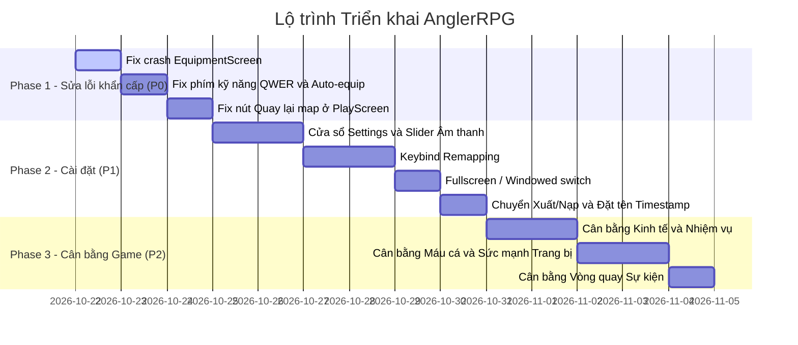

# KẾ HOẠCH PHÁT TRIỂN & THEO DÕI TÁC VỤ (ROADMAP & TASK TRACKER)
> **Dự án:** AnglerRPG  
> **Cập nhật:** 22/10/2026  
> **Trạng thái tài liệu:** Đang hoạt động (Active Tracker)

---

## 📌 BẢNG TỔNG HỢP MỨC ĐỘ ƯU TIÊN (PRIORITY MATRIX)

| ID | Nhóm công việc | Hạng mục | Mức độ ưu tiên | Trạng thái |
| :--- | :--- | :--- | :---: | :---: |
| **BUG-01** | Sửa lỗi | Crash khi bấm Quay lại từ màn hình Trang bị (Use-After-Free) | **P0 (Khẩn cấp)** | ✅ Đã khắc phục triệt để |
| **BUG-02** | Sửa lỗi | Chuẩn hóa hệ thống nút Quay lại Menu & khắc phục lỗi vòng lặp | **P0 (Khẩn cấp)** | ✅ Đã khắc phục triệt để |
| **BUG-03** | Sửa lỗi | Phím kỹ năng QWER không nhận & thiếu phản hồi trên tài khoản mới | **P0 (Khẩn cấp)** | ✅ Đã khắc phục triệt để |
| **BUG-04** | Sửa lỗi | Thoát Gacha ra game HUD bấm mục bất kì có khả năng crash | **P0 (Khẩn cấp)** | ✅ Đã khắc phục triệt để |
| **BUG-05** | Sửa lỗi | Lỗi chữ bị đè xuyên Modal Xóa Dữ Liệu & Hitbox Data Tab bị lệch | **P0 (Khẩn cấp)** | ✅ Đã khắc phục triệt để |
| **BUG-06** | Sửa lỗi | Danh sách phím bấm tràn (overflow) ra ngoài Box cài đặt & đè Header/Tabs | **P0 (Khẩn cấp)** | ✅ Đã khắc phục triệt để |
| **NEW-01** | Tính năng | Bản tin cập nhật trực quan tại Menu chính (không che HUD, không tự bật) | **P0 (Theo yêu cầu)** | ✅ Đã hoàn thành |
| **SET-01** | Tính năng | Game HUD: Nút Cài đặt & Cửa sổ Settings Modal | **P1 (Quan trọng)** | ✅ Đã hoàn thành |
| **SET-02** | Tính năng | Drag chuột chỉnh âm lượng & Tắt âm Nhạc nền (BGM) và SFX độc lập | **P1 (Quan trọng)** | ✅ Đã hoàn thành |
| **SET-03** | Tính năng | Toàn bộ 14 Keybinds (Kéo dây, 4 Kỹ năng, 9 Quickslots) & Chống trùng phím | **P1 (Quan trọng)** | ✅ Đã hoàn thành |
| **SET-04** | Tính năng | Chế độ hiển thị: Toàn màn hình / Cửa sổ & Phím tắt F11 toàn cục | **P1 (Quan trọng)** | ✅ Đã hoàn thành |
| **SET-05** | Tính năng | Chuyển Xuất/Nạp dữ liệu vào Settings & Tự động đặt tên file Timestamp | **P1 (Quan trọng)** | ✅ Đã hoàn thành |
| **SET-06** | Giao diện | Bố cục Single-Column Scrollable List & Nâng cấp UI Setting Vibe Game Fantasy | **P1 (Giao diện)** | ✅ Đã hoàn thành |
| **HUD-01** | Trải nghiệm| Random bản tin Ticker khi vào HUD & Xóa phím cứng + Chú thích Cài đặt | **P1 (Trải nghiệm)**| ✅ Đã hoàn thành |
| **MCP-01** | Công cụ | Custom Vector Studio MCP Server (Vẽ, Kiểm duyệt, Chuyển SVG sang LibGDX) | **P1 (Quan trọng)** | ✅ Đã hoàn thành |
| **GRP-01** | Đồ họa | Pipeline Đồ Họa Vector: Visual Quality Gate & CLI Runner (.agents/skills) | **P1 (Quan trọng)** | ✅ Đã hoàn thành |
| **GRP-02** | Đồ họa | Bổ Sung Bước Dọn Dẹp Sau Khi Tích Hợp (Post-Apply Cleanup) Vào Pipeline | **P1 (Quan trọng)** | ✅ Đã hoàn thành |
| **SET-07** | Đồ họa | Đại Tu Ngoại Hình Toàn Bộ Set Trang Bị Thời Không (Trượng, Dây, Lưỡi) | **P1 (Quan trọng)** | ✅ Đã hoàn thành |
| **BAL-01** | Cân bằng | Cân bằng phần thưởng Kim Cương từ Nhiệm vụ | **P2 (Cân bằng)** | ⚖️ Chờ điều chỉnh |
| **BAL-02** | Cân bằng | Cân bằng Sức mạnh Cá vs Trang bị (Kéo dài độ giằng co) | **P2 (Cân bằng)** | ⚖️ Chờ điều chỉnh |
| **BAL-03** | Cân bằng | Cân bằng Tỷ lệ Quay Gacha Sự Kiện | **P2 (Cân bằng)** | ⚖️ Chờ điều chỉnh |

---

## 🚨 PHẦN I: DANH SÁCH LỖI ĐÃ XÁC ĐỊNH & PHƯƠNG ÁN XỬ LÝ

### 1. BUG-01: Lỗi bấm vào phần Trang bị (EquipmentScreen) sau đó ấn Quay lại thì bị crash game
- **Hiện tượng:** Người chơi từ màn chơi chính hoặc Menu vào `EquipmentScreen`, nhấn nút `← QUAY LẠI` hoặc phím `ESC` thì game bị văng / sập (Crash).
- **Nguyên nhân kỹ thuật (Root Cause):**
  - Trong `EquipmentScreen.java` dòng 110: Hàm `render(float delta)` gọi `update(delta)`.
  - Trong `update()` khi phát hiện nút Back / ESC: Game gọi `game.setScreen(previousScreen);` và gọi `dispose();` (giải phóng tài nguyên OpenGL `sr.dispose()`).
  - Sau khi `update()` return, hàm `render()` **không có lệnh dừng** (`if (game.getScreen() != this) return;`). Luồng tiếp tục chạy đến dòng 125 và 134, cố gắng gọi `sr.setProjectionMatrix` và `sr.begin(...)` trên đối tượng `ShapeRenderer` đã bị giải phóng (`disposed`).
  - Hậu quả: LibGDX ném ra ngoại lệ `GdxRuntimeException: ShapeRenderer cannot be used after being disposed` gây crash game ngay lập tức.
- **Phương án khắc phục:**
  - Bổ sung lệnh kiểm tra `if (game.getScreen() != this) return;` ngay sau `update(delta);` tại `EquipmentScreen.java`.
  - Đảm bảo logic dọn dẹp biến đệm hoạt động an toàn trước khi chuyển cảnh.

---

### 2. BUG-02: Chuẩn hóa hệ thống nút quay lại Menu & khắc phục triệt để lỗi vòng lặp
- **Hiện tượng:** Người chơi bị rơi vào vòng lặp điều hướng giữa màn chơi và bản đồ do nút góc trên bên trái ở màn chơi dẫn sang Bản đồ (`MapScreen`), trong khi ở Bản đồ nút quay lại lại đưa về màn chơi, không có cách nào bấm chuột để thoát về Menu chính.
- **Nguyên nhân:**
  - Nút góc trái HUD trong `GameHUD.java` hiển thị nhãn `"BẢN ĐỒ"` và kích hoạt `new MapScreen()`.
  - Trong khi đó phím ESC lại đưa về `MainMenuScreen`, dẫn tới bất nhất giữa thao tác chuột và phím.
- **Phương án khắc phục (Đã thực hiện):**
  - Chuẩn hóa nút góc trên bên trái trên Game HUD thành `← MENU`: Bấm chuột hoặc phím ESC đều lưu game và trở về Menu chính (`MainMenuScreen`).
  - Nút ở giữa khi `State.IDLE`: `"RA KHƠI CÂU CÁ"` chuyên trách mở `MapScreen`.
  - Nút `← QUAY LẠI` (hoặc ESC) tại `MapScreen`: Quay lại màn chơi (`State.IDLE`), loại bỏ 100% hiện tượng vòng lặp luẩn quẩn.

---

### 3. BUG-03: Kỹ năng QWER hoạt động trên máy Dev nhưng người khác tải về không dùng được
- **Hiện tượng:** Trên máy phát triển test phím Q, W, E, R bình thường, nhưng gửi bản build cho người khác chơi thì bấm phím kỹ năng không có tác dụng.
- **Nguyên nhân tiềm ẩn:**
  1. **Tài khoản mới chưa có kỹ năng trang bị (Unassigned Slots):**
     - Khi một người chơi mới mở game lần đầu, mảng `equippedActives` có 4 ô rỗng (`null`).
     - Người chơi chưa mở bảng kỹ năng `SkillTreeScreen` để gán kỹ năng vào phím, hoặc đã cộng điểm nhưng chưa nhấn `Mặc Vào` (Equip) vào ô tương ứng.
     - Khi bấm phím Q/W/E/R, hệ thống kiểm tra `player.getEquippedActives()[i] == null` nên không kích hoạt gì cả, và không có thông báo HUD giải thích.
  2. **Xung đột bộ gõ tiếng Việt (Unikey / EVKey):**
     - Đa phần người dùng máy tính tại Việt Nam bật Unikey ở chế độ gõ `Telex` hoặc `VNI`.
     - Bộ gõ can thiệp vào các phím `W`, `E`, `R` (ví dụ `W` biến thành `ư`, `EE` thành `ê`, `R` là dấu hỏi trong VNI), khiến hệ thống GLFW/LWJGL3 không bắt được sự kiện `Input.Keys.W`, `Input.Keys.E`, `Input.Keys.R`.
  3. **Không hỗ trợ chuột trực tiếp:**
     - Nếu người chơi không quen dùng phím hoặc phím bị kẹt bộ gõ, họ cần click trực tiếp vào icon kỹ năng trên HUD.
- **Phương án khắc phục:**
  - **Tự động trang bị (Auto-Equip Default):** Mặc định khi người chơi học kỹ năng chủ động đầu tiên (hoặc khởi đầu game), tự động gán kỹ năng đó vào Slot Q (Slot 0).
  - **Phản hồi HUD:** Khi bấm phím mà ô trống, hiển thị Floating Text nhẹ: *"Ô phím chưa gắn kỹ năng!"*.
  - **Keybind tự do:** Cho phép đổi phím trong phần Settings sang các phím số 1, 2, 3, 4 hoặc Z, X, C, V để tránh bị Unikey bắt chữ.
  - **Hỗ trợ Click chuột mượt mà:** Đảm bảo click chuột trái vào ô kỹ năng trên HUD luôn kích hoạt kỹ năng 100%.

---

### 4. BUG-04: Thoát khỏi màn hình Gacha ra game HUD bấm vào một mục bất kì có khả năng crash
- **Hiện tượng:** Người chơi sau khi mở và đóng màn hình Gacha (`GachaScreen`), quay lại Game HUD (`PlayScreen`), nếu bấm vào một nút bất kì trên thanh điều hướng (Nhiệm vụ, Kỹ năng, Gacha, Cửa hàng, Trang bị...) thì game có tỷ lệ bị crash sập ngay lập tức (Crash JVM văng ra ngoài kèm sinh file `hs_err_pid*.log`).
- **Phân tích nhật ký Crash Dump (hs_err_pid5316, 14896, 20736, 26596 tại thời điểm 13:33 - 13:39):**
  - Cả 4 file log crash JVM mới nhất ghi nhận lỗi vi phạm truy cập bộ nhớ native: `EXCEPTION_ACCESS_VIOLATION (0xc0000005)`.
  - Stack trace chỉ ra điểm sập tại `ntdll.dll!RtlAllocateHeap` và `msvcrt.dll!memcpy` bên dưới lời gọi JNI của LibGDX:
    `BufferUtils.newDisposableByteBuffer` → `new ShapeRenderer()`
- **Nguyên nhân gốc rễ (Root Causes):**
  1. **Tạo và Hủy `ShapeRenderer` liên tục (Native Heap Fragmentation / Driver Conflict):**
     - Mỗi Screen (`GachaScreen`, `EquipmentScreen`, `QuestScreen`, `SkillTreeScreen`, `ShopScreen`,...) hiện đều tự `new ShapeRenderer()` khi khởi tạo và gọi `sr.dispose()` khi đóng.
     - `ShapeRenderer` trong LibGDX cấp phát bộ đệm Direct Byte Buffer trong C heap (`malloc`). Việc liên tục cấp phát và giải phóng các vertex buffer OpenGL qua JNI trên Windows 11 với card đồ họa (đặc biệt AMD Radeon 780M / Intel iGPU) dẫn tới phân mảnh hoặc xung đột quản lý bộ nhớ native của `msvcrt.dll`/`ntdll.dll`.
  2. **Tác động liên đới từ lỗi Use-After-Free của BUG-01:**
     - Khi `EquipmentScreen` gọi `dispose()` nhưng luồng render không dừng (`update` không chặn), các lệnh vẽ tiếp tục ghi dữ liệu vertex vào vùng đệm native C đã bị free, làm hỏng bảng điều khiển heap (`heap chunk headers`) của Windows. Bất kỳ lệnh `new ShapeRenderer()` nào sau đó đều sẽ dính `0xc0000005` trong `RtlAllocateHeap`.
  3. **Thiếu chặn click xuyên màn hình (`framesToSkip <= 0`):**
     - Tại `PlayScreen.java` dòng 222, cụm click mở các màn hình (`hud.isShopClicked`, `isEquipmentClicked`...) **không có điều kiện `framesToSkip <= 0`**, dẫn đến việc click chuột từ nút Quay lại của GachaScreen có thể kích hoạt ngay tức khắc một lệnh chuyển cảnh khác khi frame chưa ổn định.
- **Phương án khắc phục triệt để:**
  1. **Chia sẻ một instance `ShapeRenderer` duy nhất (Singleton / Shared Resource):**
     - Khởi tạo `ShapeRenderer` một lần duy nhất tại `FishingRPG.java` (giống như `batch`, `font`, `titleFont`).
     - Tất cả các Screens (`PlayScreen`, `GachaScreen`, `EquipmentScreen`, `ShopScreen`, `SkillTreeScreen`, `QuestScreen`, `EventScreen`, `MapScreen`, `MainMenuScreen`) tái sử dụng chung `game.shapeRenderer`, tuyệt đối không `new` hay `dispose()` riêng lẻ tại từng Screen.
     - Chỉ gọi `game.shapeRenderer.dispose()` duy nhất 1 lần khi toàn bộ game thoát tại `FishingRPG.dispose()`.
  2. **Bảo vệ `framesToSkip <= 0` trên toàn bộ nút HUD:**
     - Bổ sung `framesToSkip <= 0 &&` trước các sự kiện click mở Screen tại dòng 222 và dòng 186 của `PlayScreen.java`.
  3. **Khắc phục triệt để BUG-01 (ngắt render ngay khi chuyển cảnh).**

### 6. BUG-06: Danh sách cuộn phím bấm (Controls Tab) tràn ra ngoài Hộp thoại Cài Đặt
- **Hiện tượng:** Khi mở tab PHÍM BẤM và cuộn danh sách (hoặc ở vị trí mặc định), các thẻ phím bấm, viền và nút trồi ngược lên đè qua thanh Tabs, tiêu đề "CÀI ĐẶT TRÒ CHƠI", và tràn xuống đè nút "ĐẶT LẠI MẶC ĐỊNH", nút "ĐÓNG", lòi ra ngoài khung viền đáy dialog.
- **Nguyên nhân kỹ thuật (Root Cause):**
  1. `ShapeRenderer` trong LibGDX tích lũy vertices trong buffer nội bộ (`ImmediateModeRenderer20`). Khi gọi `ScissorStack.pushScissors` rồi vẽ shapes bằng `sr.rect`, sau đó gọi ngay `ScissorStack.popScissors()`, `popScissors()` đã tắt `GL_SCISSOR_TEST` trong OpenGL trước khi `sr.end()` kịp gửi vertex buffer sang GPU. Kết quả là toàn bộ shapes được vẽ mà không hề có Scissor clipping.
  2. Các vòng lặp vẽ 14 phím và 2 header banners thiếu cơ chế Hard Bounds Culling, dẫn đến việc mọi hàng dù có toạ độ Y nằm ngoài vùng nhìn (`y > 497` hoặc `y < 213`) vẫn bị đẩy vào hàng đợi render và nhận hover/click chuột.
  3. Thiếu khung viền recessed phân định box cuộn trực quan.
- **Phương án khắc phục:**
  1. Thêm `sr.flush()` trước `pushScissors` và ngay trước `popScissors()` để toàn bộ shapes cuộn được vẽ sang GPU trong khi `GL_SCISSOR_TEST` đang kích hoạt.
  2. Bổ sung tính toán `Viewport` (qua `getViewport().getScreenX()...`) chuẩn xác cho `ScissorStack.calculateScissors`.
  3. Áp dụng Hard Bounds Culling (`rY + rowH >= boxBottom && rY <= boxTop`) cho cả `drawControlsTabShapes`, `drawControlsTabTexts`, và `handleInput`.
  4. Vẽ khung hộp chìm (recessed panel) định hình rõ ràng khu vực danh sách cuộn.

---

## ⚙️ PHẦN II: HỆ THỐNG CÀI ĐẶT (SETTINGS SYSTEM)

### 1. Giao diện & Vị trí Cài đặt (HUD & Main Menu)
- **Vị trí tích hợp:**
  - Thêm Icon bánh răng ⚙️ (Settings) trên thanh HUD ở `PlayScreen` và trên `MainMenuScreen`.
  - Mở dạng Popup Modal phủ kính mờ (Glassmorphism), không làm ngắt luồng game đột ngột.

### 2. Thiết lập Âm thanh (Audio Settings)
- **Thanh trượt Nhạc nền (BGM Volume):** Điều chỉnh từ 0% đến 100% (Bước nhảy 5%).
- **Thanh trượt Hiệu ứng (SFX Volume):** Điều chỉnh từ 0% đến 100%.
- **Nút Mute nhanh:** Tắt/Bật toàn bộ âm thanh chỉ với 1 click.
- **Lưu trữ tự động:** Ghi nhớ giá trị vào `Preferences` và áp dụng ngay lập tức qua `AudioManager`.

### 3. Tùy chỉnh Phím bấm (Keybind Remapping)
- **Giao diện đổi phím:** Danh sách các thao tác kèm ô hiển thị phím hiện tại:
  - *Kéo dây / Giằng co:* Mặc định `SPACE`
  - *Kỹ năng 1 (Slot Q):* Mặc định `Q`
  - *Kỹ năng 2 (Slot W):* Mặc định `W`
  - *Kỹ năng 3 (Slot E):* Mặc định `E`
  - *Kỹ năng 4 (Slot R):* Mặc định `R`
  - *Phím tắt vật phẩm 1 - 9:* Mặc định `Phím 1` $\rightarrow$ `Phím 9`
- **Cơ chế gán phím:** Nhấp vào ô $\rightarrow$ Chờ người chơi nhấn phím mới $\rightarrow$ Kiểm tra trùng phím $\rightarrow$ Cập nhật và lưu vào cấu hình.

### 4. Thiết lập Hiển thị & Màn hình (Display Settings)
- **Chế độ màn hình:** Chuyển đổi giữa `Cửa sổ (Windowed)` và `Toàn màn hình (Fullscreen)`.
- **Độ phân giải (Resolutions):**
  - `1280 x 720` (Chuẩn HD - Tỷ lệ 16:9 gốc)
  - `1600 x 900` (HD+)
  - `1920 x 1080` (Full HD)
  - `Không viền (Borderless Windowed / Desktop Mode)`

### 5. Quản lý Dữ liệu Save trong Settings (Data Management)
- **Di chuyển tính năng Xuất/Nạp:** Chuyển toàn bộ 2 nút `Xuất Dữ Liệu` và `Nạp Dữ Liệu` từ Menu chính vào tab `Dữ liệu` bên trong Modal Cài đặt.
- **Quy tắc đặt tên file sao lưu thông minh (Anti-overwrite Timestamp):**
  - Tên file xuất ra sẽ tự động kèm ngày, tháng, năm, giờ, phút, giây:
    `angler_save_yyyyMMdd_HHmmss.json`
    *Ví dụ:* `angler_save_20261022_143015.json`
  - Đảm bảo mỗi lần xuất là một bản snapshot riêng biệt, không bao giờ vô tình ghi đè làm mất file lưu cũ của người chơi.

### 6. Bố cục Single-Column Scrollable List & Nâng cấp UI Setting Vibe Game Fantasy (SET-06)
- **Tái cấu trúc Tab Phím Bấm:**
  - Quy tụ toàn bộ 14 thao tác (Kéo dây + 4 Kỹ năng + 9 Quickslots) vào một danh sách cuộn dọc liền mạch duy nhất (Single-column list).
  - Tích hợp thanh cuộn Fantasy RPG Scrollbar: Hỗ trợ kéo thả chuột (drag), lăn bánh xe chuột, và phím mũi tên Lên/Xuống.
  - Sử dụng `ScissorStack` cắt khung chính xác theo camera, tránh tràn nội dung ra ngoài.
- **Nâng cấp thẩm mỹ chuẩn Vibe Game Fantasy RPG:**
  - Khung viền kép mạ vàng, 4 góc đính họa tiết Corner Ornaments 2 tầng với đá quý.
  - Hàng thẻ phím bấm làm bằng kính Obsidian Glass cao cấp với dải phản quang specular, hiệu ứng viền neon cyan/amber khi hover.
  - Khi bấm đổi phím, nút bấm phát sáng aura vàng pulsing rực rỡ, kèm cơ chế chống trùng phím (Anti-collision protection) phát âm thanh lỗi `sfx_fail` và hiển thị cảnh báo đỏ nếu trùng.
  - Nâng cấp đồng bộ các Tab Âm thanh (bàn trộn âm studio), Hiển thị (2 thẻ mode lớn kèm F11 tip) và Dữ liệu (3 thẻ action lớn theo mã màu).

### 7. Đại Tu Ngoại Hình Toàn Diện Set Trang Bị Thời Không (SET-07)
- **Vấn đề đồ họa cũ:**
  - `drawThoiKhongRod`: Vòng hào quang lớn quá khổ (`r * 1.30f`), thân cần đơn điệu, đầu trượng bị đẩy lệch sang `cx + r * 0.55f` dẫn đến tràn viền và lệch tâm nghiêm trọng trong modal.
  - `drawThoiKhongLine`: Chỉ gồm các vòng tròn đồng tâm phẳng, không có khối cuộn dây cước hoặc vệt chuyển động không-thời gian.
  - `drawThoiKhongHook`: Mắt xỏ dây bị vòng tròn đen che phủ toàn bộ hình thể, ngạnh móc tỷ lệ không đồng đều.
- **Phương án nâng cấp thẩm mỹ & Tái cấu trúc ShapeRenderer:**
  - Chuẩn hóa hệ quy chiếu tương đối `scale = (r * 2f) / 128f`, đưa tâm hình học về chuẩn xác `(cx, cy)`.
  - **Trượng Thời Gian (Chrono Staff):** Bánh răng thiên văn 12 khắc giờ Astrolabe, kim đồng hồ xoay vát nhọn, trục titan bọc đai vàng hoàng gia, lõi ngọc lam Cyan Opal và 2 tầng hào quang tinh vân pulsing.
  - **Sợi Dây Xuyên Thấu (Transdimensional Line):** Cuộn dây Tachyon đa tầng dạng đĩa thiên hà, 8 vòng sóng năng lượng cộng hưởng gradient đa sắc, chùm vệt photon lượng tử xuyên không-thời gian.
  - **Lưỡi Câu Hư Không (Void Singularity Hook):** Đường cong tô-pô vòng Möbius dải xoắn kép, ngạnh móc mạ Chrome sắc bén và hố đen Singularity tím huyền bí phát quang.
  - Cả 3 asset đạt điểm kiểm duyệt Visual Quality Gate 100/100 PASSED.

---

### 8. Bổ Sung Bước Dọn Dẹp Sau Khi Tích Hợp Vào Pipeline Đồ Họa (GRP-02)
- **Vấn đề phát sinh:** Trong quá trình thiết kế và chuyển đổi vector asset, nhiều file ảnh render xem trước tạm (`old_*`, `temp_*`, `test_*`, `preview_*`) và các file snapshot dữ liệu được sinh ra, gây chiếm dụng bộ nhớ và làm rác cây thư mục git.
- **Phương án giải quyết (Đã hoàn thành):**
  - Bổ sung lệnh CLI `python scripts/vector_pipeline.py clean` hỗ trợ các chế độ:
    * `--target intermediate`: Dọn dẹp toàn bộ file so sánh cũ, file thử nghiệm và nháp tạm thời.
    * `--target asset --asset <name>`: Dọn dẹp tài nguyên trung gian của một asset cụ thể sau khi tích hợp.
    * `--target previews`: Dọn dẹp sạch sẽ toàn bộ thư mục `assets/vectors/previews`.
    * `--target all`: Dọn dẹp toàn diện cả file preview trung gian và các snapshot file lưu test trong root.
  - Tích hợp công cụ MCP `cleanup_pipeline_files` trong server `vector-studio`.
  - Chuẩn hóa quy trình 5 bước trong `vector-graphics-designer` và `game-graphics-pipeline`.

---

## ⚖️ PHẦN III: CÂN BẰNG TOÀN DIỆN (GAME BALANCING)

### 1. Cân bằng Kinh tế & Phần thưởng Nhiệm vụ (Economy Rebalance)
- **Vấn đề:** Hiện tại Kim Cương (KC) nhận từ nhiệm vụ ngày, nhiệm vụ tuần và câu cá Boss quá dễ dãi, dẫn đến việc người chơi tích được hàng nghìn KC rất nhanh và quay gacha không giới hạn.
- **Điều chỉnh:**
  - **Nhiệm vụ ngày:**
    - Mỗi nhiệm vụ thông thường: Giảm từ `5 - 10 KC` xuống `1 - 2 KC` + tăng thêm `Vàng (Gold)` và `XP`.
    - Rương năng động ngày (100 điểm): Giảm từ `20 KC` xuống `5 - 10 KC` + tặng kèm `1x Vé Quay Tiêu Chuẩn`.
  - **Nhiệm vụ tuần:**
    - Mỗi nhiệm vụ tuần: Giảm từ `15 - 25 KC` xuống `5 - 8 KC`.
    - Rương năng động tuần (100 điểm): Giảm từ `100 KC` xuống `30 - 40 KC` + tặng kèm `1x Vé Quay Cao Cấp`.
  - **Thành tựu (Achievements):**
    - Giữ các mốc thành tựu là nguồn KC danh giá, nhưng phân cấp theo độ khó (mốc đầu 5 KC, mốc sau 15-30 KC).

### 2. Cân bằng Sức mạnh Trang bị vs Độ khó của Cá (Combat Balance)
- **Vấn đề:** Chỉ số trang bị cấp cao (đặc biệt là đồ Epic, Thần Thoại và Set Lạc Hồng) cộng dồn quá nhiều sát thương kéo và dòng phụ, khiến cá kể cả Boss bị kéo cạn máu chỉ trong 2-3 giây, mất đi trải nghiệm câu cá kịch tính.
- **Điều chỉnh Sức mạnh Cá:**
  - Tăng lượng máu (`maxHp`) của cá theo độ hiếm và bản đồ:
    - *Cá Thường (Common):* Máu x1.0
    - *Cá Hiếm (Uncommon/Rare):* Máu tăng từ +30% → +60%
    - *Cá Epic:* Máu tăng từ +80% → +150%
    - *Cá Thủy Quái / Boss:* Máu tăng từ +150% → +300%
  - Tăng nhịp độ bứt tốc và đổi trạng thái (Kéo ↔ Nghỉ ngơi) của cá để người chơi phải nhấp nhả phím Space khéo léo.
  - Tăng độ khó của các hiệu ứng kỹ năng cá (Bứt tốc x2 lực kéo, Quẫy bùn, Phun mực làm mờ tầm nhìn).
- **Điều chỉnh Chỉ số Trang bị:**
  - Điều chỉnh lại công thức sát thương của Cần câu: Giảm bớt tỷ lệ nhân tuyến tính quá lớn ở cấp cường hóa cao.
  - Cân bằng lại 3 bộ phận:
    - **Cần Câu:** Tập trung vào Sát thương kéo (`Base Pull Damage`) và Cơ hội Bạo kích (`Crit Rate`).
    - **Dây Cước:** Tập trung vào Sức căng tối đa (`Max Line Tension`) và Kháng đứt dây (`Pull Reduction`).
    - **Lưỡi Câu:** Tập trung vào Độ nhạy cắn câu (`Bite Time`) và Giữ mồi (`Bait Retention`).

### 3. Cân bằng Vòng quay Sự Kiện (Event Gacha Balance)
- **Vấn đề:** Tỷ lệ xuất hiện của các trang bị giới hạn sự kiện cần minh bạch và đồng đều với trang bị cùng bậc để người chơi cảm thấy công bằng.
- **Điều chỉnh:**
  - **Cơ chế Rate-Up cân bằng:**
    - Trong vòng quay Sự Kiện, khi trúng bậc 6★ (Thần Khí): Tỷ lệ ra đúng trang bị sự kiện (Set Thần Khí Lạc Hồng: Cần, Dây, Lưỡi) chiếm **50%** tổng tỷ lệ 6★. 3 món sự kiện có tỷ lệ chia đều nhau (33.3% mỗi món).
    - Các món thường cùng phẩm cấp chia nhau 50% còn lại.
  - **Cơ chế Bảo hiểm (Pity System):**
    - Giữ mốc bảo hiểm 80 lượt chắc chắn có 1 món 6★.
    - Đảm bảo tỷ lệ quay hiển thị chính xác trong bảng xác suất (Loot Table Modal).

---

## 📅 LỘ TRÌNH THỰC HIỆN ĐỀ XUẤT (EXECUTION ROADMAP)

---

> 💡 *File này sẽ được cập nhật liên tục khi từng tác vụ được hoàn thành.*
