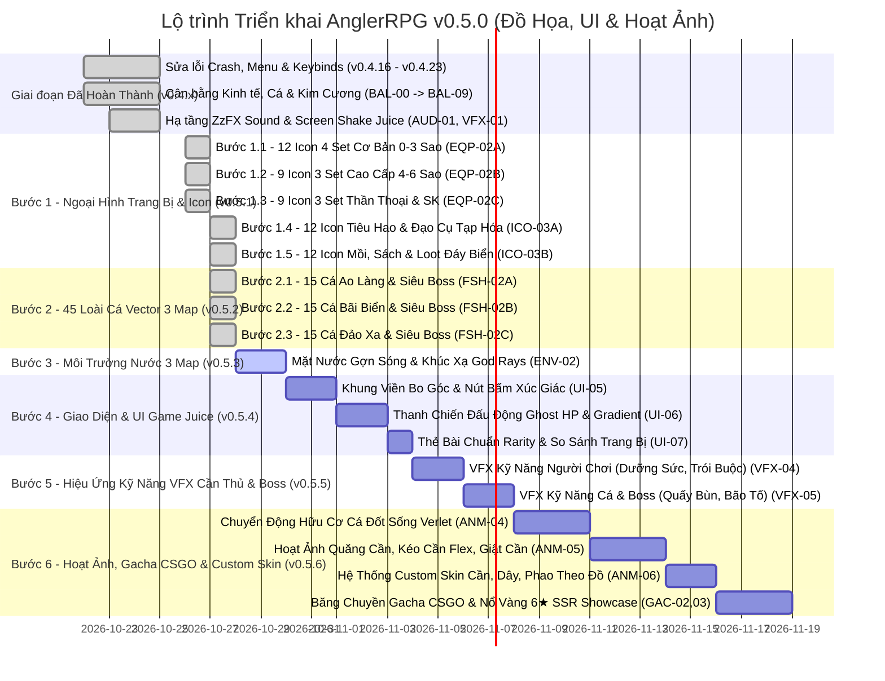

# KẾ HOẠCH PHÁT TRIỂN & THEO DÕI TÁC VỤ (ROADMAP & TASK TRACKER)
> **Dự án:** AnglerRPG  
> **Cập nhật:** 26/10/2026  
> **Trạng thái tài liệu:** Đang hoạt động (Active Tracker)

---

## 📌 BẢNG TỔNG HỢP MỨC ĐỘ ƯU TIÊN (PRIORITY MATRIX)

| ID | Nhóm công việc | Hạng mục | Mức độ ưu tiên | Trạng thái |
| :--- | :--- | :--- | :---: | :---: |
| **SEC-02** | Bảo mật  | Mã hóa file save chống gian lận & can thiệp dữ liệu (AES-256 + SHA-256 Checksum) | **P0 (Bảo mật)**   | ✅ Đã hoàn thành (v0.4.24) |
| **EVT-01** | Sự kiện  | Chốt hạn Sự kiện Lạc Hồng (28/10) & Khóa an toàn Shop, quy đổi Điểm SK tồn đọng | **P1 (Sự kiện)**  | ✅ Đã hoàn thành (v0.4.24) |
| **HLW-01** | Sự kiện  | Giai Đoạn 1: Hạ Tầng Sự Kiện, Auto-Switch Lifecycle, Giao Diện Đêm Hội Halloween & Shop | **P1 (Sự kiện)**  | ✅ Đã hoàn thành (v0.5.3.0) |
| **HLW-02** | Trang bị | Giai Đoạn 2: 2 Bộ Trang Bị (Set Cày Điểm "Dạ Hội Bí Ngô" vs Set 6★ "Huyết Nguyệt") & Gacha Banner | **P1 (Trang bị)**  | ✅ Đã hoàn thành (v0.5.3.1) |
| **HLW-03** | Gameplay | Giai Đoạn 3: Bộ 7 Cá Halloween (Mọi bản đồ), Siêu Boss Thanatos 6,666 HP & Sổ Tay Sưu Tập | **P1 (Gameplay)**  | 📋 Kế hoạch chi tiết (Phase 3) |
| **HLW-04** | Đồ họa   | Giai Đoạn 4: 13 Asset Đồ Họa Vector LibGDX (6 Icon Trang Bị + 7 Loài Cá Đa Tầng) | **P1 (Đồ họa)**     | 📋 Kế hoạch chi tiết (Phase 4) |
| **HLW-05** | Trải nghiệm| Giai Đoạn 5: Vật Phẩm Tiêu Hao (Kẹo, Đèn), Bầu Trời Huyết Nguyệt & Âm Thanh ZzFX Spooky | **P1 (Trải nghiệm)**| 📋 Kế hoạch chi tiết (Phase 5) |
| **HLW-06** | QA & Build| Giai Đoạn 6: Mô Phỏng Cân Bằng CLI, Kiểm Thử Tự Động, Bảo Mật Save & Đóng Gói v0.5.3 | **P1 (Hệ thống)** | 📋 Kế hoạch chi tiết (Phase 6) |
| **FSH-04** | Gameplay | Revamp Toàn Bộ Skill Cá, Chuẩn Hóa Phân Tầng Kỹ Năng & Bổ Sung Hạng Cá Legendary (Mini-Boss) | **P1 (Quan trọng)** | 📋 Kế hoạch triển khai |
| **VFX-SHK-01** | Trải nghiệm | Tối Ưu Rung Lắc Camera Khi Căng Dây: Giảm mốc xuống 80% & Tăng chấn động (+0.02f) | **P1 (Trải nghiệm)** | ✅ Đã hoàn thành (v0.5.3.5) |
| **BAL-STM-01** | Cân bằng & Sửa lỗi | Sửa Lỗi Hồi Kép Dưỡng Sức (+50 dồn) & Tinh Chỉnh Tiêu Hao Thể Lực Động Theo Trạng Thái Cá | **P1 (Cân bằng)** | ✅ Đã hoàn thành (v0.5.3.4) |
| **BAL-FSH-02** | Cân bằng | Đại Tu Cân Bằng Kỹ Năng 15 Loài Cá Đảo Xa, Re-Hook Cải Tiến & Thanh Tension Realtime | **P1 (Cân bằng)** | ✅ Đã hoàn thành (v0.5.3.3) |
| **UI-FIX-01** | Giao diện | Tự động xuống dòng (Text Wrap) & Chiều cao động Tooltip Cá/Vật phẩm, Hạ thấp Radar Banner | **P1 (Giao diện)** | ✅ Đã hoàn thành (v0.5.3.2) |
| **BAL-FSH-01** | Cân bằng | Báo Cáo Phân Tích Chuyên Sâu Cơ Chế Kỹ Năng 15 Loài Cá Đảo Xa | **P1 (Cân bằng)** | ✅ Đã hoàn thành (v0.5.3.2) |
| **BUG-01** | Sửa lỗi | Crash khi bấm Quay lại từ màn hình Trang bị (Use-After-Free) | **P0 (Khẩn cấp)** | ✅ Đã khắc phục triệt để |
| **BUG-02** | Sửa lỗi | Chuẩn hóa hệ thống nút Quay lại Menu & khắc phục lỗi vòng lặp | **P0 (Khẩn cấp)** | ✅ Đã khắc phục triệt để |
| **BUG-03** | Sửa lỗi | Phím kỹ năng QWER không nhận & thiếu phản hồi trên tài khoản mới | **P0 (Khẩn cấp)** | ✅ Đã khắc phục triệt để |
| **BUG-04** | Sửa lỗi | Thoát Gacha ra game HUD bấm mục bất kì có khả năng crash | **P0 (Khẩn cấp)** | ✅ Đã khắc phục triệt để |
| **BUG-05** | Sửa lỗi | Lỗi chữ bị đè xuyên Modal Xóa Dữ Liệu & Hitbox Data Tab bị lệch | **P0 (Khẩn cấp)** | ✅ Đã khắc phục triệt để |
| **BUG-06** | Sửa lỗi | Danh sách phím bấm tràn (overflow) ra ngoài Box cài đặt & đè Header/Tabs | **P0 (Khẩn cấp)** | ✅ Đã khắc phục triệt để |
| **NEW-01** | Tính năng | Bản tin cập nhật trực quan tại Menu chính (không che HUD, không tự bật) | **P0 (Theo yêu cầu)** | ✅ Đã hoàn thành |
| **SET-01** | Tính năng | Game HUD: Nút Cài đặt & Cửa sổ Settings Modal | **P1 (Quan trọng)** | ✅ Đã hoàn thành |
| **SET-02** | Tính năng | Drag chuột chỉnh âm lượng & Tắt âm Nhạc nền (BGM) và SFX độc lập | **P1 (Quan trọng)** | ✅ Đã hoàn thành |
| **SET-03** | Tính năng | Toàn bộ 14 Keybinds (Kéo dây, 4 Kỹ năng, 9 Quickslots) & Chống trùng phím | **P1 (Quan trọng)** | ✅ Đã hoàn thành |
| **SET-04** | Tính năng | Chế độ hiển thị: Toàn màn hình / Cửa sổ & Phím tắt F11 toàn cục | **P1 (Quan trọng)** | ✅ Đã hoàn thành |
| **SET-05** | Tính năng | Chuyển Xuất/Nạp dữ liệu vào Settings & Tự động đặt tên file Timestamp | **P1 (Quan trọng)** | ✅ Đã hoàn thành |
| **SET-06** | Giao diện | Bố cục Single-Column Scrollable List & Nâng cấp UI Setting Vibe Game Fantasy | **P1 (Giao diện)** | ✅ Đã hoàn thành |
| **HUD-01** | Trải nghiệm| Random bản tin Ticker khi vào HUD & Xóa phím cứng + Chú thích Cài đặt | **P1 (Trải nghiệm)**| ✅ Đã hoàn thành |
| **MCP-01** | Công cụ | Custom Vector Studio MCP Server (Vẽ, Kiểm duyệt, Chuyển SVG sang LibGDX) | **P1 (Quan trọng)** | ✅ Đã hoàn thành |
| **GRP-01** | Đồ họa | Pipeline Đồ Họa Vector: Visual Quality Gate & CLI Runner (.agents/skills) | **P1 (Quan trọng)** | ✅ Đã hoàn thành |
| **GRP-02** | Đồ họa | Bổ Sung Bước Dọn Dẹp Sau Khi Tích Hợp (Post-Apply Cleanup) Vào Pipeline | **P1 (Quan trọng)** | ✅ Đã hoàn thành |
| **SET-07** | Đồ họa | Đại Tu Ngoại Hình Toàn Bộ Set Trang Bị Thời Không (Trượng, Dây, Lưỡi) | **P1 (Quan trọng)** | ✅ Đã hoàn thành |
| **GRP-03** | Đồ họa | Chuyển Thể Đồ Họa Vector Hình Học Nguyên Bản SVG Sang LibGDX & Sửa Lỗi UI Bệ Đỡ Gacha | **P1 (Quan trọng)** | ✅ Đã hoàn thành (v0.4.24) |
| **BAL-00** | Cân bằng | Thiết Lập Hạ Tầng Pipeline Mô Phỏng & Cân Bằng Game (Mesa, SimPy, SciPy, SymPy) | **P1 (Quan trọng)** | ✅ Đã hoàn thành |
| **BAL-01** | Cân bằng | Cân bằng Kinh Tế, Cửa Hàng & Đặt Trần Lợi Nhuận Cho Lưới/Bùa | **P2 (Cân bằng)** | ✅ Đã hoàn thành |
| **BAL-02** | Cân bằng | Cân bằng Sức mạnh Máu Cá & 3 Boss Thế Giới (850 HP, 2200 HP, 5500 HP) | **P2 (Cân bằng)** | ✅ Đã hoàn thành |
| **BAL-03** | Cân bằng | Cân bằng Vòng quay Sự Kiện (Rate-up 50% & Chia đều 33.3% 3 món Lạc Hồng) | **P2 (Cân bằng)** | ✅ Đã hoàn thành |
| **BAL-04** | Cân bằng | Cân bằng Tiến trình EXP & Mở khóa Bản đồ (Bỏ cấp số nhân x10) | **P1 (Quan trọng)** | ✅ Đã hoàn thành |
| **BAL-05** | Cân bằng | Cố Định Rarity 6★ Thần Khí Lạc Hồng & Khóa Chặt Khỏi Roll Không Nổ | **P1 (Quan trọng)** | ✅ Đã hoàn thành |
| **BAL-06** | Cân bằng | Đại Tu Cân Bằng Chỉ Số 42 Loài Cá Thường (Common, Uncommon, Rare, Epic) Cả 3 Bản Đồ | **P1 (Quan trọng)** | ✅ Đã hoàn thành |
| **BAL-07** | Cân bằng | Cân Bằng Toàn Diện Nguồn Kiếm Kim Cương (Cá Hiếm, Rương Ngày/Tuần, Sự Kiện, Thành Tựu) | **P1 (Quan trọng)** | ✅ Đã hoàn thành |
| **BAL-08** | Tính năng | Bổ Sung Thưởng Kim Cương Sổ Tay Thủy Tộc (Fish Catalog) & Khắc Phục Lỗi SFX sfx_button | **P1 (Quan trọng)** | ✅ Đã hoàn thành |
| **UPD-01** | Tính năng | Module Auto-Updater Tự Động Cập Nhật Trực Tuyến & Tự Động Khởi Động Lại 1-Click | **P1 (Quan trọng)** | ✅ Đã hoàn thành |
| **TIM-01** | Tính năng | Dịch Vụ Đồng Bộ Thời Gian Thực Chuẩn Quốc Tế & Chống Gian Lận Tua Giờ (TimeSyncService) | **P1 (Quan trọng)** | ✅ Đã hoàn thành |
| **SEC-01** | Bảo mật  | Rà Soát & Ẩn Toàn Bộ File Nhạy Cảm, Save Game, Cache, Credentials Khỏi GitHub | **P1 (Bảo mật)**   | ✅ Đã hoàn thành |
| **AUD-01** | Âm thanh | Bộ Tổng Hợp Âm Thanh Thủ Tục ZzFX Java Synthesizer & Fallback Safety Net Không Cần File | **P1 (Quan trọng)** | ✅ Đã hoàn thành (Bước 1) |
| **VFX-01** | Trải nghiệm| Easing & Screen Shake Controller ("Game Juice" Rung Giật Màn Hình & Popup Nảy Mượt) | **P1 (Trải nghiệm)**| ✅ Đã hoàn thành (Bước 2) |
| **GAS-01** | Gameplay | Gameplay Ability System (GAS) Chuẩn Hóa Bộ 4 Kỹ Năng QWER, Cooldown & Hiệu Ứng Buff/Debuff | **P1 (Gameplay)**   | ✅ Đã hoàn thành (Bước 3) |
| **BUG-08** | Sửa lỗi  | Lỗi Kỹ năng Dưỡng Sức (space deal dmg) & Trói Buộc (kéo dây vẫn tăng tension) | **P0 (Khẩn cấp)**   | ✅ Đã khắc phục triệt để |
| **QST-01** | Sự kiện  | Bỏ thưởng đơn lẻ nhiệm vụ sự kiện, chuyển thành huy hiệu trạng thái & gom quà vào Rương Mốc | **P1 (Quan trọng)** | ✅ Đã hoàn thành |
| **ACH-01** | Cân bằng | Cân bằng phần thưởng 48 mốc thành tựu (2-30 KC), sửa target 5000 và đồng bộ SaveManager | **P1 (Cân bằng)**   | ✅ Đã hoàn thành |
| **SKL-01** | Kỹ năng  | Viết lại chú thích động theo cấp & đưa thông tin Cooldown/Thể lực xuống đáy tooltip | **P1 (Trải nghiệm)**| ✅ Đã hoàn thành |
| **UI-03**  | Giao diện| Tinh giản văn bản trang bị (xóa "(Max Tension)", "xịn") & Icon Vector Tiền tệ Catalog | **P1 (Giao diện)**  | ✅ Đã hoàn thành |
| **UI-04**  | Giao diện| Giãn cách dock tiền tệ Sổ Tay Thủy Tộc & Đồng nhất chuẩn Icon Đồng Vàng | **P1 (Giao diện)**  | ✅ Đã hoàn thành |
| **SKL-02** | Kỹ năng  | Khắc phục lỗi font ô vuông `[]` & căn chỉnh Cooldown tránh đè nút Nâng Cấp | **P1 (Trải nghiệm)**| ✅ Đã hoàn thành |
| **SKL-03** | Kỹ năng  | Đại tu bố cục thẻ kỹ năng: Bỏ dấu chấm hồi chiêu, đồng nhất phông chữ, tối ưu khoảng cách dọc & neo đáy nút | **P1 (Giao diện)**  | ✅ Đã hoàn thành |
| **KEY-01** | Hệ thống | Cơ chế tự động hoán đổi phím (Auto-Swap) & Quét phím phần khớp IME/Unikey | **P0 (Khẩn cấp)**   | ✅ Đã hoàn thành |
| **BAL-09** | Cân bằng | Cân bằng lực căng dây khi kéo cá (Reeling Tension) & Sàn kháng lực kéo (25%) | **P1 (Quan trọng)** | ✅ Đã hoàn thành |
| **BAL-10** | Cân bằng | Tái Cân Bằng Tension: Giảm xả tự nhiên (6+0.04*Max), cá buông kéo 80%, nerf cá mệt IDLE 15%/10% nhịp 1.5-3.5s | **P1 (Cân bằng)**   | ✅ Đã hoàn thành (v0.4.24) |
| **BAL-11** | Cân bằng | Nerf Lực Cản Cá Trong IDLE: Kéo giảm 0.15x->0.03x, buông 0.10x->0.0x, hạ baseline quay máy câu 10+0.02*Max | **P1 (Cân bằng)**   | ✅ Đã hoàn thành (v0.5.1.1) |
| **FSH-03** | Tính năng| Hiển thị chi tiết cơ chế tác động của 20 kỹ năng cá trong Sổ Tay Thủy Tộc | **P1 (Trải nghiệm)**| ✅ Đã hoàn thành |
| **QST-02** | Nhiệm vụ | Đại tu kho nhiệm vụ Ngày/Tuần (12 ngày, 7 tuần), triệt tiêu trùng lặp yêu cầu| **P1 (Quan trọng)** | ✅ Đã hoàn thành |
| **EQP-02A**| Đồ họa   | Bước 1.1: 12 Icon Trang Bị Bậc 0★-3★ (Tập Sự, Thợ Săn, Băng Giá, Đại Dương) & Đại Tu Full Representation Gacha/Equipment | **P1 (Đồ họa)**     | ✅ Đã hoàn thành (v0.5.1a) |
| **EQP-02B**| Đồ họa   | Bước 1.2: 9 Icon Trang Bị Bậc 4★-6★ (Hải Tặc, Vực Thẳm, Hoàng Gia - Đã loại Thời Không)| **P1 (Đồ họa)**     | ✅ Đã hoàn thành (v0.5.1b) |
| **EQP-02C**| Đồ họa   | Bước 1.3: 9 Icon Trang Bị Bậc 6★-7★ & Sự Kiện (Quang Minh, Vệ Quốc, Thần Khí Lạc Hồng) | **P1 (Đồ họa)**     | ✅ Đã hoàn thành (v0.5.1c) |
| **EQP-02D**| Đồ họa   | Đột phá thiết kế độc bản (Strict Non-Repetition Rule) & Bùng nổ hiệu ứng Thần Khí Lạc Hồng (8 Icon)| **P1 (Đồ họa)**     | ✅ Đã hoàn thành (v0.4.24) |
| **ICO-03A**| Đồ họa   | Bước 1.4: 12 Icon Tiêu Hao & Đạo Cụ Chiến Đấu Tiệm Tạp Hóa (Thuốc, Nước Tăng Lực, Bùa...)| **P1 (Đồ họa)**     | ✅ Đã hoàn thành (v0.4.24) |
| **ICO-03B**| Đồ họa   | Bước 1.5: 12 Icon Mồi Câu, Sách Kỹ Năng & Loot Rác / Kho Báu Đáy Biển                | **P1 (Đồ họa)**     | ✅ Đã hoàn thành (v0.5.1.1) |
| **BAL-12** | Cân bằng | Nerf lực kéo cá khi buông cần (0.8x->0.4x), giảm screen shake tension & cảnh báo đứt dây| **P1 (Cân bằng)**   | ✅ Đã hoàn thành (v0.5.1.2) |
| **ECO-02** | Kinh tế  | Giới hạn mua sách kỹ năng theo cấp tối đa & lọc bỏ sách max khỏi sự kiện giảm giá    | **P1 (Kinh tế)**    | ✅ Đã hoàn thành (v0.5.1.2) |
| **ITM-01** | Vật phẩm | Chống dùng trùng lặp vật phẩm đa lượt, hiển thị Buff trên HUD & đổi tên Trà Thảo Mộc | **P1 (Vật phẩm)**   | ✅ Đã hoàn thành (v0.5.1.2) |
| **BUG-09** | Sửa lỗi  | Khắc phục Auto-Updater đóng ngay khi mở, cân đối 3 nút và bỏ nhãn `(AUTO-UPDATER)`   | **P0 (Khẩn cấp)**   | ✅ Đã khắc phục triệt để (v0.5.1.2) |
| **GAC-04** | Giao diện| Giãn cách tên và chỉ số khỏi icon kết quả quay Gacha đơn lẻ tránh đè chữ             | **P1 (Giao diện)**  | ✅ Đã hoàn thành (v0.5.1.2) |
| **DAO-01** | Gameplay | Đại Tu 15 Loài Cá Đảo Xa, Chuẩn Hóa Phân Tầng Kỹ Năng, Cơ Chế Perfect Re-Hook & Siêu Boss Cá Cờ Xanh 3K HP | **P1 (Quan trọng)** | ✅ Đã hoàn thành (v0.5.2.0) |
| **QSL-01** | Giao diện| Phân trang Quick Slots (Ô Phím Tắt Nhanh) chống tràn 9 ô & Đồng bộ phím 1-9 | **P0 (Cần thiết)** | ✅ Đã hoàn thành (v0.5.2.1) |
| **ITM-02** | Vật phẩm | Sửa lỗi Sonar thấu thị khi 0 lượt, không trừ Sonar khi CHẬM TAY, mất Mồi Thơm khi bỏ lỡ | **P0 (Cần thiết)** | ✅ Đã hoàn thành (v0.5.2.1) |
| **COL-02** | Sổ tay   | Tái thiết kế 5 Bộ Sưu Tập Đảo Xa khớp chuẩn 15 loài cá mới & Xóa sạch dấu vết cá cũ | **P1 (Quan trọng)** | ✅ Đã hoàn thành (v0.5.2.1) |
| **FSH-02A** | Đồ họa   | Bước 2.1: 15 Loài Cá Ao Làng & Siêu Boss Thủy Quái Sông Trà trong FishVisualRenderer | **P1 (Đồ họa)**     | ✅ Đã hoàn thành (v0.5.2.2) |
| **FSH-02B** | Đồ họa   | Bước 2.2: 15 Loài Cá Bãi Biển & Siêu Boss Bạch Tuộc Khổng Lồ trong FishVisualRenderer | **P1 (Đồ họa)**     | ✅ Đã hoàn thành (v0.5.2.3) |
| **FSH-02C** | Đồ họa   | Bước 2.3: 15 Loài Cá Đảo Xa & Siêu Boss Cá Cờ Xanh Khổng Lồ trong FishVisualRenderer  | **P1 (Đồ họa)**     | ✅ Đã hoàn thành (v0.5.2.4) |
| **ENV-02**  | Đồ họa   | Bước 3: Môi trường mặt nước gợn sóng sinh động, rạn san hô & khúc xạ ánh sáng 3 Map  | **P1 (Đồ họa)**     | 📋 Kế hoạch (Bước 3 - v0.5.3) |
| **UI-05**   | Giao diện| Bước 4: Khung viền Dialog hiện đại bo góc & Bộ nút bấm phản hồi âm ZzFX               | **P1 (Giao diện)**  | 📋 Kế hoạch (Bước 4 - v0.5.4) |
| **UI-06**   | Giao diện| Bước 4: Thanh trạng thái chiến đấu động (Ghost HP bar tụt dần, Gradient Tension bar)  | **P1 (Giao diện)**  | 📋 Kế hoạch (Bước 4 - v0.5.4) |
| **UI-07**   | Giao diện| Bước 4: Thẻ bài trang bị hiển thị Rarity rõ nét & So sánh chỉ số tức thì (Stat Diff)  | **P1 (Giao diện)**  | 📋 Kế hoạch (Bước 4 - v0.5.4) |
| **VFX-04**  | Kỹ năng  | Bước 5: Bộ hiệu ứng thị giác chiêu thức cần thủ (Dưỡng Sức, Giật Kép, Trói Buộc)     | **P1 (Trải nghiệm)**| 📋 Kế hoạch (Bước 5 - v0.5.5) |
| **VFX-05**  | Kỹ năng  | Bước 5: Bộ hiệu ứng kỹ năng cá & Boss (Quẫy Bùn che HUD, Mực Mù, Sóng Thần, Cuồng Nộ) | **P1 (Trải nghiệm)**| 📋 Kế hoạch (Bước 5 - v0.5.5) |
| **ANM-04**  | Hoạt ảnh | Bước 6: Chuyển động hữu cơ của cá (đuôi quẫy nhịp nhàng, uốn mình giằng co)          | **P1 (Hoạt ảnh)**   | 📋 Kế hoạch (Bước 6 - v0.5.6) |
| **ANM-05**  | Hoạt ảnh | Bước 6: Cần câu uốn cong vật lý theo lực căng Tension, hiệu ứng giật cần & bọt nước   | **P1 (Hoạt ảnh)**   | 📋 Kế hoạch (Bước 6 - v0.5.6) |
| **ANM-06**  | Hoạt ảnh | Bước 6: Hệ thống Skin Động Cần - Dây - Phao trên PlayScreen thay đổi theo đồ mặc     | **P1 (Hoạt ảnh)**   | 📋 Kế hoạch (Bước 6 - v0.5.6) |
| **GAC-02**  | Gacha    | Bước 6: Hoạt ảnh Băng Chuyền Gacha cuộn ngang kiểu CS:GO (Con lăn trượt giảm tốc)     | **P1 (Hoạt ảnh)**   | 📋 Kế hoạch (Bước 6 - v0.5.6) |
| **GAC-03**  | Gacha    | Bước 6: Hiệu ứng nổ trang bị bậc cao Legendary & Limited Premium (Rung chấn màn hình) | **P1 (Hoạt ảnh)**   | 📋 Kế hoạch (Bước 6 - v0.5.6) |

---

## 🚨 PHẦN I: DANH SÁCH LỖI ĐÃ XÁC ĐỊNH & PHƯƠNG ÁN XỬ LÝ

### 1. BUG-01: Lỗi bấm vào phần Trang bị (EquipmentScreen) sau đó ấn Quay lại thì bị crash game
- **Hiện tượng:** Người chơi từ màn chơi chính hoặc Menu vào `EquipmentScreen`, nhấn nút `← QUAY LẠI` hoặc phím `ESC` thì game bị văng / sập (Crash).
- **Nguyên nhân kỹ thuật (Root Cause):**
  - Trong `EquipmentScreen.java` dòng 110: Hàm `render(float delta)` gọi `update(delta)`.
  - Trong `update()` khi phát hiện nút Back / ESC: Game gọi `game.setScreen(previousScreen);` và gọi `dispose();` (giải phóng tài nguyên OpenGL `sr.dispose()`).
  - Sau khi `update()` return, hàm `render()` **không có lệnh dừng** (`if (game.getScreen() != this) return;`). Luồng tiếp tục chạy đến dòng 125 và 134, cố gắng gọi `sr.setProjectionMatrix` và `sr.begin(...)` trên đối tượng `ShapeRenderer` đã bị giải phóng (`disposed`).
  - Hậu quả: LibGDX ném ra ngoại lệ `GdxRuntimeException: ShapeRenderer cannot be used after being disposed` gây crash game ngay lập tức.
- **Phương án khắc phục:**
  - Bổ sung lệnh kiểm tra `if (game.getScreen() != this) return;` ngay sau `update(delta);` tại `EquipmentScreen.java`.
  - Đảm bảo logic dọn dẹp biến đệm hoạt động an toàn trước khi chuyển cảnh.

---

### 2. BUG-02: Chuẩn hóa hệ thống nút quay lại Menu & khắc phục triệt để lỗi vòng lặp
- **Hiện tượng:** Người chơi bị rơi vào vòng lặp điều hướng giữa màn chơi và bản đồ do nút góc trên bên trái ở màn chơi dẫn sang Bản đồ (`MapScreen`), trong khi ở Bản đồ nút quay lại lại đưa về màn chơi, không có cách nào bấm chuột để thoát về Menu chính.
- **Nguyên nhân:**
  - Nút góc trái HUD trong `GameHUD.java` hiển thị nhãn `"BẢN ĐỒ"` và kích hoạt `new MapScreen()`.
  - Trong khi đó phím ESC lại đưa về `MainMenuScreen`, dẫn tới bất nhất giữa thao tác chuột và phím.
- **Phương án khắc phục (Đã thực hiện):**
  - Chuẩn hóa nút góc trên bên trái trên Game HUD thành `← MENU`: Bấm chuột hoặc phím ESC đều lưu game và trở về Menu chính (`MainMenuScreen`).
  - Nút ở giữa khi `State.IDLE`: `"RA KHƠI CÂU CÁ"` chuyên trách mở `MapScreen`.
  - Nút `← QUAY LẠI` (hoặc ESC) tại `MapScreen`: Quay lại màn chơi (`State.IDLE`), loại bỏ 100% hiện tượng vòng lặp luẩn quẩn.

---

### 3. BUG-03: Kỹ năng QWER hoạt động trên máy Dev nhưng người khác tải về không dùng được
- **Hiện tượng:** Trên máy phát triển test phím Q, W, E, R bình thường, nhưng gửi bản build cho người khác chơi thì bấm phím kỹ năng không có tác dụng.
- **Nguyên nhân tiềm ẩn:**
  1. **Tài khoản mới chưa có kỹ năng trang bị (Unassigned Slots):**
     - Khi một người chơi mới mở game lần đầu, mảng `equippedActives` có 4 ô rỗng (`null`).
     - Người chơi chưa mở bảng kỹ năng `SkillTreeScreen` để gán kỹ năng vào phím, hoặc đã cộng điểm nhưng chưa nhấn `Mặc Vào` (Equip) vào ô tương ứng.
     - Khi bấm phím Q/W/E/R, hệ thống kiểm tra `player.getEquippedActives()[i] == null` nên không kích hoạt gì cả, và không có thông báo HUD giải thích.
  2. **Xung đột bộ gõ tiếng Việt (Unikey / EVKey):**
     - Đa phần người dùng máy tính tại Việt Nam bật Unikey ở chế độ gõ `Telex` hoặc `VNI`.
     - Bộ gõ can thiệp vào các phím `W`, `E`, `R` (ví dụ `W` biến thành `ư`, `EE` thành `ê`, `R` là dấu hỏi trong VNI), khiến hệ thống GLFW/LWJGL3 không bắt được sự kiện `Input.Keys.W`, `Input.Keys.E`, `Input.Keys.R`.
  3. **Không hỗ trợ chuột trực tiếp:**
     - Nếu người chơi không quen dùng phím hoặc phím bị kẹt bộ gõ, họ cần click trực tiếp vào icon kỹ năng trên HUD.
- **Phương án khắc phục:**
  - **Tự động trang bị (Auto-Equip Default):** Mặc định khi người chơi học kỹ năng chủ động đầu tiên (hoặc khởi đầu game), tự động gán kỹ năng đó vào Slot Q (Slot 0).
  - **Phản hồi HUD:** Khi bấm phím mà ô trống, hiển thị Floating Text nhẹ: *"Ô phím chưa gắn kỹ năng!"*.
  - **Keybind tự do:** Cho phép đổi phím trong phần Settings sang các phím số 1, 2, 3, 4 hoặc Z, X, C, V để tránh bị Unikey bắt chữ.
  - **Hỗ trợ Click chuột mượt mà:** Đảm bảo click chuột trái vào ô kỹ năng trên HUD luôn kích hoạt kỹ năng 100%.

---

### 4. BUG-04: Thoát khỏi màn hình Gacha ra game HUD bấm vào một mục bất kì có khả năng crash
- **Hiện tượng:** Người chơi sau khi mở và đóng màn hình Gacha (`GachaScreen`), quay lại Game HUD (`PlayScreen`), nếu bấm vào một nút bất kì trên thanh điều hướng (Nhiệm vụ, Kỹ năng, Gacha, Cửa hàng, Trang bị...) thì game có tỷ lệ bị crash sập ngay lập tức (Crash JVM văng ra ngoài kèm sinh file `hs_err_pid*.log`).
- **Phân tích nhật ký Crash Dump (hs_err_pid5316, 14896, 20736, 26596 tại thời điểm 13:33 - 13:39):**
  - Cả 4 file log crash JVM mới nhất ghi nhận lỗi vi phạm truy cập bộ nhớ native: `EXCEPTION_ACCESS_VIOLATION (0xc0000005)`.
  - Stack trace chỉ ra điểm sập tại `ntdll.dll!RtlAllocateHeap` và `msvcrt.dll!memcpy` bên dưới lời gọi JNI của LibGDX:
    `BufferUtils.newDisposableByteBuffer` → `new ShapeRenderer()`
- **Nguyên nhân gốc rễ (Root Causes):**
  1. **Tạo và Hủy `ShapeRenderer` liên tục (Native Heap Fragmentation / Driver Conflict):**
     - Mỗi Screen (`GachaScreen`, `EquipmentScreen`, `QuestScreen`, `SkillTreeScreen`, `ShopScreen`,...) hiện đều tự `new ShapeRenderer()` khi khởi tạo và gọi `sr.dispose()` khi đóng.
     - `ShapeRenderer` trong LibGDX cấp phát bộ đệm Direct Byte Buffer trong C heap (`malloc`). Việc liên tục cấp phát và giải phóng các vertex buffer OpenGL qua JNI trên Windows 11 với card đồ họa (đặc biệt AMD Radeon 780M / Intel iGPU) dẫn tới phân mảnh hoặc xung đột quản lý bộ nhớ native của `msvcrt.dll`/`ntdll.dll`.
  2. **Tác động liên đới từ lỗi Use-After-Free của BUG-01:**
     - Khi `EquipmentScreen` gọi `dispose()` nhưng luồng render không dừng (`update` không chặn), các lệnh vẽ tiếp tục ghi dữ liệu vertex vào vùng đệm native C đã bị free, làm hỏng bảng điều khiển heap (`heap chunk headers`) của Windows. Bất kỳ lệnh `new ShapeRenderer()` nào sau đó đều sẽ dính `0xc0000005` trong `RtlAllocateHeap`.
  3. **Thiếu chặn click xuyên màn hình (`framesToSkip <= 0`):**
     - Tại `PlayScreen.java` dòng 222, cụm click mở các màn hình (`hud.isShopClicked`, `isEquipmentClicked`...) **không có điều kiện `framesToSkip <= 0`**, dẫn đến việc click chuột từ nút Quay lại của GachaScreen có thể kích hoạt ngay tức khắc một lệnh chuyển cảnh khác khi frame chưa ổn định.
- **Phương án khắc phục triệt để:**
  1. **Chia sẻ một instance `ShapeRenderer` duy nhất (Singleton / Shared Resource):**
     - Khởi tạo `ShapeRenderer` một lần duy nhất tại `FishingRPG.java` (giống như `batch`, `font`, `titleFont`).
     - Tất cả các Screens (`PlayScreen`, `GachaScreen`, `EquipmentScreen`, `ShopScreen`, `SkillTreeScreen`, `QuestScreen`, `EventScreen`, `MapScreen`, `MainMenuScreen`) tái sử dụng chung `game.shapeRenderer`, tuyệt đối không `new` hay `dispose()` riêng lẻ tại từng Screen.
     - Chỉ gọi `game.shapeRenderer.dispose()` duy nhất 1 lần khi toàn bộ game thoát tại `FishingRPG.dispose()`.
  2. **Bảo vệ `framesToSkip <= 0` trên toàn bộ nút HUD:**
     - Bổ sung `framesToSkip <= 0 &&` trước các sự kiện click mở Screen tại dòng 222 và dòng 186 của `PlayScreen.java`.
  3. **Khắc phục triệt để BUG-01 (ngắt render ngay khi chuyển cảnh).**

### 6. BUG-06: Danh sách cuộn phím bấm (Controls Tab) tràn ra ngoài Hộp thoại Cài Đặt
- **Hiện tượng:** Khi mở tab PHÍM BẤM và cuộn danh sách (hoặc ở vị trí mặc định), các thẻ phím bấm, viền và nút trồi ngược lên đè qua thanh Tabs, tiêu đề "CÀI ĐẶT TRÒ CHƠI", và tràn xuống đè nút "ĐẶT LẠI MẶC ĐỊNH", nút "ĐÓNG", lòi ra ngoài khung viền đáy dialog.
- **Nguyên nhân kỹ thuật (Root Cause):**
  1. `ShapeRenderer` trong LibGDX tích lũy vertices trong buffer nội bộ (`ImmediateModeRenderer20`). Khi gọi `ScissorStack.pushScissors` rồi vẽ shapes bằng `sr.rect`, sau đó gọi ngay `ScissorStack.popScissors()`, `popScissors()` đã tắt `GL_SCISSOR_TEST` trong OpenGL trước khi `sr.end()` kịp gửi vertex buffer sang GPU. Kết quả là toàn bộ shapes được vẽ mà không hề có Scissor clipping.
  2. Các vòng lặp vẽ 14 phím và 2 header banners thiếu cơ chế Hard Bounds Culling, dẫn đến việc mọi hàng dù có toạ độ Y nằm ngoài vùng nhìn (`y > 497` hoặc `y < 213`) vẫn bị đẩy vào hàng đợi render và nhận hover/click chuột.
  3. Thiếu khung viền recessed phân định box cuộn trực quan.
- **Phương án khắc phục:**
  1. Thêm `sr.flush()` trước `pushScissors` và ngay trước `popScissors()` để toàn bộ shapes cuộn được vẽ sang GPU trong khi `GL_SCISSOR_TEST` đang kích hoạt.
  2. Bổ sung tính toán `Viewport` (qua `getViewport().getScreenX()...`) chuẩn xác cho `ScissorStack.calculateScissors`.
  3. Áp dụng Hard Bounds Culling (`rY + rowH >= boxBottom && rY <= boxTop`) cho cả `drawControlsTabShapes`, `drawControlsTabTexts`, và `handleInput`.
  4. Vẽ khung hộp chìm (recessed panel) định hình rõ ràng khu vực danh sách cuộn.

---

## ⚙️ PHẦN II: HỆ THỐNG CÀI ĐẶT (SETTINGS SYSTEM)

### 1. Giao diện & Vị trí Cài đặt (HUD & Main Menu)
- **Vị trí tích hợp:**
  - Thêm Icon bánh răng ⚙️ (Settings) trên thanh HUD ở `PlayScreen` và trên `MainMenuScreen`.
  - Mở dạng Popup Modal phủ kính mờ (Glassmorphism), không làm ngắt luồng game đột ngột.

### 2. Thiết lập Âm thanh (Audio Settings)
- **Thanh trượt Nhạc nền (BGM Volume):** Điều chỉnh từ 0% đến 100% (Bước nhảy 5%).
- **Thanh trượt Hiệu ứng (SFX Volume):** Điều chỉnh từ 0% đến 100%.
- **Nút Mute nhanh:** Tắt/Bật toàn bộ âm thanh chỉ với 1 click.
- **Lưu trữ tự động:** Ghi nhớ giá trị vào `Preferences` và áp dụng ngay lập tức qua `AudioManager`.

### 3. Tùy chỉnh Phím bấm (Keybind Remapping)
- **Giao diện đổi phím:** Danh sách các thao tác kèm ô hiển thị phím hiện tại:
  - *Kéo dây / Giằng co:* Mặc định `SPACE`
  - *Kỹ năng 1 (Slot Q):* Mặc định `Q`
  - *Kỹ năng 2 (Slot W):* Mặc định `W`
  - *Kỹ năng 3 (Slot E):* Mặc định `E`
  - *Kỹ năng 4 (Slot R):* Mặc định `R`
  - *Phím tắt vật phẩm 1 - 9:* Mặc định `Phím 1` $\rightarrow$ `Phím 9`
- **Cơ chế gán phím:** Nhấp vào ô $\rightarrow$ Chờ người chơi nhấn phím mới $\rightarrow$ Kiểm tra trùng phím $\rightarrow$ Cập nhật và lưu vào cấu hình.

### 4. Thiết lập Hiển thị & Màn hình (Display Settings)
- **Chế độ màn hình:** Chuyển đổi giữa `Cửa sổ (Windowed)` và `Toàn màn hình (Fullscreen)`.
- **Độ phân giải (Resolutions):**
  - `1280 x 720` (Chuẩn HD - Tỷ lệ 16:9 gốc)
  - `1600 x 900` (HD+)
  - `1920 x 1080` (Full HD)
  - `Không viền (Borderless Windowed / Desktop Mode)`

### 5. Quản lý Dữ liệu Save trong Settings (Data Management)
- **Di chuyển tính năng Xuất/Nạp:** Chuyển toàn bộ 2 nút `Xuất Dữ Liệu` và `Nạp Dữ Liệu` từ Menu chính vào tab `Dữ liệu` bên trong Modal Cài đặt.
- **Quy tắc đặt tên file sao lưu thông minh (Anti-overwrite Timestamp):**
  - Tên file xuất ra sẽ tự động kèm ngày, tháng, năm, giờ, phút, giây:
    `angler_save_yyyyMMdd_HHmmss.json`
    *Ví dụ:* `angler_save_20261022_143015.json`
  - Đảm bảo mỗi lần xuất là một bản snapshot riêng biệt, không bao giờ vô tình ghi đè làm mất file lưu cũ của người chơi.

### 6. Bố cục Single-Column Scrollable List & Nâng cấp UI Setting Vibe Game Fantasy (SET-06)
- **Tái cấu trúc Tab Phím Bấm:**
  - Quy tụ toàn bộ 14 thao tác (Kéo dây + 4 Kỹ năng + 9 Quickslots) vào một danh sách cuộn dọc liền mạch duy nhất (Single-column list).
  - Tích hợp thanh cuộn Fantasy RPG Scrollbar: Hỗ trợ kéo thả chuột (drag), lăn bánh xe chuột, và phím mũi tên Lên/Xuống.
  - Sử dụng `ScissorStack` cắt khung chính xác theo camera, tránh tràn nội dung ra ngoài.
- **Nâng cấp thẩm mỹ chuẩn Vibe Game Fantasy RPG:**
  - Khung viền kép mạ vàng, 4 góc đính họa tiết Corner Ornaments 2 tầng với đá quý.
  - Hàng thẻ phím bấm làm bằng kính Obsidian Glass cao cấp với dải phản quang specular, hiệu ứng viền neon cyan/amber khi hover.
  - Khi bấm đổi phím, nút bấm phát sáng aura vàng pulsing rực rỡ, kèm cơ chế chống trùng phím (Anti-collision protection) phát âm thanh lỗi `sfx_fail` và hiển thị cảnh báo đỏ nếu trùng.
  - Nâng cấp đồng bộ các Tab Âm thanh (bàn trộn âm studio), Hiển thị (2 thẻ mode lớn kèm F11 tip) và Dữ liệu (3 thẻ action lớn theo mã màu).

### 7. Đại Tu Ngoại Hình Toàn Diện Set Trang Bị Thời Không (SET-07)
- **Vấn đề đồ họa cũ:**
  - `drawThoiKhongRod`: Vòng hào quang lớn quá khổ (`r * 1.30f`), thân cần đơn điệu, đầu trượng bị đẩy lệch sang `cx + r * 0.55f` dẫn đến tràn viền và lệch tâm nghiêm trọng trong modal.
  - `drawThoiKhongLine`: Chỉ gồm các vòng tròn đồng tâm phẳng, không có khối cuộn dây cước hoặc vệt chuyển động không-thời gian.
  - `drawThoiKhongHook`: Mắt xỏ dây bị vòng tròn đen che phủ toàn bộ hình thể, ngạnh móc tỷ lệ không đồng đều.
- **Phương án nâng cấp thẩm mỹ & Tái cấu trúc ShapeRenderer:**
  - Chuẩn hóa hệ quy chiếu tương đối `scale = (r * 2f) / 128f`, đưa tâm hình học về chuẩn xác `(cx, cy)`.
  - **Trượng Thời Gian (Chrono Staff):** Bánh răng thiên văn 12 khắc giờ Astrolabe, kim đồng hồ xoay vát nhọn, trục titan bọc đai vàng hoàng gia, lõi ngọc lam Cyan Opal và 2 tầng hào quang tinh vân pulsing.
  - **Sợi Dây Xuyên Thấu (Transdimensional Line):** Cuộn dây Tachyon đa tầng dạng đĩa thiên hà, 8 vòng sóng năng lượng cộng hưởng gradient đa sắc, chùm vệt photon lượng tử xuyên không-thời gian.
  - **Lưỡi Câu Hư Không (Void Singularity Hook):** Đường cong tô-pô vòng Möbius dải xoắn kép, ngạnh móc mạ Chrome sắc bén và hố đen Singularity tím huyền bí phát quang.
  - Cả 3 asset đạt điểm kiểm duyệt Visual Quality Gate 100/100 PASSED.

---

### 8. Bổ Sung Bước Dọn Dẹp Sau Khi Tích Hợp Vào Pipeline Đồ Họa (GRP-02)
- **Vấn đề phát sinh:** Trong quá trình thiết kế và chuyển đổi vector asset, nhiều file ảnh render xem trước tạm (`old_*`, `temp_*`, `test_*`, `preview_*`) và các file snapshot dữ liệu được sinh ra, gây chiếm dụng bộ nhớ và làm rác cây thư mục git.
- **Phương án giải quyết (Đã hoàn thành):**
  - Bổ sung lệnh CLI `python scripts/vector_pipeline.py clean` hỗ trợ các chế độ:
    * `--target intermediate`: Dọn dẹp toàn bộ file so sánh cũ, file thử nghiệm và nháp tạm thời.
    * `--target asset --asset <name>`: Dọn dẹp tài nguyên trung gian của một asset cụ thể sau khi tích hợp.
    * `--target previews`: Dọn dẹp sạch sẽ toàn bộ thư mục `assets/vectors/previews`.
    * `--target all`: Dọn dẹp toàn diện cả file preview trung gian và các snapshot file lưu test trong root.
  - Tích hợp công cụ MCP `cleanup_pipeline_files` trong server `vector-studio`.
  - Chuẩn hóa quy trình 5 bước trong `vector-graphics-designer` và `game-graphics-pipeline`.

---

## ⚖️ PHẦN III: CÂN BẰNG TOÀN DIỆN (GAME BALANCING)

### 1. Cân bằng Kinh tế & Phần thưởng Nhiệm vụ (Economy Rebalance)
- **Vấn đề:** Hiện tại Kim Cương (KC) nhận từ nhiệm vụ ngày, nhiệm vụ tuần và câu cá Boss quá dễ dãi, dẫn đến việc người chơi tích được hàng nghìn KC rất nhanh và quay gacha không giới hạn.
- **Điều chỉnh:**
  - **Nhiệm vụ ngày:**
    - Mỗi nhiệm vụ thông thường: Giảm từ `5 - 10 KC` xuống `1 - 2 KC` + tăng thêm `Vàng (Gold)` và `XP`.
    - Rương năng động ngày (100 điểm): Giảm từ `20 KC` xuống `5 - 10 KC` + tặng kèm `1x Vé Quay Tiêu Chuẩn`.
  - **Nhiệm vụ tuần:**
    - Mỗi nhiệm vụ tuần: Giảm từ `15 - 25 KC` xuống `5 - 8 KC`.
    - Rương năng động tuần (100 điểm): Giảm từ `100 KC` xuống `30 - 40 KC` + tặng kèm `1x Vé Quay Cao Cấp`.
  - **Thành tựu (Achievements):**
    - Giữ các mốc thành tựu là nguồn KC danh giá, nhưng phân cấp theo độ khó (mốc đầu 5 KC, mốc sau 15-30 KC).

### 2. Cân bằng Sức mạnh Trang bị vs Độ khó của Cá (Combat Balance)
- **Vấn đề:** Chỉ số trang bị cấp cao (đặc biệt là đồ Epic, Thần Thoại và Set Lạc Hồng) cộng dồn quá nhiều sát thương kéo và dòng phụ, khiến cá kể cả Boss bị kéo cạn máu chỉ trong 2-3 giây, mất đi trải nghiệm câu cá kịch tính.
- **Điều chỉnh Sức mạnh Cá:**
  - Tăng lượng máu (`maxHp`) của cá theo độ hiếm và bản đồ:
    - *Cá Thường (Common):* Máu x1.0
    - *Cá Hiếm (Uncommon/Rare):* Máu tăng từ +30% → +60%
    - *Cá Epic:* Máu tăng từ +80% → +150%
    - *Cá Thủy Quái / Boss:* Máu tăng từ +150% → +300%
  - Tăng nhịp độ bứt tốc và đổi trạng thái (Kéo ↔ Nghỉ ngơi) của cá để người chơi phải nhấp nhả phím Space khéo léo.
  - Tăng độ khó của các hiệu ứng kỹ năng cá (Bứt tốc x2 lực kéo, Quẫy bùn, Phun mực làm mờ tầm nhìn).
- **Điều chỉnh Chỉ số Trang bị:**
  - Điều chỉnh lại công thức sát thương của Cần câu: Giảm bớt tỷ lệ nhân tuyến tính quá lớn ở cấp cường hóa cao.
  - Cân bằng lại 3 bộ phận:
    - **Cần Câu:** Tập trung vào Sát thương kéo (`Base Pull Damage`) và Cơ hội Bạo kích (`Crit Rate`).
    - **Dây Cước:** Tập trung vào Sức căng tối đa (`Max Line Tension`) và Kháng đứt dây (`Pull Reduction`).
    - **Lưỡi Câu:** Tập trung vào Độ nhạy cắn câu (`Bite Time`) và Giữ mồi (`Bait Retention`).

### 3. Cân bằng Vòng quay Sự Kiện (Event Gacha Balance)
- **Vấn đề:** Tỷ lệ xuất hiện của các trang bị giới hạn sự kiện cần minh bạch và đồng đều với trang bị cùng bậc để người chơi cảm thấy công bằng.
- **Điều chỉnh:**
  - **Cơ chế Rate-Up cân bằng:**
    - Trong vòng quay Sự Kiện, khi trúng bậc 6★ (Thần Khí): Tỷ lệ ra đúng trang bị sự kiện (Set Thần Khí Lạc Hồng: Cần, Dây, Lưỡi) chiếm **50%** tổng tỷ lệ 6★. 3 món sự kiện có tỷ lệ chia đều nhau (33.3% mỗi món).
    - Các món thường cùng phẩm cấp chia nhau 50% còn lại.
  - **Cơ chế Bảo hiểm (Pity System):**
    - Giữ mốc bảo hiểm 80 lượt chắc chắn có 1 món 6★.
    - Đảm bảo tỷ lệ quay hiển thị chính xác trong bảng xác suất (Loot Table Modal).

### 4. BAL-05: Cố Định Rarity 6★ Thần Khí Lạc Hồng & Khóa Chặt Khỏi Roll Không Nổ
- **Vấn đề:** Set Thần Khí Lạc Hồng trước đây có nguy cơ xuất hiện ngẫu nhiên trong Vòng quay Thường (`rollGacha`) với phẩm cấp rác (Common, Uncommon, Rare) hoặc lọt vào các lượt quay không nổ của sự kiện, gây phá vỡ tính độc bản và cao cấp của set Thần Khí.
- **Giải pháp:**
  - Thiết lập bất biến mã hóa: Mọi món đồ thuộc Set Lạc Hồng luôn cố định phẩm cấp 6★ `Rarity.LIMITED_PREMIUM`.
  - Loại bỏ hoàn toàn Set Lạc Hồng khỏi danh sách quay của Vòng quay Thường.
  - Trong Vòng quay Sự Kiện: Set Lạc Hồng chỉ có thể xuất hiện khi nổ 6★ (`LIMITED_PREMIUM`). Tuyệt đối không lọt vào roll thường/roll xịt.
  - Tự động chuẩn hóa và nâng cấp độ hiếm cho mọi món Lạc Hồng trong rương đồ người chơi khi nạp save game.

### 5. BAL-06: Đại Tu Cân Bằng Chỉ Số 42 Loài Cá Thường Cả 3 Bản Đồ
- **Vấn đề:** Chỉ số Máu (HP) của cá Common/Uncommon trước đây quá thấp (25 - 50 HP), khiến người chơi khi trang bị cần câu bậc trung có thể giật chết cá chỉ trong 1 - 2 giây, làm mất đi tính tương tác giằng co.
- **Giải pháp:**
  - Chuẩn hóa TTK theo từng cấp độ: Common (8 - 14s), Uncommon (15 - 22s), Rare (22 - 32s), Epic (35 - 50s).
  - Tăng chỉ số Máu và Lực kéo cho toàn bộ 42 loài cá thuộc Ao Làng, Bãi Biển và Đảo Xa.
  - Tăng tỷ lệ thưởng Vàng và EXP tương xứng với độ khó và thời gian giằng co.

### 6. BAL-07: Cân Bằng Toàn Diện Nguồn Kiếm Kim Cương (Chống Lạm Phát Currency)
- **Vấn đề:** Kim Cương (KC) là tiền tệ cao cấp phục vụ Gacha, nhưng trước đây bị lạm phát nghiêm trọng từ mọi nguồn (Cá hiếm rơi 100%, mỗi 10 con cá thưởng 5 KC, Rương ngày 20 KC, Rương tuần 100 KC, Nhiệm vụ sự kiện 55 KC/ngày, Thành tựu thưởng tới 10,000 KC). Người chơi F2P kiếm được hơn 5,000 – 7,000 KC/tháng (tương đương 3 – 4 chu kỳ bảo hiểm Pity), khiến gacha mất hoàn toàn giá trị quý hiếm.
- **Giải pháp đã thực hiện:**
  - **Rơi từ Câu Cá (`FishingManager`):** Cá Rare giảm từ 100% xuống 20% tỷ lệ rơi 1 KC; cá Epic rơi 1–2 KC; Boss rơi 3–5 KC (trần nhân lưới thưởng thêm tối đa 2 KC).
  - **Nội tại Tiến trình (`PlayerProgression`):** Thưởng thăng cấp 2 KC (riêng mốc 5 cấp thưởng 10 KC); mốc câu cá chuyển thành mỗi 25 con cá thưởng +3 KC (thay vì 10 con +5 KC).
  - **Rương Nhiệm vụ (`QuestScreen`):** Rương Ngày chuẩn hóa 10 KC (thay vì 20); Rương Tuần chuẩn hóa 40 KC (thay vì 100).
  - **Sự Kiện (`EventManager`):** Nhiệm vụ sự kiện giảm từ 10–20 KC xuống 3–8 KC; Mốc 4/6 thưởng 10 KC (thay vì 20); Điểm danh tháng tổng 135 KC (thay vì 215).
  - **Thành Tựu (`QuestManager`):** Tinh chỉnh toàn bộ bậc thành tựu từ 5 KC đến tối đa 500–600 KC cho mốc tối thượng cuối game (thay vì 2,000 – 10,000 KC).
  - **Kết quả:** Đưa lượng Kim Cương F2P trung bình về mức chuẩn **1,700 – 2,300 KC/tháng (~85 – 118 lượt quay)**, đạt chính xác 1–1.2 chu kỳ Pity/tháng.

---

### 9. BAL-08: Bổ Sung Thưởng Kim Cương Sổ Tay Thủy Tộc (Fish Catalog) & Khắc Phục Lỗi Âm Thanh SFX
- **Vấn đề:** 
  1. Trong Sổ Tay Thủy Tộc (`CatalogScreen`), các bộ sưu tập trước đây chỉ thưởng Vàng và XP, chưa có nguồn thưởng Kim Cương milestone một lần (one-time completion reward) đặc trưng của các tựa game RPG sưu tập.
  2. Bị lỗi âm thanh `[AudioManager] Could not load SFX: sfx_button` do thiếu tệp `assets/audio/sfx/sfx_button.wav`, đồng thời `AudioManager` không có cơ chế cache null khiến ngoại lệ bị quăng và log lỗi bị spam liên tục mỗi khi tương tác chuột.
- **Giải pháp đã thực hiện:**
  - **Thưởng Hoàn Thành Bộ Sưu Tập (`CollectionDatabase` & `CatalogScreen`):**
    - Bổ sung trường `rewardDiamonds` cho toàn bộ 15 bộ sưu tập cả 3 bản đồ:
      * **Ao Làng:** 10, 15, 20, 35, 60 KC (Tổng 140 KC).
      * **Bãi Biển:** 15, 20, 25, 40, 70 KC (Tổng 170 KC).
      * **Đảo Xa:** 20, 25, 35, 50, 100 KC (Tổng 230 KC).
      * Tổng thưởng trọn đời từ hoàn thành 15 bộ sưu tập: **540 Kim Cương**.
  - **Thưởng Khám Phá Lần Đầu Từng Loài Cá:**
    - Mỗi khi câu được loài cá mới lần đầu, ô cá trong Sổ Tay mở khóa tag phát sáng `+X 💎 NHẬN`:
      * Common: +2 KC
      * Uncommon: +3 KC
      * Rare: +5 KC
      * Epic: +10 KC
      * Boss: +25 KC
    - Người chơi có thể bấm trực tiếp vào từng ô cá để nhận hoặc bấm nút **★ NHẬN TẤT CẢ ★** ở góc trên bên phải để nhận đồng loạt toàn bộ thưởng cá và bộ sưu tập.
  - **Giao Diện Sổ Tay & Lưu Trữ Dữ Liệu:**
    - Bổ sung thanh dock hiển thị số dư Vàng và Kim Cương trực tiếp trên thanh công cụ Sổ Tay.
    - Lưu trạng thái `claimedFishCatalog` vào Save/Load của `SaveManager.java` an toàn và tương thích ngược.
  - **Khắc Phục Lỗi Âm Thanh SFX (`AudioManager`):**
    - Sinh tệp âm thanh click chuột cơ khí cao cấp `assets/audio/sfx/sfx_button.wav` (44.1kHz, 16-bit PCM).
    - Cải tiến `AudioManager.java` kiểm tra tệp bằng `fh.exists()`, cache `null` vào `sfxMap` khi không tìm thấy để triệt tiêu vĩnh viễn việc ném `GdxRuntimeException` và spam log.
    - Bổ sung alias tự động tương thích: `"button_click"` -> `"sfx_button"`, `"victory"` -> `"sfx_success"`.

---

## 🎨 PHẦN II: LỘ TRÌNH ĐẠI TU ĐỒ HỌA, GIAO DIỆN & HOẠT ẢNH (5 BƯỚC TRIỂN KHAI DẦN)

> **Mục tiêu:** Nâng tầm mỹ thuật toàn diện của AnglerRPG từ đồ họa đơn sắc cơ bản lên chuẩn game nhập vai Fantasy RPG cao cấp. Kế hoạch được phân bổ thành **5 Bước cuốn chiếu** (từ tĩnh đến động, từ icon đến toàn cảnh) để triển khai từng bước vững chắc, dễ kiểm soát và không gây gián đoạn gameplay.

| Bước triển khai | Phiên bản | Trọng tâm công việc | Hạng mục công việc (Task ID) |
| :--- | :---: | :--- | :--- |
| **BƯỚC 1.1** | `v0.5.1a` | **Trang Bị Khởi Đầu & Cơ Bản (0★ - 3★)** | EQP-02A (12 icon: Set Tập Sự, Thợ Săn, Băng Giá, Đại Dương) - ✅ Đã hoàn thành |
| **BƯỚC 1.2** | `v0.5.1b` | **Trang Bị Cao Cấp & Huyền Thoại (4★ - 6★)** | EQP-02B (9 icon: Set Hải Tặc, Vực Thẳm, Hoàng Gia - Đã loại Thời Không) |
| **BƯỚC 1.3** | `v0.5.1c` | **Trang Bị Thần Thoại & Giới Hạn (6★ - 7★)** | EQP-02C (9 icon: Set Quang Minh, Vệ Quốc Vang Danh, Thần Khí Lạc Hồng) - ✅ Đã hoàn thành |
| **BƯỚC 1.4** | `v0.4.24` | **Vật Phẩm Tiêu Hao & Đạo Cụ Tạp Hóa** | ICO-03A (Đã hoàn thành 12 icon vector 4 lớp 100/100 audit & tích hợp in-game) - ✅ Đã hoàn thành |
| **BƯỚC 1.5** | `v0.5.1` | **Mồi Câu, Sách Kỹ Năng & Loot Đáy Biển** | ICO-03B (12 icon: Mồi thơm/rủi ro, sách kỹ năng, rương & loot rác) - ✅ Đã hoàn thành |
| **BƯỚC 2.1** | `v0.5.2` | **15 Loài Cá Ao Làng & Siêu Boss Thủy Quái** | FSH-02A (15 loài cá Ao Làng & Boss Thủy Quái Sông Trà) - ✅ Đã hoàn thành |
| **BƯỚC 2.2** | `v0.5.2` | **15 Loài Cá Bãi Biển & Siêu Boss Bạch Tuộc** | FSH-02B (15 loài cá Bãi Biển & Boss Bạch Tuộc Khổng Lồ) |
| **BƯỚC 2.3** | `v0.5.2` | **15 Loài Cá Đảo Xa & Siêu Boss Cá Cờ Xanh** | FSH-02C (15 loài cá Đảo Xa & Boss Cá Cờ Xanh Khổng Lồ) |
| **BƯỚC 3** | `v0.5.3` | **Môi Trường Nước 3 Bản Đồ & Khúc Xạ Ánh Sáng** | ENV-02 (Sóng nước tự nhiên, rạn san hô, khúc xạ biển) |
| **BƯỚC 4** | `v0.5.4` | **Hiện Đại Hóa UI, Nút Bấm Xúc Giác & Gauges** | UI-05 (Khung viền/nút bấm), UI-06 (Ghost HP/Tension), UI-07 (Thẻ Rarity) |
| **BƯỚC 5** | `v0.5.5` | **Hiệu Ứng Kỹ Năng VFX Cần Thủ & Boss** | VFX-04 (VFX chiêu cần thủ), VFX-05 (VFX chiêu Boss & kỹ năng cá) |
| **BƯỚC 6** | `v0.5.6` | **Hoạt Ảnh Vật Lý, Băng Chuyền CS:GO & Custom Skin** | ANM-04 (Đuôi cá hữu cơ), ANM-05 (Uốn cong cần câu), ANM-06, GAC-02,03 |

---

### 📦 BƯỚC 1: Ngoại Hình 10 Set Trang Bị & 24 Vật Phẩm Tạp Hóa / Loot (Phiên bản v0.5.1)
*Được chia nhỏ thành 5 giai đoạn cuốn chiếu: 3 bước cho 10 Set Trang Bị (30 icon - đã loại Set Thời Không do đã hoàn thành độc lập ở SET-07) và 2 bước cho 24 Vật phẩm tiệm tạp hóa & loot đáy biển.*

#### 🔹 Bước 1.1: 12 Icon Trang Bị Khởi Đầu & Cơ Bản 0★ - 3★ (EQP-02A - `EquipmentIconRenderer.java`) - ✅ Đã Hoàn Thành
- Chuẩn hóa nét vẽ vector 4 lớp cho 4 Set trang bị cơ bản (4 Cần, 4 Dây, 4 Lưỡi câu = 12 icon):
  - *Set Tập Sự (0★ Common):* Cần Câu Tre mộc mạc quấn đốt trúc, Dây Cước Thường cuộn cước thô, Lưỡi Câu Chì đơn giản.
  - *Set Thợ Săn (1★ Uncommon):* Gậy Phục Kích ngụy trang xanh rêu, Sợi Tơ Kẽm bện kim loại, Móng Vuốt Biển sắc nhọn.
  - *Set Băng Giá (2★ Rare):* Cần Câu Băng tinh thể băng xanh buốt, Dây Lạnh Cóng phủ sương tuyết, Móc Câu Tuyết hình hoa tuyết băng giá.
  - *Set Đại Dương (3★ Rare/Epic):* Trượng Biển Khơi xanh dương đậm, Sợi Thủy Tinh lấp lánh ánh nước, Nanh Thủy Quái cong vút.

#### 🔹 Bước 1.2: 9 Icon Trang Bị Cao Cấp & Huyền Thoại 4★ - 6★ (EQP-02B - `EquipmentIconRenderer.java`) - [x] ✅ ĐÃ HOÀN THÀNH
- Chuẩn hóa nét vẽ vector 4 lớp cho 3 Set trang bị cao cấp (3 Cần, 3 Dây, 3 Lưỡi câu = 9 icon) *(Set Thời Không đã hoàn thành độc lập ở mã SET-07 trước đó)*:
  - *Set Hải Tặc (4★ Epic):* Trụ Cột Buồm gỗ sồi bọc đồng & đèn bão ma quái (`rod_hai_tac.svg`), Bánh lái tàu chiến & mỏ neo cổ kẹp đồng Aztec mắt ngọc lục bảo (`line_hai_tac.svg`), Lưỡi hái Damascus rãnh máu & đồng bạc 8-Reales (`hook_hai_tac.svg`).
  - *Set Vực Thẳm (5★ Legendary):* Trượng Obsidian gai góc tím thẫm & All-Seeing Nether Eye (`rod_vuc_tham.svg`), Khung cuộn bát giác nether-titanium 8 sừng quỷ & tơ hắc mạch (`line_vuc_tham.svg`), Móng vuốt rồng vực sâu gai vảy rồng & rãnh huyết tương (`hook_vuc_tham.svg`).
  - *Set Hoàng Gia (6★ Legendary):* Quyền trượng bạch kim mạ vàng 24k đính hồng ngọc Ruby Fleur-de-lis (`rod_hoang_gia.svg`), Bánh xe tơ tằm hoàng gia 8 cánh cung đình khảm Sapphire (`line_hoang_gia.svg`), Lưỡi câu cẩm thạch trắng viền vàng ngọc trai giọt nước (`hook_hoang_gia.svg`).
- Đã transpile toàn bộ 9 hàm `drawHaiTac...`, `drawVucTham...`, `drawHoangGia...` sang hình học đa giác đặc `(sx, sy, fillTri, fillQuad, drawLine, fillCircle)` chuẩn xác 100% SVG.

#### 🔹 Bước 1.3: 9 Icon Trang Bị Thần Thoại & Giới Hạn Sự Kiện 6★ - 7★ (EQP-02C - `EquipmentIconRenderer.java`) - [x] ✅ ĐÃ HOÀN THÀNH
- Chuẩn hóa nét vẽ vector 4 lớp đỉnh cao cho 3 Set tối thượng (3 Cần, 3 Dây, 3 Lưỡi câu = 9 icon) đạt 100/100 điểm kiểm duyệt:
  - *Set Quang Minh (7★ Mythic):* Trượng Ánh Sáng Seraph vàng kim bạch kim nạm ngọc Sunstone (`rod_quang_minh.svg`), Cuộn tơ kim tuyến bánh xe mặt trời 12 răng cưa (`line_quang_minh.svg`), Lưỡi câu thánh quang 3 tầng cánh thiên thần (`hook_quang_minh.svg`).
  - *Set Vệ Quốc Vang Danh (Limited Event cày mốc):* Cần khởi nghĩa trúc son ngọc bích nạm sao vàng (`rod_ve_quoc.svg`), Cước bện tơ đỏ huyết chiến & bánh xe đồng cổ (`line_ve_quoc.svg`), Lưỡi câu móng rồng chiến tích oai hùng nạm sao vàng (`hook_ve_quoc.svg`).
  - *Set Thần Khí Lạc Hồng (6★ Limited Premium Gacha):* Thần trượng Đông Sơn khảm ngọc lục bảo & trống đồng 14 tia sáng Chim Lạc (`rod_lac_hong.svg`), Dây Song Long Chầu Nguyệt ôm ngọc rồng Lạc Long Quân (`line_lac_hong.svg`), Móc Âu Cơ đóa sen tiên mẫu nạm ngọc Tiên Châu (`hook_lac_hong.svg`).
- Đã transpile toàn bộ 9 hàm `drawQuangMinh...`, `drawVeQuoc...`, `drawLacHong...` sang hình học đa giác đặc `(fillTri, fillQuad, drawLine, fillCircle)` chuẩn xác 100% SVG.

#### 🔹 Bước 1.4: 12 Icon Vật Phẩm Tiêu Hao & Đạo Cụ Chiến Đấu Tiệm Tạp Hóa (ICO-03A - `ItemDatabase.java`, `LootVisualRenderer.java`) - [x] ✅ ĐÃ HOÀN THÀNH
- Chuẩn hóa toàn diện 12 tác phẩm vector phân tầng 4 lớp đạt điểm tuyệt đối 100/100 tại Quality Gate audit:
  - *5 Vật phẩm tiêu hao & hồi phục:* Bánh Mì (khía nướng bơ rắc bột mì trắng), Thuốc Hồi Stamina (bình cầu ngọc bích sủi bọt khí nắp bần), Nước Tăng Lực (lon nhôm cyber tia sét & ngưng tụ giọt lạnh), Nước Bứt Phá (bình tam giác giả kim tâm plasma Overdrive), Trà Thảo Mộc Định Thần (tách gốm ngọc men sứ lá trà nổi & 3 làn khói thơm).
  - *7 Đạo cụ hỗ trợ câu cá & chiến đấu:* Dây Câu Tốt (cuộn cước Kevlar gia cường khung titan), Bình Xịt Đóng Băng (bình khí nén phủ băng hoa tuyết Cryo), Đá Mài Lưỡi Câu (khối đá mài 2 tầng độ mịn vát góc phát tia lửa), Nam Châm Kho Báu (nam châm chữ U đỏ bạc hút đồng vàng & sóng từ), Kính Nhìn Xuyên Nước (kính lặn radar sonar lưới quét & đốm cá), Lưới Đánh Cá (lưới nón mắt cáo chì chìm & khuyên đồng), Bùa Hoàng Kim (thẻ bùa giấy cổ chu sa đỏ & hạt ngọc bích).
- Sửa triệt để lỗi hoán vị tọa độ đỉnh `y1 = x1` và `y3 = x3` trong bộ transpile, bổ sung hàm `fillEllipse` hỗ trợ vẽ elip chuẩn xác.
- Đã transpile và route 100% 12 hàm vẽ vào `LootVisualRenderer.java` với bộ helper `(sx, sy, fillTri, fillQuad, drawLine, fillCircle, fillEllipse)`. Dọn dẹp sạch sẽ toàn bộ thư mục preview.

#### 🔹 Bước 1.5: 12 Icon Mồi Câu, Sách Kỹ Năng & Loot Rác / Kho Báu Đáy Biển (ICO-03B - `LootVisualRenderer.java`) - [x] ✅ ĐÃ HOÀN THÀNH
- Chuẩn hóa toàn diện 12 tác phẩm vector phân tầng 4 lớp đạt điểm tuyệt đối 100/100 tại Quality Gate audit:
  - *4 Chiến Lợi Phẩm Rác:* Ủng Cao Su Cũ (`loot_ung_cao_su.svg` - miếng vá da chỉ thêu & giọt nước mũi ủng), Chai Nhựa (`loot_chai_nhua.svg` - nắp xanh ren, nước đục bọt khí & nhãn bóc dở), Lốp Xe (`loot_lop_xe.svg` - 8 rãnh khía gai xuyên tâm & rong rêu bám), Túi Rác (`loot_tui_rac.svg` - túi nilon thắt 2 tai thỏ & dây rút đỏ).
  - *4 Cổ Vật Kho Báu:* Bình Cổ (`loot_binh_co.svg` - bình men ngọc quai rồng & đai vàng đính hồng ngọc ruby), Nhẫn Vàng (`loot_nhan_vang.svg` - nhẫn vàng ròng đính ruby cushion-cut lấp lánh sao), Rương Chìm (`loot_ruong_chim.svg` - rương gỗ sồi đai sắt ngập tràn tiền vàng doubloon & sapphire), Kiếm Cổ (`loot_kiem_co.svg` - bảo kiếm khắc phù chú cổ ngữ, đốc rồng ngọc bích & tua lụa đỏ).
  - *2 Mồi Câu Chuyên Dụng:* Mồi Thơm (`item_moi_thom.svg` - hũ thủy tinh mồi xanh lá mật ngọt thẻ sao), Mồi Rủi Ro (`item_moi_rui_ro.svg` - lọ pha lê tím đậm mồi độc neon & nhãn đầu lâu tử thần).
  - *2 Sách Kỹ Năng:* Sách Kỹ Năng Chủ Động (`item_sach_chu_dong.svg` - bìa da rồng đỏ viền vàng & biểu tượng kiếm chiến), Sách Kỹ Năng Bị Động / Sách Thông Thái (`item_sach_bi_dong.svg` - bìa nhung xanh thẳm viền bạc & mắt toàn tri).
- Đã transpile và tích hợp 100% 12 hàm vẽ độc lập vào `LootVisualRenderer.java` với bộ helper `(sx, sy, fillTri, fillQuad, drawLine, fillCircle, fillEllipse)`.
- Hoàn thành trọn vẹn 100% Giai đoạn 1 (54/54 icon vector nguyên bản: 30 trang bị + 24 tiêu hao & loot).

#### 🔹 Bản Cập Nhật v0.5.1.2 (BAL-12, ECO-02, ITM-01, BUG-09, GAC-04) - [x] ✅ ĐÃ HOÀN THÀNH
- **BAL-12 (Cân bằng giằng co & giảm screen shake, chuẩn hóa chữ nổi):**
  - Nerf lực kéo cá khi người chơi buông phím Space trong trạng thái `PULLING` từ `0.8x` xuống `0.4x` (giảm 50% lực kéo), tạo khoảng thở nhả bớt lực căng dây an toàn.
  - Giảm chấn động rung giật màn hình khi Tension cao từ `0.04f` xuống `0.01f`, chỉ kích hoạt khi Tension > 88% và khống chế tối đa `0.16f`.
  - Chuẩn hóa thông báo đứt dây: Bỏ tiền tố `"CĂNG DÂY TỐI ĐA!"`, hiển thị gọn gàng `"DÂY CƯỚC BỊ ĐỨT, CÁ ĐÃ CHẠY MẤT!"` và chữ nổi `"ĐỨT DÂY CÂU!"`.
  - Bổ sung chữ nổi khi cá vừa cắn câu (`!`): Tự động nhảy chữ nổi `"BOSS!"` nếu là Boss, và `"NEW!"` nếu là loài cá mới chưa từng câu được trong đời.
  - Sửa lỗi chữ nổi khi hụt cá: Tinh giản thành một chữ nổi ngắn gọn `"CHẬM TAY!"`, không bị nhảy đè cả câu văn bản dài.
- **ECO-02 (Cửa hàng & Sách kỹ năng):**
  - Công thức giới hạn số lượng mua tối đa: `maxLevel - currentLevel - booksInBag`. Khi `<= 0` chuyển sang `"ĐÃ BÁN HẾT"`.
  - Loại bỏ các sách kỹ năng đã bán hết / đạt cấp tối đa khỏi sự kiện giảm giá ngẫu nhiên của tiệm tạp hóa.
- **ITM-01 (Nút BUFF trên thanh trạng thái & Bảo vệ Buff):**
  - Dời nút Mồi Thơm cũ sang vị trí mới thoáng đãng (`x=438px`), chuyển đổi thành nút duy nhất `"BUFF (N)"`.
  - Khi hover vào nút `"BUFF"`, mở bảng Tooltip chi tiết hiển thị danh sách toàn bộ các hiệu ứng vật phẩm đang kích hoạt kèm số lượt còn lại.
  - Khóa sử dụng trùng lặp cho các vật phẩm đa lượt đang còn hiệu lực: Lưới Đánh Cá, Mồi Rủi Ro, Bùa Hoàng Kim, Sách Thông Thái, Nước Bứt Phá, Đá Mài Lưỡi Câu, Nam Châm Kho Báu, Kính Nhìn Xuyên Nước.
  - Đổi tên `"Trà Thảo Mộc Định Thần"` thành `"Trà Thảo Mộc"` (duy trì tương thích dữ liệu cũ).
- **BUG-09 & GAC-04 (Sửa lỗi giao diện & Auto-Updater):**
  - Sửa lỗi click-through làm tắt `UpdateDialog` ngay frame đầu tiên khi mở từ menu chính.
  - Bỏ nhãn `(AUTO-UPDATER)` trên tiêu đề và cân đối 3 nút bấm với độ rộng 190px, khoảng cách 35px.
  - Mở rộng kích thước thẻ bài Gacha đơn lẻ `340x380px`, giãn cách tách biệt hoàn toàn Tên trang bị và Chỉ số khỏi icon trang bị.
- **MAP-01 (Sửa lỗi thanh tiến trình bản đồ & Độ khó):**
  - Sửa lỗi thanh tiến trình cá hiển thị sai bản đồ: Đưa về đúng thẻ tương ứng `Đã bắt ở [Tên Map]: X/15 loài`.
  - Cập nhật xếp hạng độ khó: Ao Làng (0 sao - Rất Dễ), Bãi Biển (1 sao - Dễ), Đảo Xa (2 sao - Vừa).
  - Tinh giản mô tả Đảo Xa thành vùng biển ngoài khơi thực tế: `"Hòn đảo ngoài khơi xa, sóng gió và cá lớn"`.

---

### 🐟 BƯỚC 2: Ngoại Hình 45 Loài Cá Vector & 3 Siêu Boss Thế Giới (Phiên bản v0.5.2)

#### 🔹 Bước 2.1: 15 Loài Cá Ao Làng & Siêu Boss Thủy Quái Sông Trà (FSH-02A - `FishVisualRenderer.java`) - [x] ✅ ĐÃ HOÀN THÀNH
- Chuẩn hóa nét vẽ vector đa lớp, tạo khối mềm mại, bóng sáng và cử động quẫy đuôi mềm mại (tail wagging) cho 15 loài cá Ao Làng:
  - *4 Loài Cá Thường (Common):*
    - **Cá Rô Đồng:** Thân ô-liu ánh đồng, vây lưng 9 gai nhọn sắc bén, đốm đen nắp mang, vệt vằn ngụy trang.
    - **Cá Diếc:** Lưng vồng cao, vảy trắng bạc ngọc trai lấp lánh, vây phớt hồng cam dịu dàng.
    - **Cá Mương:** Thân thon dài trong suốt như lưỡi liềm, vảy bạc phản chiếu ánh nắng mặt hồ.
    - **Cá Lóc Nhí:** Lưng hoa văn rằn ri ngụy trang cỏ nước, mắt lanh lợi sục sạo tìm mồi.
  - *3 Loài Cá Hiếm (Uncommon):*
    - **Cá Chép:** Lưng gù uy dũng ánh cam hoàng kim, vảy xếp lớp giáp rồng, đôi râu mềm mại rước lộc, vây đuôi đỏ son.
    - **Cá Mè:** Đầu to béo tròn, miệng hướng lên đớp bọt nước, vảy xám bạc nhạt bơi đàn tầng mặt.
    - **Cá Trê:** Thân trơn bóng đen nâu nhẵn thín, 4 cặp râu dài linh hoạt sục bùn, gai ngạnh sắc.
  - *3 Loài Cá Quý (Rare):*
    - **Cá Trôi:** Thân thuôn dài vẩy viền đỏ thẫm tinh tế, lưng cong xám xanh bơi lướt uyển chuyển.
    - **Cá Trắm Cỏ:** Cơ bắp cuồn cuộn vảy xanh ô-liu dày dặn, hàm răng cưa nghiền cỏ nước mạnh mẽ.
    - **Cá Chim Trắng:** Dáng dẹt tròn như chiếc đĩa bạc, vây bơi vút nhọn viền đen nổi bật.
  - *3 Loài Cá Sử Thi (Epic):*
    - **Cá Lóc Bông:** Thân rồng đầm lầy hoa văn đốm hoa mai đen tuyền, đầu bẹt hung hãn, cú táp kinh hoàng.
    - **Cá Trê Lai:** Thân khổng lồ vằn cẩm thạch vàng đen, sức kéo đầm lì ghìm đáy bùn lầy.
    - **Cá Chép Vàng:** Thần ngư ánh kim rực rỡ phát quang hào quang may mắn, vây đuôi lụa bồng bềnh.
  - *2 Loài Huyền Thoại & Boss:*
    - **Cá Lăng Khổng Lồ:** Chiến binh đáy sâu đen tím bóng bẩy, râu thép dài quét bùn, lực giật đanh thép.
    - **Siêu Boss Thủy Quái Sông Trà (2,500 HP):** Hào quang huyết ma bạo chúa đa tầng, vảy rêu phù sa bọc giáp dung nham, mắt rực lửa với con ngươi khe hẹp ma quỷ, 6 quả cầu lửa xoay quanh cơ thể, đuôi lưỡi hái khổng lồ xé toạc lòng sông Trà.

#### 🔹 Bước 2.2: 15 Loài Cá Bãi Biển & Siêu Boss Bạch Tuộc Khổng Lồ (FSH-02B - `FishVisualRenderer.java`) - [x] ✅ ĐÃ HOÀN THÀNH (v0.5.2.3)
- Chuẩn hóa nét vẽ vector đa lớp, tạo khối nổi khối mềm mại, bóng sáng specular và cử động quẫy đuôi/xúc tu mềm mại cho 15 loài cá Bãi Biển:
  - *6 Loài Cá Thường (Common):*
    - **Cá Chỉ Vàng:** Thân thoi bạc ánh xanh biển, dải sọc vàng kim óng ả kéo dài từ mang đến cuống đuôi, gai vảy cứng đường bên, đốm đen nắp mang đặc trưng, vây đuôi xòe vàng chanh.
    - **Cá Đục:** Thân thon dài vàng cát ngụy trang đáy cát biển nông, vảy óng ánh chấm nâu li ti, mõm dài nhọn sục cát tìm mồi.
    - **Cá Cơm:** Thân trong suốt như pha lê, dải chỉ bạc dọc sống lưng phản chiếu lấp lánh ánh nắng, vây đuôi quẫy nhanh (`wagFine`).
    - **Cá Mòi:** Lưng xanh thẫm ánh thép, hàng 4-7 chấm đen tròn dọc mạn sườn, vảy bạc mềm mại, vây lưng tam giác nhọn.
    - **Cá Lẹp:** Thân dẹt mỏng như tờ giấy lướt sóng, bụng sắc cạnh như lưỡi dao, vảy trắng bạc phản quang.
    - **Cá Bạc Má:** Mắt to tròn thao thức, lưng xanh lục rằn ri vằn sóng biển, thân thon chắc nịch của dòng họ cá thu ngừ bơi nhanh.
  - *4 Loài Cá Hiếm (Uncommon):*
    - **Cá Nục:** Thân thuôn tròn chắc nịch, đường bên uốn lượn phủ giáp vảy cứng (scutes), vây đuôi cánh én vàng tươi.
    - **Cá Đối:** Đầu dẹt mõm tù môi dày, vảy tròn to xám bạc viền đậm, mắt to lấp lánh màng mỡ bảo vệ.
    - **Cá Trích:** Thân dẹp dài xanh thẫm lưng, bụng trắng bạc óng ánh, vảy tròn lấp lánh phản xạ ánh mặt trời.
    - **Cá Chim Biển:** Thân dẹt hình đĩa tròn màu bạc ngọc trai kiêu sa, vây lưng và vây hậu môn cong dài như lưỡi liềm.
  - *2 Loài Cá Quý (Rare):*
    - **Cá Mú:** Thân đầm chắc hoa văn đốm hoa đá (honeycomb) ngụy trang rạn san hô, miệng rộng răng sắc nhọn, vây lưng gai tua tủa.
    - **Cá Bóp:** Thân ngư lôi màu nâu đen khỏe khoắn, hai dải sọc trắng bạc song song nổi bật chạy dọc thân, vây lưng trước cụt gai sắc.
  - *2 Loài Cá Sử Thi (Epic):*
    - **Cá Thu Hoàng Kim:** Hào quang hoàng kim bạo chúa xé biển, thân ngư lôi xanh sapphire bóng bẩy, 8 đôi vây phụ rời vàng chói dọc cuống đuôi, vây đuôi trăng khuyết khổng lồ vàng rực 24K.
    - **Cá Ngừ Đại Dương:** Thân bắp thịt hình thoi khổng lồ xanh thẫm - bạc, các vây phụ nhọn vàng tươi phát quang, mắt vàng săn mồi sắc lẹm, lực bơi bạt mạng.
  - *1 Siêu Boss Thế Giới:*
    - **Bạch Tuộc Khổng Lồ (2,200 HP):** Xoáy mực vực thẳm và vòng năng lượng cyan-tím đa tầng (`fastPulse`), 8 xúc tu gai nhọn khổng lồ quằn quại bọc giác mút đỏ thẫm phát sáng, mắt quỷ tím với đồng tử chữ nhật ma quái, mắt phụ phát quang thái dương, mỏ quái vật sừng đen chitin tử thần và giọt mực độc ma quỷ.

#### 🔹 Bước 2.3: 15 Loài Cá Đảo Xa & Siêu Boss Cá Cờ Xanh Khổng Lồ (FSH-02C - `FishVisualRenderer.java`) - [x] ✅ ĐÃ HOÀN THÀNH (v0.5.2.4)
- Chuẩn hóa toàn bộ 15 loài cá Đảo Xa hoàn toàn mới theo chuẩn Big Game Fishing với hình học vector LibGDX ShapeRenderer đa tầng, hiệu ứng ánh sáng đại dương và hoạt ảnh sinh động:
  - *6 Loài Cá Thường (Common):*
    - **Cá Mú Đỏ:** Thân bầu dục đậm đà màu đỏ san hô rực rỡ, phủ kín hàng chục đốm sao xanh ngọc bích lấp lánh, vây đuôi quạt tròn viền xanh neon, miệng rộng hàm bẹt dữ dằn.
    - **Cá Hồng Chuối:** Thân thon dài màu hồng phấn - hồng cam tươi tắn, dải sọc vàng chuối óng ả chạy dọc từ sau mắt tới cuống đuôi, vây đuôi xẻ thùy vàng chanh rực rỡ.
    - **Cá Dìa Biển Đảo:** Thân dẹt hình bầu dục màu nâu ô-liu lấm tấm hoa văn cẩm thạch hoa đá biển khơi, vây lưng và vây hậu môn có hàng gai nhọn tẩm độc bảo vệ (`gai_doc_san_ho`), mõm nhỏ như miệng thỏ gặm san hô.
    - **Cá Nhồng Biển:** Thân thuôn dài ngư lôi như mũi tên bạc xé nước, lưng xám xanh ánh thép, 12 vạch sọc vằn đứng sẫm màu, hàm dưới chìa dài lộ răng nanh tam giác nhọn hoắt như dao găm (`can_day`), vây đuôi chữ V cắt nước cực nhanh (`wagFine`).
    - **Cá Bè Trang:** Thân dẹt sâu hình thoi bằng chrome bạc sáng chói, hàng 6 đốm đen tròn to như đồng tiền cổ chạy trên đường bên uốn lượn, vây đuôi xẻ sâu nhọn hoắt tạo lực bơi xé sóng.
    - **Cá Nục Heo (Mahi-Mahi / Dorado):** Trán gồ vuông góc dốc thẳng đứng kiêu hãnh của dòng cá đực, lưng xanh ngọc lục bảo rực rỡ, mạn sườn chuyển vàng chanh phát quang chấm xanh điện tử, vây lưng dải lụa xanh biếc chạy suốt sống lưng, bơi bứt tốc đổi hướng (`doi_huong`).
  - *4 Loài Cá Hiếm (Uncommon):*
    - **Cá Bớp Khơi:** Thân ngư lôi cơ bắp cuồn cuộn tròn trịa màu nâu đen espresso sẫm tuyền (`tro_luc`), 2 dải sọc trắng kem song song hoàn hảo chạy từ mang tới cuống đuôi, hàng 8 gai ngắn rời rạc cứng như đinh thép.
    - **Cá Cam Biển:** Thân dày khỏe bắp thịt chắc nịch, lưng xanh ô-liu ánh đồng, mạn sườn vàng cam hổ phách rực rỡ, vệt sọc sẫm màu đặc trưng vắt chéo từ mõm qua mắt lên đỉnh gáy, bơi dũng mãnh nương theo hải lưu xiết (`nuong_hai_luu`).
    - **Cá Thu Ngàng (Wahoo):** Thân dài thanh mảnh như thanh trường đao ("Thân Đao Xé Gió"), lưng xanh coban sapphire đậm, 24-28 sọc vằn lam sẫm hổ vằn biển sâu, hàng 8 vây phụ nhỏ vàng chói ở cuống đuôi, vây đuôi lưỡi liềm đối xứng xé gió bạt mạng (`wagFine`).
    - **Cá Đuối Hoa Cương:** Đĩa thân tròn rộng xòe như cánh diều ngầm lướt đáy biển, phủ kín hoa văn cẩm thạch xoáy đá hoa cương mỹ thuật, đuôi roi dài có gai ngạnh độc phóng điện (`phong_dien`), tia điện cyan phát quang crackling theo nhịp timer.
  - *2 Loài Cá Quý (Rare):*
    - **Cá Ngừ Vây Vàng:** Thân ngư lôi khổng lồ cơ bắp tròn vo xanh thẫm kim loại, vây lưng thứ hai và vây hậu môn hình lưỡi liềm vàng chanh rực rỡ vươn dài cong vút, hàng vây phụ tam giác vàng tươi viền đen tạo xoáy nước áp lực lớn (`xoay_nuoc`), mắt vàng sáng quắc.
    - **Cá Cờ Gòn (Sailfish):** Mũi kiếm nhọn dài thanh mảnh, cánh buồm vây lưng vĩ đại cao chót vót màu xanh coban phủ đầy hàng chục đốm tròn đen óng ánh ("Vũ Điệu Cờ Buồm"), vây bụng dài như hai dải lụa mỏng buông thõng, vây đuôi trăng khuyết mềm mại.
  - *2 Loài Cá Sử Thi (Epic):*
    - **Cá Mú Nghệ Khơi (Giant Grouper):** Thân hình đồ sộ mập mạp bọc lớp giáp đá cổ thạch sừng sững (`than_ho_co_thach`), các đốm đen hoa mai lớn phủ kín thân và vây, chiếc miệng vực thẳm khổng lồ nuốt chửng mọi thứ (`vuc_da_nuot_chung`), hào quang bụi đá trầm tích xoay quanh thân.
    - **Cá Mập Rạn Đen (Blacktip Reef Shark):** Kẻ săn mồi đỉnh cao với thân hình khí động học xám nâu ánh đồng, bụng trắng muốt tương phản sắc nét, đỉnh chóp của TẤT CẢ các vây đều có vệt đen tuyền viền trắng nổi bật đặc trưng, 5 khe mang sắc lẹm, đôi mắt vàng thính mùi máu (`thinh_mui_mau`), hàm răng tam giác lởm chởm cắn xé điên cuồng (`can_xe_dien_cuong`).
  - *1 Siêu Boss Thế Giới (World Boss - 3,000 HP, Lực kéo 195.0, 260 kg):*
    - **Cá Cờ Xanh Khổng Lồ (Blue Marlin - Tuyệt Tác Siêu Boss):**
      - *Hào Quang Thần Thoại Đa Tầng:* Hào quang tím sâu thẳm + xanh coban bão tố + vầng sáng cyan điện tử phát xung nhịp nhàng.
      - *Mũi Kiếm Thép Xé Biển (`mui_kiem_xe_bien`):* Mũi kiếm thép siêu dài nhọn hoắt với rãnh năng lượng plasma điện tử chạy dọc từ gốc đến mũi và tia lửa điện lóe sáng chớp nháy ở đầu mũi kiếm.
      - *Cánh Buồm Lam Ngọc Vĩ Đại (`vu_dieu_luot_song`):* 10 tia vây buồm vươn cao ngạo nghễ với màng vây xanh ngọc bích phát quang rực rỡ, chóp vây đính hạt ngọc lấp lánh.
      - *Thân Hình Ngư Lôi Bạo Chúa:* Lưng xanh navy hoàng gia, mạn sườn chuyển bạc xà cừ, 7 dải sọc xanh neon điện tử rực sáng chớp nháy.
      - *Vây Đuôi Trăng Khuyết Khổng Lồ:* Hai thùy đuôi vút dài uy mãnh xé toạc đại dương với các tia trợ lực vàng ngọc.
      - *Mắt Thần Săn Mồi (`cuong_phong_ngu_kiem`):* Đôi mắt vàng kim rực lửa uy dũng, đồng tử sắc lạnh nhìn thấu tâm can cần thủ, kèm đốm sáng kim cương và tia sáng ngọc lục bảo.
      - *Hiệu Ứng Bọt Khí Cavitation:* Bọt khí bão tố khí động học và tia sóng áp lực tỏa ra quanh thân khi bơi.

---

### 🌊 BƯỚC 3: Môi Trường Nước 3 Bản Đồ & Khúc Xạ Ánh Sáng Biển (Phiên bản v0.5.3)
- Hoàn thiện chuyển động sóng nước tự nhiên theo thời gian thực tại `AoLangBackground`, `BaiBienBackground`, và `DaoXaBackground` (ENV-02).
- Hiệu ứng rạn san hô, cá bơi nền, bóng nước khúc xạ God Rays và bọt sóng ven bờ.

---

### 🖥️ BƯỚC 4: Hiện Đại Hóa UI, Nút Bấm Xúc Giác & Combat Gauges (Phiên bản v0.5.4)
- **Đợt 4.1 - Bộ Khung Viền Dialog Bo Góc & Phản Hồi Xúc Giác (UI-05):**
  - Nâng cấp khung viền các Modal/Dialog (Shop, Inventory, Equipment, PatchNotes, Settings, SkillTree) bo góc 12px hiện đại, viền obsidian phân tầng độ sâu bóng đổ.
  - Chuẩn hóa nút bấm 3 trạng thái phản hồi xúc giác: Normal, Hover (phát sáng viền hào quang), Pressed (thụt 2px kèm âm click cơ khí ZzFX).
- **Đợt 4.2 - Thanh Trạng Thái Chiến Đấu Động (UI-06 - Dynamic Combat Gauges):**
  - *Thanh Máu Cá (HP Bar):* Bổ sung thanh "Ghost HP" đỏ sẫm tụt dần sau mỗi đòn kéo sát thương, tạo cảm giác đòn đánh có trọng lượng và uy lực.
  - *Thanh Lực Căng (Tension Bar):* Chuyển sang dải Gradient mượt mà (Xanh an toàn -> Vàng cảnh báo -> Đỏ cam nguy hiểm -> Đỏ nhấp nháy rung giật khi > 85%).
  - *Quickslots HUD:* Hiển thị số lượng vật phẩm và phím tắt (1, 2, 3...) rõ ràng, hiệu ứng sáng viền khi sẵn sàng sử dụng.
- **Đợt 4.3 - Thẻ Bài Trang Bị Chuẩn Hóa Rarity & So Sánh Chỉ Số (UI-07):**
  - Viền thẻ bài hiển thị chuẩn hệ màu Rarity: Trắng (Common), Xanh lá (Uncommon), Xanh dương (Rare), Tím (Epic), Cam (Legendary), Vàng Kim (Limited Premium).
  - Hiển thị so sánh chỉ số tức thì (Stat Diff: `+X` xanh lá, `-Y` đỏ) trực tiếp với trang bị đang mặc khi hover trong túi đồ.

---

### ✨ BƯỚC 5: Bộ Hiệu Ứng Kỹ Năng VFX Cần Thủ & Boss Thủy Quái (Phiên bản v0.5.5)
- **Đợt 5.1 - Bộ Hiệu Ứng Kỹ Năng Cần Thủ (VFX-04 - `CombatVFXManager.java`):**
  - Dưỡng Sức (vòng hồi thể lực xanh ngọc sáng bừng quanh cần thủ).
  - Giật Kép (vết chém kép sóng nước xé toạc mặt hồ).
  - Mắt Đại Bàng (hào quang định vị tầm nhìn xuyên thấu).
  - Trói Buộc (vòng sóng năng lượng trói chặt cá).
  - Thuần Hóa, Trái Tim Đại Dương (hào quang cộng hưởng dịu mắt).
- **Đợt 5.2 - Bộ Hiệu Ứng Kỹ Năng Cá & Siêu Boss (VFX-05):**
  - Quẫy Bùn (vết bùn bắn che mờ thanh Tension và HUD).
  - Bứt Tốc (luồng bọt nước xoáy tốc độ cao phía sau đuôi cá).
  - Lặn Sâu (sóng nước xoáy tụ, giật tăng lực căng đột ngột).
  - Cuồng Nộ (hào quang đỏ rực bùng cháy khi cá dưới 25% HP).
  - Giật Điện (tia sét tê liệt chạy dọc theo đường dây cước).

---

### 🎬 BƯỚC 6: Hoạt Ảnh Chuyển Động Hữu Cơ, Băng Chuyền CS:GO & Custom Skin Động (Phiên bản v0.5.6)
- **Đợt 4.1 - Bộ Hiệu Ứng Kỹ Năng Cần Thủ (VFX-04 - `CombatVFXManager.java`):**
  - Dưỡng Sức (vòng hồi thể lực xanh ngọc sáng bừng quanh cần thủ).
  - Giật Kép (vết chém kép sóng nước xé toạc mặt hồ).
  - Mắt Đại Bàng (hào quang định vị tầm nhìn xuyên thấu).
  - Trói Buộc (vòng sóng năng lượng trói chặt cá).
  - Thuần Hóa, Trái Tim Đại Dương (hào quang cộng hưởng dịu mắt).
- **Đợt 4.2 - Bộ Hiệu Ứng Kỹ Năng Cá & Siêu Boss (VFX-05):**
  - Quẫy Bùn (vết bùn bắn che mờ thanh Tension và HUD).
  - Bứt Tốc (luồng bọt nước xoáy tốc độ cao phía sau đuôi cá).
  - Lặn Sâu (sóng nước xoáy tụ, giật tăng lực căng đột ngột).
  - Cuồng Nộ (hào quang đỏ rực bùng cháy khi cá dưới 25% HP).
  - Giật Điện (tia sét tê liệt chạy dọc theo đường dây cước).
  - Mực Mù, Hút Máu, Sóng Thần, Bão Tố Biển Khơi.

---

### 🎬 BƯỚC 5: Hoạt Ảnh Chuyển Động Hữu Cơ, Băng Chuyền CS:GO & Custom Skin Động (Phiên bản v0.5.5)
- **Đợt 5.1 - Chuyển Động Hữu Cơ Của Cá (ANM-04):**
  - Cải tiến hoạt ảnh quẫy đuôi mềm mại theo hàm sin/cos trong `FishVisualRenderer.java`, cá uốn mình nghiêng vây khi PULLING giằng co với cần thủ.
- **Đợt 5.2 - Cần Câu Uốn Cong Vật Lý & Hiệu Ứng Cắn Câu (ANM-05):**
  - Độ cong thân cần câu co giãn tỷ lệ thuận với lực căng Tension trong `PlayScreen.java`.
  - Hiệu ứng vòng sóng nước bung nở và rung màn hình nhẹ khi cá cắn câu (Bite).
- **Đợt 5.3 - Băng Chuyền Gacha CS:GO & Showcase Nổ Vàng 6★ (GAC-02, GAC-03):**
  - Hoàn thiện hoạt ảnh Băng chuyền con lăn ngang mở hòm CS:GO trong `GachaScreen.java`: Con lăn 70 thẻ trượt lướt giảm tốc mượt mà với `pow5Out`, vạch kim căn giữa, âm thanh tick cơ học qua từng món đồ.
  - Rung chấn màn hình (Screen Shake) kết hợp âm thanh fanfare chiến thắng và bùng nổ hào quang ánh kim/huyết nguyệt khi dừng đúng trang bị Huyền Thoại / 6★ Thần Khí Showcase (không có cơ chế lật thẻ bài).
- **Đợt 5.4 - Hệ Thống Custom Skin Động Cần - Dây - Phao Theo Trang Bị Đang Mặc (ANM-06 - Dynamic Equipment Skin System):**
  - Tùy biến toàn bộ ngoại hình chiến đấu trên màn hình chơi câu cá (`PlayScreen` / `GameHUD`) đồng bộ 100% với trang bị người chơi đang mặc:
    * *Cần câu (Rod Skin):* Thân cần câu thay đổi chất liệu, màu sắc và hoa văn theo Cần Câu đang trang bị (Cần Tre, Gậy Phục Kích ngụy trang, Cần Băng tinh thể, Trượng Biển Khơi, Trụ Buồm Hải Tặc bọc đồng, Trượng Hắc Ám, Cần Bạch Kim viền vàng, Trượng Thời Gian Astrolabe, Trượng Ánh Sáng, Cần Khởi Nghĩa, Trượng Lạc Hồng khắc chim Lạc).
    * *Dây câu (Line Skin):* Dây cước hiển thị lúc câu thay đổi màu sắc, độ dày, độ bóng và hiệu ứng phát quang theo Dây Cước đang trang bị (Cước thô, Tơ kẽm xám thép, Dây sương tuyết xanh băng, Sợi thủy tinh óng ánh, Xích sắt gai, Sợi hắc mạch ma mị, Tơ tằm hoàng gia, Dây tachyon đa chiều, Dây chỉ vàng, Dây rồng thiêng lượn sóng).
    * *Phao câu (Bobber / Float Skin):* Phao nổi bập bềnh trên mặt nước thay đổi kiểu dáng, chóp phao và biểu tượng theo Lưỡi Câu đang trang bị (Lưỡi chì mộc, Móng vuốt biển, Móc câu tuyết hoa băng, Nanh thủy quái, Lưỡi hái thép, Móng vuốt vực sâu, Móc cẩm thạch ngọc, Lưỡi câu Möbius, Lưỡi câu thần, Lưỡi sao vàng chiến tích, Móc Âu Cơ vàng linh thiêng).

---

## 🎃 PHẦN III: KẾ HOẠCH TRIỂN KHAI SỰ KIỆN HALLOWEEN 2026 & BẢO MẬT HỆ THỐNG

### 1. SEC-02: Kiến Trúc Mã Hóa File Save Chống Gian Lận (AES-256 & SHA-256 Tamper Check)
- **Bối cảnh & Lỗ hổng:** Trước đây hệ thống xuất dữ liệu ra file text JSON thuần túy (`angler_save_*.json`), người chơi có thể dễ dàng mở bằng Notepad để chỉnh sửa các trường tài nguyên nhạy cảm (`gold: 99999999`, `diamonds: 999999`, `level: 100`, v.v.), làm phá vỡ hoàn toàn tính cân bằng kinh tế và độ uy tín của game.
- **Giải pháp kỹ thuật đã triển khai (v0.4.24):**
  - **Thuật toán mã hóa chuẩn công nghiệp:** Sử dụng `AES/CBC/PKCS5Padding` tích hợp sẵn trong Java Standard Library (`javax.crypto`), khóa 256-bit được sinh ra thông qua hàm băm SHA-256 kết hợp chuỗi khóa muối bí mật (`SECRET_SALT`).
  - **Vector khởi tạo động (IV):** Mỗi lần xuất save đều sinh ngẫu nhiên 16 bytes IV (`java.security.SecureRandom`), triệt tiêu hoàn toàn tấn công phân tích mẫu mã hóa (Pattern Analysis Attack).
  - **Cơ chế chống can thiệp (Tamper Detection):**
    - Tính toán mã băm SHA-256 (32 bytes) của chuỗi JSON nguyên bản và đính kèm vào phần đầu payload trước khi bọc Base64 với Header nhận dạng `ANGLER_SECURE_SAVE_v1:`.
    - Khi người chơi nạp file save: Hệ thống giải mã AES, tính toán lại SHA-256 của kết quả và so sánh đối chiếu bằng `MessageDigest.isEqual` (bảo vệ chống tấn công Timing Attack).
    - Nếu phát hiện bất kỳ bit nào bị sửa đổi thủ công, phương thức giải mã sẽ ngay lập tức trả về `null`, ghi cảnh báo vi phạm và chặn đứng hành vi nạp dữ liệu rác.
  - **Chuẩn hóa tệp `.sav` & Sao chép Clipboard:**
    - Xuất file chuẩn đuôi `.sav` (`angler_save_yyyyMMdd_HHmmss.sav`), đồng thời lưu chuỗi mã hóa vào Clipboard và tạo bản fallback.
    - Hộp thoại nạp file hỗ trợ đa định dạng `*.sav;*.json;*.bak`.
  - **Tương thích ngược & Phòng vệ đa luồng:**
    - Nhận diện và tiếp nhận an toàn các file JSON/XML cũ từ các bản v0.4.23 trở về trước, tự động chuyển đổi sang mã hóa ở lần xuất kế tiếp.
    - Cơ chế logging bắt lỗi `Throwable` phòng thủ, tương thích 100% với cả môi trường đồ họa LibGDX lẫn các bộ kiểm thử đơn vị độc lập.

---

### 2. EVT-01: Chốt Hạn Sự Kiện Lạc Hồng (28/10) & Cơ Chế Chuyển Giao Dọn Dẹp (Grace Transition)
- **Mục tiêu:** Khép lại chuỗi sự kiện Lạc Hồng đúng hạn, bảo vệ quyền lợi người chơi và dọn sạch dữ liệu tồn đọng để sẵn sàng mở mùa sự kiện mới.
- **Quy trình triển khai đã hoàn thành (v0.4.24):**
  - **Ấn định thời hạn bế mạc:** Cố định thời điểm kết thúc Sự kiện Lạc Hồng vào đúng **23:59:59 ngày 28/10/2026** (`EVENT_END_TIMESTAMP`).
  - **Khóa an toàn Cửa Hàng Sự Kiện:**
    - Sau 23:59:59 ngày 28/10, hàm `EventManager.isEventActive()` trả về `false`.
    - Toàn bộ 6 thẻ vật phẩm trong Shop Sự Kiện (Set Vệ Quốc, Vé quay, Vàng) tự động mờ đi, nút đổi hiển thị nhãn: `"ĐÃ ĐÓNG (HẾT HẠN)"`.
    - Hàm xử lý mua `buyShopItem` kích hoạt rào chắn bảo vệ, từ chối mọi giao dịch và hiển thị Toast nhắc nhở người chơi sự kiện đã kết thúc.
  - **Bảo lưu nỗ lực - Quy đổi Điểm Sự Kiện tồn đọng (Grace Transition):**
    - Tránh tình trạng người chơi bị mất trắng điểm khi chưa kịp đổi: Khi sự kiện bế mạc, toàn bộ Điểm Sự Kiện còn dư sẽ được tự động quy đổi thành Vàng với tỉ lệ ưu đãi: **1 Điểm SK = 1,000 Vàng**.
    - Sau khi đền bù, Điểm Sự Kiện tự động reset về 0 để chuẩn bị đón nhận tài nguyên của sự kiện kế tiếp.
  - **Giai đoạn chuyển giao (Intermission 29/10 - 30/10):**
    - Header sự kiện hiển thị đồng hồ đếm ngược trực quan: *"LẠC HỒNG ĐÃ KẾT THÚC (Halloween sau: Xd Yh)"*.

---

### 3. KẾ HOẠCH TỔNG THỂ & THIẾT KẾ KỸ THUẬT SỰ KIỆN HALLOWEEN 2026 (HLW-MASTER)
> **Thời gian diễn ra sự kiện:** Kéo dài trọn vẹn **28 Ngày** (Từ **00:00:00 ngày 30/10/2026** đến **23:59:59 ngày 26/11/2026**).  
> **Giai đoạn chuyển giao dọn dẹp (Grace Intermission):** Ngày **29/10/2026** (Chờ khai mạc) và **27/11 - 30/11/2026** (Bế mạc, khóa shop, đổi điểm tồn đọng).  
> **Phiên bản mục tiêu:** `v0.5.3.0` (AnglerRPG - Halloween Spooky Festival Update).  
> **Kiến trúc cốt lõi:** Zero-Crash Memory Safety, Tự động chuyển giao không gián đoạn (Stateless/Resilient Auto-Switch theo `TimeSyncService`), Đồ họa Vector LibGDX nguyên bản (Strict Non-Repetition Rule), Cân bằng kinh tế thân thiện F2P kết hợp Gacha Premium Rate-Up.

```
                    ┌────────────────────────────────────────────────────────┐
                    │               VÒNG ĐỜI SỰ KIỆN HALLOWEEN               │
                    └────────────────────────────────────────────────────────┘
                                                 │
            ┌────────────────────────────────────┼───────────────────────────────────┐
            ▼                                    ▼                                   ▼
 ┌──────────────────────┐             ┌─────────────────────┐             ┌──────────────────────┐
 │ PRE-EVENT (29/10)    │             │ ACTIVE (30/10-26/11)│             │ POST-EVENT (27-30/11)│
 ├──────────────────────┤             ├─────────────────────┤             ├──────────────────────┤
 │• Lạc Hồng bế mạc     │  Tự động    │• 28 Ngày lễ hội     │  Tự động    │• Shop Halloween khóa │
 │• Đổi điểm dư 1:1,000 │ ──────────> │• Giao diện Tím/Cam  │ ──────────> │• Điểm dư -> Vàng     │
 │• Đếm ngược Halloween │  00:00:00   │• 7 Cá HLW mọi map   │  00:00:00   │• Ngắt spawn cá HLW   │
 │• Shop Lạc Hồng đóng  │    30/10    │• 2 Set đồ + Banner  │    27/11    │• Dọn dẹp đón mùa mới │
 └──────────────────────┘             └─────────────────────┘             └──────────────────────┘
```

---

### 4. HLW-01: Giai Đoạn 1 - Hạ Tầng Sự Kiện, Auto-Switch Lifecycle & Giao Diện Ma Quái
- **Mục tiêu:** Xây dựng cỗ máy trạng thái tự động nhận diện thời gian thực để kích hoạt toàn bộ sự kiện Halloween mà không cần cập nhật nóng hay can thiệp code thủ công.

#### 📝 Danh mục tác vụ chi tiết (Checklist):
- [x] **HLW-01.1 - Nâng cấp State Machine `EventManager.java` & `TimeSyncService.java`**:
  - Khai báo timestamp chuẩn quốc tế:
    * `HALLOWEEN_START_TIMESTAMP = 1793322000000L;` (00:00:00 ngày 30/10/2026 GMT+7).
    * `HALLOWEEN_END_TIMESTAMP = 1795741199000L;` (23:59:59 ngày 26/11/2026 GMT+7).
  - Bổ sung `enum EventPhase { PRE_EVENT_INTERMISSION, ACTIVE_HALLOWEEN, POST_EVENT_GRACE }` và phương thức `getCurrentPhase()`.
  - Cơ chế tự động reset an toàn 1 lần duy nhất: Khi chuyển từ `PRE_EVENT` sang `ACTIVE_HALLOWEEN`, tự động kiểm tra cờ `player.isHalloweenResetDone()`. Nếu `false`: reset `player.setTotalLoginDaysThisMonth(0)`, `player.setEventPoints(0)`, đánh dấu `player.setHalloweenResetDone(true)`.
- [x] **HLW-01.2 - Đại tu giao diện `EventScreen.java` sang phong cách Dark Gothic Fantasy**:
  - Bộ màu chủ đạo ma quái:
    * Nền Gradient: `BG_TOP = Color(0.07f, 0.04f, 0.11f, 1f)` (Tím thẫm vực thẳm) và `BG_BOT = Color(0.04f, 0.02f, 0.06f, 1f)`.
    * Khung viền & Thẻ: `BORDER_PUMPKIN = Color(0.95f, 0.45f, 0.10f, 1f)` (Cam bí ngô) và `BORDER_GHOST = Color(0.68f, 0.32f, 0.88f, 1f)` (Tím dạ quỷ).
  - Header sự kiện: Nhãn rực rỡ *"ĐÊM HỘI HALLOWEEN 2026"* kèm icon quả bí ngô Jack-o'-Lantern 3 lớp mắt tam giác rực lửa vàng pulsing.
  - Hiệu ứng hạt động LibGDX:
    * Thay thế hạt lửa đỏ Lạc Hồng bằng 25 hạt ma trơi lơ lửng phát quang xanh ngọc/tím dạ quang (`MathUtils.sin(animTimer + phase)`).
    * Tích hợp đàn dơi 5 con sải cánh bay lướt ngang qua màn hình theo hàm sin/cos tạo chiều sâu khí quyển.
- [x] **HLW-01.3 - Cửa Hàng Quy Đổi Sự Kiện Halloween (Event Shop)**:
  - Cấu trúc 6 vị trí vật phẩm độc quyền trong `EventScreen.drawShopTab`:
    1. `Cần Bí Ngô (Jack-o'-Rod 4★)`: Giá 10 Điểm SK (Giới hạn: 1 lần).
    2. `Dây Tơ Nhện (Spider Silk Line 4★)`: Giá 8 Điểm SK (Giới hạn: 1 lần).
    3. `Móc Kẹo Ma (Ghost Candy Hook 4★)`: Giá 8 Điểm SK (Giới hạn: 1 lần).
    4. `Kẹo Ma Thuật Trick-or-Treat`: Giá 1 Điểm SK (Giới hạn: 20 viên/mùa).
    5. `Đèn Lồng Bí Ngô (Pumpkin Lantern)`: Giá 2 Điểm SK (Giới hạn: 10 cái/mùa).
    6. `Vé Quay Cao Cấp (x1)`: Giá 3 Điểm SK (Giới hạn: 5 vé/mùa).
    7. `Túi 5,000 Vàng`: Giá 1 Điểm SK (Không giới hạn - sink xả điểm cuối mùa).
- [x] **HLW-01.4 - Chuỗi Điểm Danh 25 Ngày "Halloween Spooky Attendance"**:
  - Tái cấu trúc ma trận 25 ô (5 cột x 5 hàng) dạng thẻ kính Obsidian viền cam bí ngô.
  - 5 Mốc thưởng lớn phát quang hào quang nhấp nháy:
    * *Ngày 5:* +1 Điểm SK, +2 Vé Quay Thường, 1x Kẹo Trick-or-Treat.
    * *Ngày 10:* +1 Điểm SK, +3 Vé Quay Thường, 1x Đèn Lồng Bí Ngô.
    * *Ngày 15:* +2 Điểm SK, +1 Vé Cao Cấp, 2x Kẹo Trick-or-Treat.
    * *Ngày 20:* +2 Điểm SK, +2 Vé Cao Cấp, 2x Đèn Lồng Bí Ngô.
    * *Ngày 25 (Đại Mốc Đỉnh Cao):* +3 Điểm SK, +3 Vé Cao Cấp, **Trọn vẹn Cần Bí Ngô (Jack-o'-Rod 4★ Limited)**.
- [x] **HLW-01.5 - Kho Nhiệm Vụ Ngày Mùa Halloween**:
  - Làm mới nhóm 12 nhiệm vụ sự kiện với tên gọi và mục tiêu đậm chất Halloween: "Săn Lùng Hồn Ma", "Ánh Sáng Bí Ngô", "Kẹo Hay Bị Ghẹo", "Đêm Trăng Máu", "Tuyệt Kỹ Trừ Tà",...
  - Cơ chế nhận Rương Mốc Ngày 4/6: +1 Điểm SK, +500 Vàng, +10 Kim Cương.

---

### 5. HLW-02: Giai Đoạn 2 - 2 Bộ Trang Bị Cần Câu & Đài Gacha Huyết Nguyệt
- **Mục tiêu:** Cung cấp 2 hướng tiếp cận trang bị hoàn hảo: 1 bộ miễn phí cày cuốc (F2P Event) và 1 bộ Thần Vương 6★ giới hạn đài Gacha (Event Banner).

#### 🎃 Set 1: "Dạ Hội Bí Ngô" (Pumpkin Carnival Set - 4★ Limited Event)
- **Cách thức sở hữu:** Tích lũy Điểm Sự Kiện đổi tại Shop (Cần, Dây, Móc) hoặc điểm danh nhận Cần tại Ngày 25.
- **Bảng chỉ số chi tiết:**
  * *Cần Bí Ngô (Jack-o'-Rod):* Sát thương kéo cơ bản `34.0f`, Thể lực tối đa `210.0f`.
  * *Dây Tơ Nhện (Spider Silk Line):* Lực căng tối đa `400.0f`, Kháng đứt dây `6.4f`.
  * *Móc Kẹo Ma (Ghost Candy Hook):* Tỷ lệ cá hiếm `+17.0%`, Tỷ lệ giữ mồi `+34.0%`.
- **Nội tại Bộ Trang Bị 3 Món (`Ảo Thuật Halloween`):**
  * Tăng **+25%** tỷ lệ bắt gặp các loài Cá Halloween ở mọi vùng nước.
  * Tăng **+20%** lượng EXP nhận được khi câu thành công bất kỳ loài cá nào.

#### 🩸 Set 2: "Huyết Nguyệt Thần Vương" (Blood Moon Monarch Set - 6★ Limited Premium)
- **Cách thức sở hữu:** Chỉ xuất hiện độc quyền tại Đài Gacha Sự Kiện Halloween.
- **Bảng chỉ số chi tiết:**
  * *Trượng Lưỡi Hái Tử Thần (Grim Reaper Scythe Rod):* Sát thương cơ bản `43.6f`, Thể lực tối đa `274.0f`.
  * *Dây Huyết Ma Linh (Blood Spectre Line):* Sức căng tối đa `520.0f`, Kháng đứt dây `8.16f`.
  * *Móc Xương Quỷ (Fiend Bone Hook):* Tỷ lệ cá hiếm `+21.8%`, Tỷ lệ giữ mồi `+43.6%`.
- **Nội tại Bộ Trang Bị Tối Thượng 3 Món (`Huyết Dạ Thôn Phệ`):**
  * **Hút Máu Thời Gian Thực (Stamina Vampirism):** Khi người chơi nhấn giữ `SPACE` kéo dây, mỗi giây tự động rút **3% HP hiện tại của cá** chuyển hóa thành Thể lực hồi phục tức thì cho cần thủ (`delta * 0.03f * fish.currentHp`).
  * **Bạo Kích Cú Ném Hoàn Hảo (Perfect Strike):** Khi quăng cần đạt mốc `PERFECT`, đòn kéo dây đầu tiên gây sát thương nổ bạo kích nhân đôi (**x2.0 Damage**)!

#### 📝 Danh mục tác vụ chi tiết (Checklist):
- [x] **HLW-02.1 - Khởi tạo dữ liệu trang bị trong `EquipmentGenerator.java`** *(Đã hoàn thành - v0.5.3.1)*:
  - Đồng bộ chuẩn tên: Set "Huyết Nguyệt Thần Vương" (*Huyết Nguyệt Thần Trượng*, *Dây Huyết Ma Cơ*, *Lưỡi Huyết Nguyệt Ma Trảo* - 8 điểm / 18 cấp điểm 6★) và Set "Dạ Hội Bí Ngô" (*Cần Dạ Hội Bí Ngô*, *Dây Cước Tơ Nhện Quỷ*, *Lưỡi Kẹo Ma Quái* - 4 điểm / 4★).
  - Thêm phương thức `createHuyetNguyetEquipment(EquipmentType type)` với stats chuẩn 6★ Limited Premium (Damage 48.0, Max Stamina 280, Max Tension 520, Kháng đứt 8.5, Cá hiếm +28%, Giữ mồi +45%, 4 substats cấp cao).
  - Cập nhật `getSetBonusDesc()` mô tả chi tiết hiệu ứng độc quyền cho cả 2 bộ.
  - Bảo vệ chặt chẽ: Cả 2 set bị loại trừ hoàn toàn khỏi Gacha Thường (`rollGacha`).
- [x] **HLW-02.2 - Logic Nội Tại Kích Hoạt trong `PlayerEquipment.java`, `Player.java`, `PlayerProgression.java` & `FishingManager.java`** *(Đã hoàn thành - v0.5.3.1)*:
  - `PlayerEquipment.getRarityBoost()`: Set Dạ Hội Bí Ngô +35% Cá Hiếm; Set Huyết Nguyệt Thần Vương +45% Cá Hiếm.
  - `Player.gainGold()`: Set Dạ Hội Bí Ngô tăng +25% Vàng khi câu cá.
  - `PlayerProgression.gainXp()`: Set Dạ Hội Bí Ngô tăng +35% EXP từ mọi nguồn cá.
  - `FishingManager.finishEncounter(true)`: Khi mang Set Dạ Hội Bí Ngô, có **35% tỉ lệ rơi thêm 1 Kẹo Trick-or-Treat** vào túi đồ.
  - `FishingManager.startEncounter()` & `updateCombat()`: Set Huyết Nguyệt Thần Vương kích hoạt `perfectCastBuffTimer = 2.0f` khi quăng Perfect, nhân đôi sát thương kéo (**x2.0 Damage**) trong 2 giây đầu.
  - `FishingManager.updateCombat()`: Khi kéo dây `isSpaceDown`, hút 3% HP hiện tại của cá chuyển thành Thể lực người chơi mỗi giây (`Math.min(currentFish.getCurrentHp() * 0.03f, 12.0f)`), áp trần tối đa **12.0 Thể lực/giây** để không làm vỡ game khi gặp Siêu Boss HP khủng (Thanatos 6,666 HP, Cá Cờ Xanh 3,000 HP).
- [x] **HLW-02.3 - Nâng cấp Banner Đài Gacha Sự Kiện trong `GachaScreen.java`** *(Đã hoàn thành - v0.5.3.1)*:
  - Tự động chuyển giao banner dựa trên `EventManager.isHalloweenActive()`: Trước ngày 30/10 hiển thị trọn vẹn Lạc Hồng; Đúng ngày 30/10 tự động chuyển sang Banner "BỘ HUYẾT NGUYỆT THẦN VƯƠNG" với nền Trăng Máu Huyết Nguyệt Eclipse và tàn ma lửa bay.
  - Giữ cố định tỷ lệ nổ 6★: **1.5%**, bảo lưu tiến trình Pity 80 roll chắc chắn nhận 6★.
  - Rate-up 50% trúng Set Huyết Nguyệt Thần Vương (chia đều 3 món).
  - Modal Chi Tiết Set và Modal Tỉ Lệ / Danh Sách Trang Bị (Loot Table) chuyển đổi đồng bộ sang 2 set Halloween độc quyền.
- [x] **HLW-02.4 - 6 Tuyệt Tác Vector SVG & LibGDX ShapeRenderer (`EquipmentIconRenderer.java`)** *(Đã hoàn thành - v0.5.3.1)*:
  - 6 File SVG trong `assets/vectors/equipment/`: `rod_da_hoi_bi_ngo.svg`, `line_da_hoi_bi_ngo.svg`, `hook_da_hoi_bi_ngo.svg`, `rod_huyet_nguyet.svg`, `line_huyet_nguyet.svg`, `hook_huyet_nguyet.svg`.
  - **Đại Tu Độc Bản Siêu Phẩm 6★ Limited Premium (`line_huyet_nguyet` & `hook_huyet_nguyet`)**:
    * `drawHuyetNguyetLine`: Khung xương Ma Vương Gothic 4 cánh xòe nhọn 4 góc chéo, vành Bát Giác Cấm Thuật nạm 8 nanh rồng tà thần, tơ huyết đan chéo hình ngôi sao bát giác thiêng liêng, Trái Tim Trăng Máu 4 facet kim cương, Ma Nhãn Tà Thần đồng tử lửa vàng và 4 mảnh huyết thạch lơ lửng.
    * `drawHuyetNguyetHook`: Bàn Tay Vuốt Quỷ Ma Vương Đoạt Hồn, Vương Miện Cặp Sừng Rồng khổng lồ xòe hai bên bọc vàng cổ, xích ma quỷ quấn cổ khoen, thân Cột Sống Cổ Long 4 đốt nạm Huyết Lệ Tinh Thể với 3 ngạnh gai ngược vây lưng, vòm uốn đa lớp sắc lẹm cùng hệ thống đa ngạnh tàn bạo (mũi vuốt quỷ, ngạnh xé thịt, ngạnh phá giáp và rãnh thoát máu kép).
- [x] **HLW-02.5 - Kiểm thử cân bằng hệ thống CLI** *(Đã hoàn thành - v0.5.3.1)*:
  - Chạy `python scripts/balance/balance_cli.py gacha`: Xác nhận phân phối Pity 80 và Monte Carlo đạt chuẩn.
  - Chạy `python scripts/balance/balance_cli.py combat`: Kiểm định thông số giằng co ổn định.
  - Chạy `python scripts/balance/balance_cli.py economy`: Đảm bảo cân bằng nguồn thu chi kinh tế.

---

### 6. HLW-03: Giai Đoạn 3 - Bộ 7 Cá Halloween Toàn Cầu & Siêu Boss Thanatos
- **Mục tiêu:** Bổ sung hệ sinh thái 7 loài cá mùa Halloween độc bản xuất hiện trên toàn bộ các bản đồ (Ao Làng, Bãi Biển, Đảo Xa). Độ khó (HP & Pull Strength) được cân chỉnh vượt Map Đảo Xa, mang lại thử thách đỉnh cao cho các cần thủ cấp cao.

#### 🐟 Bảng Cân Bằng Chỉ Số 7 Loài Cá Halloween (Đã tinh chỉnh vượt Map Đảo Xa):
| Tên loài cá | Phẩm cấp | Máu (HP) | Lực kéo | Trọng lượng | Kích thước | Thưởng Vàng | Thưởng EXP | Kỹ năng đặc biệt & Hiệu ứng chiến đấu |
| :--- | :---: | :---: | :---: | :---: | :---: | :---: | :---: | :--- |
| **Cá Skeleton** *(Cá Xương)* | **Common** | **400 HP** | **58.0f** | 1.8 kg | 35 cm | 180 Vàng | 75 XP | *Cốt Cách Bất Diệt (Nội tại thuần)*: Giảm 20% sát thương đòn kéo thường (SPACE), nhưng nhận thêm **+50% sát thương từ mọi kỹ năng** người chơi. Đã xóa active skill. |
| **Cá Đèn Lồng Jack-o'** | Uncommon | 720 HP | 90.0f | 4.2 kg | 52 cm | 380 Vàng | 160 XP | *Hỏa Ngục Lân Tinh (Nội tại mới)*: Tăng +25% tốc độ sinh Tension khi cá PULLING; nếu Tension >70% sẽ thiêu đốt bốc hơi 3 Thể lực/giây.<br/>*Hỏa Đăng Jack-o' (Active)*: Tụ lửa 1.2s nổ +15% Tension & -10 Thể lực (ngắt được bằng Trói Buộc). |
| **Cá Đầu Lâu Huyết Nguyệt** | Rare | 1,300 HP | 132.0f | 12.5 kg | 85 cm | 850 Vàng | 380 XP | *Khát Máu Đêm Rằm (Nội tại)*: Hồi phục +1% Max HP/s (+13 HP/s) khi cần thủ <50% Thể lực.<br/>*Xung Kích Đoạt Hồn (Active)*: Cửa sổ Re-Hook 0.6s; trượt Re-hook bị phạt +25 Tension và **cá hồi 15% máu đã mất** (bỏ giảm max tension). |
| **Cá Dạng Ma** *(Phantom)* | **Epic** | **2,000 HP** | **168.0f** | 28.0 kg | 125 cm | 1,800 Vàng | 750 XP | *Thể Xác Hư Vô (Nội tại)*: Mỗi 8s hóa khói tím bán trong suốt 2.5s miễn nhiễm 100% sát thương kéo & kỹ năng.<br/>*Tiếng Than U Ám (Active)*: Hút 15 Thể lực hồi 5% HP cho cá và giảm 50% hồi phục của người chơi kéo dài **5.0 giây**. |
| **Thủy Quái Frankenstein** | Epic | 2,250 HP | 178.0f | 45.0 kg | 140 cm | 2,200 Vàng | 900 XP | *Quá Tải Điện Năng (Nội tại)*: Ghìm kéo dây liên tục >1.5s bị giật điện: **trừ 10 Thể lực và ngắt nhịp kéo 0.6 giây**.<br/>*Sấm Sét Hồi Sinh (Active)*: Sốc tim hồi sinh 20% HP (+450 HP) khi cạn máu lần đầu + giật +25% Tension! |
| **Hải Xà Dạ Xoa** *(Shadow Serpent)* | **Legendary** | **4,000 HP** | **210.0f** | 95.0 kg | 260 cm | 5,500 Vàng | 2,000 XP | *(Thay thế Bạch Tuộc Phù Thủy - Rồng Biển Xương Đen Đáy Vực)*<br/>*Uốn Lượn Ma Quái (Nội tại)*: Giảm 30% tốc độ xả chùng Slack; quất đuôi bơi giật +10% Tension.<br/>*Mãng Xà Siết Cước (Active 1)*: Khóa cứng thanh Tension không thể giảm trong 3s (kéo lúc này tăng tension x2).<br/>*Độc Tố Âm Ty (Active 2)*: Nhiễm độc rút 5 Thể lực/giây trong 5s và phủ sương mù tím làm tối mờ màn hình. |
| **Kình Ngư Tử Thần Thanatos** | **Siêu Boss Thế Giới** | **6,666 HP** | **235.0f** | 180.0 kg | 380 cm | 15,000 Vàng | 5,000 XP | **Đại Chiến Trùm 3 Pha (3-Phase Battle)**:<br/>• *Uy Áp Tử Thần (Nội tại)*: Camera rung lắc + Mọi kỹ năng người chơi bị tăng +20% tiêu hao Thể lực.<br/>• *Pha 1 (100-70% HP)*: **Tiếng Hú Địa Ngục** vô hiệu hóa hoàn toàn chiêu thức tiếp theo của người chơi.<br/>• *Pha 2 (70-30% HP)*: **Vực Xoáy Âm Ty** (+15 Tension/s tự động + hồi 3% HP cá) & **Âm Hồn Quấy Phá** (tạo Giáp Soul Shield 500 HP, bị phá hủy tức thì nếu trúng Phá Giáp).<br/>• *Pha 3 (<30% HP)*: **Tử Thần Bộc Phát** (Giảm 30% hồi chiêu tất cả skill thường) & Tuyệt kỹ **Liên Hoàn Trảm Đoạt Mệnh** (Re-Hook 2 nhịp 0.5s/0.6s: thành công choáng boss 3s nhận x2 dmg; thất bại phạt +50 Tension, bóp 25% max tension và 50% nguy cơ đứt dây tức thì nếu tension >80%). |

#### 📝 Danh mục tác vụ chi tiết (Checklist):
- [ ] **HLW-03.1 - Khai báo dữ liệu trong `assets/data/fishes.json`**:
  - Thêm 7 định nghĩa cá Halloween với trường `"map": null` (Global spawn) và bộ chỉ số mới vượt Map Đảo Xa.
- [ ] **HLW-03.2 - Thuật toán Global Event Spawn trong `FishDatabase.getRandomFish(Player)`**:
  - Tỷ lệ cơ bản **15%** lượt cắn câu khi sự kiện hoạt động (`EventManager.isHalloweenActive()`).
  - Cộng hưởng: Buff Kẹo Trick-or-Treat (+50% tỉ lệ), Set Dạ Hội Bí Ngô (+25% tỉ lệ), Set Huyết Nguyệt Thần Vương (x2 tỉ lệ nổ cá Epic, Legendary & Boss).
- [ ] **HLW-03.3 - Hệ thống Hàng Đợi Kỹ Năng & Global Cooldown (`FishingManager.java`)**:
  - Xây dựng Fish Skill Queue và bộ đếm Global Cooldown (`fishSkillGCD = 2.5s - 3.0s`) chống chồng đè kỹ năng của cá nhiều skill.
- [ ] **HLW-03.4 - Hệ thống Giáp Hấp Thụ (Soul Shield) & Tương tác Phá Giáp (`FishingManager.java`)**:
  - Cài đặt cơ chế Giáp linh hồn 500 HP hấp thụ 50% sát thương đòn kéo thường, tự vỡ vụn khi trúng kỹ năng Phá Giáp (`pha_giap`).
- [ ] **HLW-03.5 - Cài đặt kịch bản 7 bộ Kỹ Năng Độc Bản (`FishingManager.java`)**:
  - Script toàn bộ 7 loài: Cốt cách bất diệt (+50% skill dmg), ngọn lửa bốc hơi thể lực, hồi 1% HP/s, ngắt kéo 0.6s, mãng xà siết cước, tiếng hú câm lặng, vực xoáy hồi máu, và Liên Hoàn Trảm 2 nhịp.
- [ ] **HLW-03.6 - Sổ Tay Thủy Tộc Sự Kiện (`CollectionDatabase.java` & `CatalogScreen.java`)**:
  - Tạo bộ sưu tập mới `hlw_dem_ma_quai` ("Huyền Thoại Đêm Halloween") với 7 loài cá; thưởng: 5,000 Vàng, 2,500 XP, 50 Kim Cương và Danh hiệu *"Thợ Săn Linh Hồn"*.
- [ ] **HLW-03.7 - Phần thưởng Trùm Thanatos (`ItemDatabase.java`, `PlayerProgression.java`)**:
  - Trao tặng 100% `Rương Ma Quái` (mở ra nhận vé gacha, kim cương, kẹo) và Danh hiệu độc quyền màu đỏ máu `[Reaper Slayer]`.

---

### 7. HLW-04: Giai Đoạn 4 - Thiết Kế 13 Asset Đồ Họa Vector LibGDX Nguyên Bản
- **Mục tiêu:** Kiến tạo toàn bộ hình ảnh trang bị và cá bằng LibGDX `ShapeRenderer` đa lớp nguyên bản (Vector 4 Layers Standard), tuyệt đối không sử dụng ảnh bitmap bên ngoài, đạt điểm kiểm duyệt Visual Quality Gate 100/100.

#### 🎨 6 Icon Trang Bị Mới (`EquipmentIconRenderer.java`):
- [ ] **HLW-04.1 - 3 Icon Trang Bị Set "Dạ Hội Bí Ngô" (4★ Limited)**:
  1. *Cần Bí Ngô (Jack-o'-Rod):* Cán gậy gỗ đại ngàn nâu đậm sần sùi uốn cong tự nhiên; dây leo gai xanh quấn quanh thân cần; 2 quả bí ngô mini phát sáng vàng rực lơ lửng quanh cán; ngọn cần đính búp hoa bí ngô bung nở tia sáng vàng cam.
  2. *Dây Tơ Nhện (Spider Silk Line):* Cuộn tơ dệt hình mạng nhện đa giác 8 cạnh đối xứng tinh xảo; các sợi tơ bạc lấp lánh phản quang; trung tâm cuộn dây là một chú nhện biển tím ngọc lục bảo phát quang đính đá sương mai.
  3. *Móc Kẹo Ma (Ghost Candy Hook):* Thân móc câu xoắn ốc 2 màu tím huyền bí và cam bí ngô như viên kẹo gậy lễ hội; luồng khói ma quái mờ ảo bốc lên từ mắt xỏ dây; mũi ngạnh móc sắc nhọn bằng pha lê trong suốt.
- [ ] **HLW-04.2 - 3 Icon Trang Bị Set 6★ "Huyết Nguyệt Thần Vương"**:
  1. *Trượng Lưỡi Hái Tử Thần (Grim Reaper Scythe Rod):* Cán trượng đúc từ xương sống rồng hắc ám màu đen obsidian; đầu trượng gắn lưỡi hái huyết sắc cong vút tạo từ plasma đỏ rực; mắt tử thần phát sáng đỏ rực chớp nháy ở cổ trượng.
  2. *Dây Huyết Ma Linh (Blood Spectre Line):* Ổ quay bát giác màu đen kim loại bọc viền vàng ma quỷ; cuộn tơ máu đỏ thẫm ruby phát ra 6 vòng sóng âm xung kích ma quái; viên ngọc huyết thạch tỏa sáng trung tâm.
  3. *Móc Xương Quỷ (Fiend Bone Hook):* Lưỡi móc đúc từ ngà quỷ biển sừng sững sắc lẹm khắc ký tự cổ Rune ma thuật; mắt móc ngậm viên hồng ngọc Ruby bốc khói đen tà khí.

#### 🐟 7 Loài Cá Vector Đa Tầng (`FishVisualRenderer.java`):
- [ ] **HLW-04.3 - Tạo hình 7 Loài Cá Halloween Độc Bản**:
  1. *Cá Skeleton (Cá Xương):* Cột sống và hàng xương sườn trắng ngà lộ rõ; hộp sọ cá sắc cạnh với hốc mắt đen sâu hoắm phát ánh sáng lân tinh xanh cyan; vây đuôi tưa rách quẫy nhịp nhàng.
  2. *Cá Đèn Lồng Jack-o':* Thân hình quả bí ngô cam mập tròn trĩnh; trên thân khắc hoa văn khuôn mặt Jack-o'-Lantern ranh mãnh rực lửa vàng chói lọi; cuống vây lưng lá bí xanh gai uốn lượn.
  3. *Cá Đầu Lâu Huyết Nguyệt:* Thân hình cá săn mồi đen tuyền vệt sọc đỏ huyết mạch; đầu cá bọc chiếc sọ sừng nhọn uy hiếp; mắt đỏ ruby rực cháy; vây đuôi trăng khuyết chém sóng nước.
  4. *Cá Dạng Ma (Phantom Spectre):* Thiết kế bán trong suốt huyền ảo (`alpha = 0.55f`); thân cá uốn lượn bồng bềnh như dải lụa ma trơi; đuôi cá tan biến thành vệt khói tím hư ảo; đôi mắt u buồn phát sáng.
  5. *Thủy Quái Frankenstein:* Thân mình chắp vá từ các mảng da xanh rêu và xám tro sần sùi; hai chiếc bu-lông kim loại cắm xuyên qua mang; các đường chỉ khâu đen sắc nét; tia chớp điện màu vàng nhạt nổ lách tách quanh vây.
  6. *Bạch Tuộc Phù Thủy:* Thân tròn tím sẫm đội chiếc nón phù thủy chóp nhọn đen quấn dải ruy-băng cam; 8 xúc tu gai nhọn quằn quại bọc giác mút phát quang xanh ma quái; một xúc tu cầm lọ thuốc độc nhỏ lấp lánh bọt khí.
  7. *Kình Ngư Tử Thần Thanatos (Siêu Boss Thế Giới):* Kích thước vĩ đại choáng ngợp; toàn thân màu đen hắc ám bọc các phiến giáp xương gai nhọn chĩa ngược; vây lưng vươn cao sắc bén như lưỡi hái thần chết; 3 tầng hào quang ma quái (vòng tối vực thẳm ngoài cùng, hào quang tím u linh ở giữa, tia lửa huyết nguyệt crackling bên trong).

---

### 8. HLW-05: Giai Đoạn 5 - Đạo Cụ Tiêu Hao, Bầu Trời Huyết Nguyệt & Âm Thanh ZzFX
- **Mục tiêu:** Thổi bùng bầu không khí rùng rợn, kỳ bí và hứng khởi xuyên suốt thời gian diễn ra sự kiện.

#### 📝 Danh mục tác vụ chi tiết (Checklist):
- [ ] **HLW-05.1 - Triển khai Đạo Cụ Tiêu Hao trong `ItemDatabase.java` & `Player.java`**:
  * *Kẹo Ma Thuật Trick-or-Treat:* 
    - Cơ chế: Sử dụng từ Túi đồ hoặc Quick Slots, tồn tại trong **15 phút**.
    - Hiệu ứng: Tăng **+50%** cơ hội cắn câu của các loài Cá Halloween.
    - Lưu trữ: `player.getTrickOrTreatBuffRemainingTime()` được lưu vào file save an toàn.
  * *Đèn Lồng Bí Ngô (Pumpkin Lantern):*
    - Cơ chế: Kích hoạt bảo hộ trong **1 trận câu**.
    - Hiệu ứng: Chiếu sáng đáy biển, giảm **25%** lực giằng co của cá và miễn nhiễm hoàn toàn hiệu ứng mực mù / lóa mắt của Bạch Tuộc Phù Thủy.
- [ ] **HLW-05.2 - Hiện tượng Khí quyển "Bầu Trời Huyết Nguyệt" (Blood Moon Ambient)**:
  * Trong `PlayScreen.java`: Khi thời gian trong game chuyển sang Ban Đêm (sau 18:00):
    - Tỷ lệ **20%** mỗi đêm kích hoạt hiện tượng *Huyết Nguyệt*.
    - Bầu trời chuyển sang tông đỏ rượu ma mị `Color(0.24f, 0.04f, 0.07f, 1f)`.
    - Mặt trăng tròn chuyển sang màu đỏ máu tỏa vầng hào quang rực rỡ.
    - Trong thời gian Huyết Nguyệt: Tỷ lệ xuất hiện của Cá Đầu Lâu và Siêu Boss Thanatos tự động **tăng gấp đôi (x2.0 Rate)**!
- [ ] **HLW-05.3 - Bộ Âm Thanh Ma Quái Thủ Tục ZzFX (`SoundController.java` & `ZzFX.java`)**:
  * Tích hợp 3 preset âm thanh thủ tục không cần file âm thanh ngoài:
    1. `sfx_halloween_cackle`: Tiếng cười khúc khích quỷ dị của phù thủy khi cá hiếm cắn câu.
    2. `sfx_thanatos_howl`: Tiếng rền vang trầm đục địa ngục rung chuyển đáy sâu khi Boss Thanatos xuất hiện.
    3. `sfx_candy_burst`: Tiếng kẹo nổ giòn tan vui tươi khi mở phần thưởng điểm danh và Rương Ma Quái.
- [ ] **HLW-05.4 - Hiển Thị Buff & Trạng Thái Sự Kiện Trên HUD (`GameHUD.java`)**:
  * Bổ sung khay hiển thị Buff trên góc phải HUD:
    - Icon Kẹo Ma Thuật kèm đồng hồ đếm ngược thời gian dạng `[Kẹo: 14:32]`.
    - Icon Đèn Lồng Bí Ngô hiển thị trạng thái `[Đèn: SẴN SÀNG]`.
    - Cảnh báo trực quan màu đỏ chữ nhấp nháy khi Huyết Nguyệt xuất hiện: `"⚠️ HUYẾT NGUYỆT GIÁNG TRẦN - CÁ QUỶ XUẤT HIỆN!"`.

---

### 9. HLW-06: Giai Đoạn 6 - Kiểm Thử, Cân Bằng Game CLI, Tài Liệu & Đóng Gói
- **Mục tiêu:** Đảm bảo tính ổn định tuyệt đối, an toàn bộ nhớ native, cân bằng tài nguyên và hoàn tất bộ 3 tài liệu cập nhật bắt buộc.

#### 📝 Danh mục tác vụ chi tiết (Checklist):
- [ ] **HLW-06.1 - Chạy Suite Kiểm Thử Cân Bằng Game CLI (`scripts/balance/balance_cli.py`)**:
  * Chạy `python scripts/balance/balance_cli.py combat --fish "Kình Ngư Tử Thần Thanatos" --set "Huyết Nguyệt Thần Vương" --iter 500`:
    - Đảm bảo Win Rate đạt từ **70% - 85%** đối với trang bị 6★.
    - Thời gian kéo trung bình (Mean TTK) dao động từ **45s đến 75s** (chuẩn trải nghiệm Boss kịch tính).
  * Chạy `python scripts/balance/balance_cli.py economy --days 28 --agents 500`:
    - Đảm bảo tổng lượng Vàng và Kim Cương người chơi nhận qua sự kiện không gây lạm phát kinh tế.
- [ ] **HLW-06.2 - Kiểm Tra An Toàn Dữ Liệu Save (AES-256 + SHA-256 Checksum)**:
  * Thử nghiệm nạp file save từ các phiên bản v0.5.2.4: Đảm bảo tương thích 100%, không bị lỗi cấu trúc dữ liệu.
  * Thử nghiệm xuất save mùa Halloween và nạp lại: Đảm bảo các thuộc tính buff và điểm danh được bảo toàn vẹn toàn.
- [ ] **HLW-06.3 - Hoàn Thành Bộ 3 Tài Liệu Bắt Buộc**:
  * `CHANGELOG.md`: Thêm mục phát hành phiên bản `v0.5.3.0` ghi nhận toàn bộ nội dung Halloween.
  * `TASKS.md`: Đánh dấu hoàn tất toàn bộ checklist của các mốc `HLW-01` đến `HLW-06`.
  * `PatchNotesDialog.java`: Bổ sung trang Bản tin cập nhật sự kiện Halloween trực quan cho người chơi.
- [ ] **HLW-06.4 - Đóng Gói & Xuất Bản Bản Build Phát Hành**:
  * Biên dịch JAR độc lập: `gradlew lwjgl3:jar`.
  * Đóng gói bản nén `AnglerRPG-v0.5.3.0.zip` gồm `AnglerRPG.jar` và `Launcher.bat`.

---

### 10. MA TRẬN TIÊU CHUẨN NGHIỆM THU CHIẾN DỊCH HALLOWEEN (ACCEPTANCE CRITERIA)
| ID Tiêu chí | Nội dung kiểm tra | Tiêu chuẩn đạt yêu cầu (Pass Criteria) | Trạng thái |
| :--- | :--- | :--- | :---: |
| **AC-HLW-01** | Chuyển giao tự động 30/10 | Đến 00:00 ngày 30/10, EventScreen tự động chuyển sang theme Tím/Cam, Header Bí Ngô, Shop và Bảng điểm danh Halloween mà không cần cập nhật file hay reset thủ công. | 📋 Chờ kiểm thử |
| **AC-HLW-02** | Thu hồi & Đổi điểm Lạc Hồng | Người chơi còn Điểm Sự Kiện dư sau 28/10 được quy đổi tự động 1:1,000 Vàng, điểm reset về 0 an toàn. | 📋 Chờ kiểm thử |
| **AC-HLW-03** | Hiệu năng & Rò rỉ bộ nhớ | Không khởi tạo `new ShapeRenderer()`, `new Vector2()`, `new Color()` trong vòng lặp `render()`. Tỷ lệ FPS ổn định 60 FPS. | 📋 Chờ kiểm thử |
| **AC-HLW-04** | Nội tại Set Dạ Hội Bí Ngô | Mặc đủ 3 món tăng +25% tỉ lệ gặp cá Halloween, +20% EXP; chỉ số hiển thị chính xác trong màn hình Trang bị. | 📋 Chờ kiểm thử |
| **AC-HLW-05** | Nội tại Set Huyết Nguyệt 6★ | Khi giữ SPACE kéo cá, thể lực người chơi hồi đều đặn theo 3% HP hiện tại của cá. Đòn đầu sau Perfect quăng cần gây x2.0 damage. | 📋 Chờ kiểm thử |
| **AC-HLW-06** | Đài Gacha Huyết Nguyệt | Banner hiển thị 1.5% tỷ lệ 6★ với 50% Rate-up cho Set Huyết Nguyệt; đếm Pity 80 roll hoạt động chính xác. | 📋 Chờ kiểm thử |
| **AC-HLW-07** | 7 Loài Cá Halloween | Cả 7 loài cá cắn câu được trên cả 3 bản đồ (Ao Làng, Bãi Biển, Đảo Xa); chỉ số HP, Lực kéo, Thưởng chuẩn xác. | 📋 Chờ kiểm thử |
| **AC-HLW-08** | Siêu Boss Thanatos | Máu 6,666 HP, kỹ năng rung màn hình giật tension và tăng kháng cự dưới 30% HP hoạt động mượt mà; rơi Rương Ma Quái khi thắng. | 📋 Chờ kiểm thử |
| **AC-HLW-09** | Đồ họa Vector 13 Asset | 6 Icon trang bị và 7 loài cá hiển thị sắc nét bằng ShapeRenderer đa tầng, không bể hình khi phóng to, đạt 100 điểm audit. | 📋 Chờ kiểm thử |
| **AC-HLW-10** | Đạo cụ Kẹo & Đèn Lồng | Kẹo Trick-or-Treat tăng tỉ lệ cắn câu cá HLW và đếm ngược 15 phút trên HUD; Đèn lồng hóa giải mực mù thành công. | 📋 Chờ kiểm thử |
| **AC-HLW-11** | Bầu Trời Huyết Nguyệt | Tỷ lệ 20% ban đêm kích hoạt nền đỏ máu, mặt trăng đỏ, nhân đôi tỷ lệ gặp Boss Thanatos và Cá Đầu Lâu. | 📋 Chờ kiểm thử |
| **AC-HLW-12** | Tính toàn vẹn Save Data | Xuất và nạp file save `.sav` mã hóa AES-256 + SHA-256 chuẩn xác, không mất dữ liệu hay lỗi crash. | 📋 Chờ kiểm thử |

---

## 🐟 PHẦN IV: ĐẠI TU TOÀN DIỆN HỆ THỐNG KỸ NĂNG CÁ & BỔ SUNG HẠNG CÁ LEGENDARY (FSH-04)

### 1. Phân Tích Thực Trạng & Các Điểm Nghẽn Trải Nghiệm (Pain Points)
1. **Thiếu Bậc Phẩm Cấp Legendary (Khung Vàng / Mini-Boss):**
   - Hiện nay thang phẩm cấp cá nhảy vọt từ Epic (máu 300 - 680 HP) thẳng lên Boss thế giới (2,200 - 5,500 HP).
   - Khoảng trống sức mạnh và trải nghiệm quá lớn khiến người chơi sau khi vượt qua Epic không có mục tiêu chinh phục trung gian; thiếu các trận chiến "Mini-Boss" kịch tính trước khi đủ đồ khiêu chiến Siêu Boss.
2. **Kỹ Năng Quá Trùng Lặp & Nghèo Nàn:**
   - *Bền bỉ* (giảm 15% dmg), *Trơn trượt* (giảm 20% dmg), *Vỏ cứng* (giảm 20% dmg) thực chất đều chỉ là một cơ chế giảm sát thương nhận vào, chỉ đổi tên gọi, gây cảm giác đơn điệu và thiếu bản sắc loài cá.
   - Kỹ năng *Vùng vẫy* (vung_vay) được định nghĩa là nội tại nhưng cơ chế không rõ ràng, người chơi không cảm nhận được tác động trong lúc kéo dây.
   - Hầu hết kỹ năng chỉ xoay quanh việc giảm sát thương, thiếu vắng các cơ chế tương tác đa dạng (cắn dây, đổi hướng dòng chảy, làm trơn tay phím, rút thể lực, che tầm nhìn).
3. **Cơ Chế "Nhảy Vọt" (Aerial Leap) Quá Mơ Hồ:**
   - Người chơi không nắm được khi cá nhảy vọt thì cần phải làm gì (giữ phím, nhả phím hay bấm nhấp), dẫn tới cảm giác ức chế khi đứt dây bất thình lình.
4. **Bộ Kỹ Năng Boss Thế Giới Thiếu Tính Độc Bản:**
   - Cả 3 Boss thế giới trong `fishes.json` gồm **Thủy Quái Sông Trà** (Ao Làng - 850 HP), **Bạch Tuộc Khổng Lồ** (Bãi Biển - 2200 HP), và **Thần Biển Leviathan** (Đảo Xa - 5500 HP) đang bị xài chung hoặc trùng lặp với nhiều skill thường (quẫy bùn, bão tố, vỏ cứng...), làm mất đi độ hoành tráng và tính thử thách đỉnh cao của trận đấu Trùm.

---

### 2. Chuẩn Hóa Phân Tầng Số Lượng Kỹ Năng Theo Cấp Độ Cá (Skill Slotting Formula)
Thiết lập bộ khung quy chuẩn số lượng và loại kỹ năng bắt buộc theo từng bậc phẩm cấp:

| Cấp độ cá (Rarity) | Số lượng Kỹ năng | Cơ cấu Kỹ năng bắt buộc | Mục tiêu thiết kế gameplay |
| :--- | :---: | :--- | :--- |
| **Common (Cá Thường)** | 0 - 1 | Có thể có **0 hoặc 1 Passive nhẹ** (đa số không có skill). | Làm quen thao tác kéo dây cơ bản. |
| **Uncommon (Cá Hiếm Nhẹ)** | 1 | Chắc chắn có **1 Passive**. | Giới thiệu các thuộc tính cá (nhanh nhẹn, lươn trơn, vỏ cứng). |
| **Rare (Cá Quý)** | 1 | Chắc chắn có **1 Kỹ năng (Passive hoặc Active)**. | Bắt đầu đòi hỏi người chơi chú ý nhịp giằng co hoặc thanh Tension. |
| **Epic (Cá Siêu Quý)** | 2 | Chắc chắn có **2 Kỹ năng (1 Passive + 1 Active)**. | Thử thách nhấp nhả nhịp nhàng kết hợp phản xạ khi cá kích hoạt chiêu. |
| **Legendary (Mini-Boss Mới)** | **3** | Chắc chắn có **1 Passive + 2 Active** *(1 trong 2 Active được thiết kế ĐỘC NHẤT riêng biệt)*. | Cần thủ phải phối hợp kỹ năng nhân vật (QWER), đồ nghề và phản xạ cao. |
| **Boss (Thủy Quái Thế Giới)** | **3** | Chắc chắn có **1 Passive + 2 Active ĐỘC NHẤT HOÀN TOÀN** *(không bao giờ dùng lại ở cá khác)*. | Trận đấu Trùm điện ảnh nhiều giai đoạn (Phases), mang tính biểu tượng thế giới. |

---

### 3. Thiết Kế Lại Toàn Bộ Cơ Chế Các Kỹ Năng Cũ (Reworking Stale Skills)
Biến đổi các kỹ năng nhàm chán thành các cơ chế rõ ràng, trực quan và có tính phản đòn (Counter-play):

- **Vỏ Cứng (Carapace / Hard Shell):**
  - *Cơ chế mới:* **Giảm sát thương phẳng (Flat Damage Reduction)**. Mỗi đòn kéo dây bị trừ trực tiếp `-8` đến `-15` sát thương cơ bản (thay vì giảm theo %).
  - *Ý nghĩa chiến thuật:* Khắc chế các bộ cần có sát thương nhỏ kéo nhanh; buộc người chơi phải dùng cần câu nặng hoặc đòn bạo kích (Crit) để xuyên giáp.
- **Trơn Trượt (Slippery / Evasive Scales):**
  - *Cơ chế mới:* **Tỉ lệ Né Đòn (Evasion)**. Khi bị kéo dây, cá có **20% cơ hội né hoàn toàn đòn kéo** (Hiển thị chữ *"MISS!"* bay lên), lực kéo không gây sát thương và cá không bị hãm tốc.
- **Bền Bỉ (Tenacity / Deep Endurance):**
  - *Cơ chế mới:* **Kéo dài chu kỳ giằng co**. Tăng **+40% thời gian cá ở trạng thái PULLING** và rút ngắn **-30% thời gian cá nghỉ IDLE**.
  - *Ý nghĩa chiến thuật:* Thử thách sự kiên nhẫn và kỹ năng quản lý thể lực của cần thủ, không còn là bản sao giảm sát thương.
- **Vùng Vẫy (Thrashing Frenzy):**
  - *Cơ chế mới:* **Dao Động Nhiễu Kim Đo (Tension Jitter)**. Cứ mỗi 3.5 giây, cá quẫy đuôi dữ dội làm kim đo trên thanh Tension rung lắc hỗn loạn biên độ `±15%` trong 1.5 giây.
  - *Ý nghĩa chiến thuật:* Gây nhiễu phán đoán vùng an toàn/nguy hiểm, đòi hỏi người chơi phải nhìn vào biểu hiện con cá dưới nước thay vì chỉ chăm chăm nhìn thanh bar.
- **Nhảy Vọt (Aerial Leap) - Làm Rõ Cơ Chế 100%:**
  - *Cơ chế hoạt động rõ ràng:*
    1. Khi cá kích hoạt Nhảy Vọt: Cá phóng vút lên khỏi mặt nước 1.5 giây kèm vệt bọt sóng 3D và tiếng splash vang dội.
    2. Trong 1.5 giây cá ở trên không: Lực căng Tension tụt về 0.
    3. **QUY TẮC PHẢN XẠ:** Nếu người chơi **VẪN GIỮ SPACE** kéo dây lúc cá chạm nước, cú sốc lực va đập sẽ làm **tăng vọt +45% Tension ngay tức khắc** (rất dễ làm đứt cước)!
    4. **CÁCH XỬ LÝ (COUNTER-PLAY):** Người chơi phải **NHẢ PHÍM SPACE** khi cá đang bay trên không, và **NHẤP LẠI PHÍM SPACE đúng thời điểm cá vừa tiếp mặt nước** để tạo cú *"Hook Hoàn Hảo"* gây gấp đôi sát thương (**x2.0 Damage**) và làm choáng cá 1 giây!

---

### 4. Phát Triển Bộ Cơ Chế Kỹ Năng Mới Đa Dạng (New Dynamic Skill Archetypes)
Mở rộng các hướng cản trở mới vượt ra ngoài bài toán sát thương:

1. **Cắn Dây (Line Gnaw):** Cá dùng răng nanh nghiến vào dây cước, tạm thời **giảm 20% giới hạn chịu lực Max Tension** của dây trong 6 giây (vùng đỏ tụt xuống thấp hơn).
2. **Bơi Đảo Chiều (Zigzag Counter-Pull):** Cá đột ngột quay 180 độ bơi ngược chiều kéo, thanh lực căng tăng tốc nhanh gấp đôi nếu người chơi cố tình giữ kéo dây.
3. **Tiết Nhớt Trơn Trượt (Mucus Hand):** Cá phóng chất nhờn lên dây truyền vào tay cầm cần thủ, tạo hiệu ứng **trễ phím bấm 0.2s (Input Delay)** trong 3 giây.
4. **Hút Thể Lực (Stamina Siphon):** Trong lúc giằng co PULLING, mỗi giây rút trực tiếp 8 Thể lực của cần thủ thay vì chỉ tác động lên dây câu.
5. **Triệu Hồi Bầy Đàn (School Calling):** Gọi 4-6 cá con bơi xung quanh chắn đỡ đòn kéo, người chơi phải kéo dọn sạch cá con hoặc đợi chúng tản ra.
6. **Sóng Điện Từ (Electro-Pulse):** Phóng luồng điện dọc dây cước, nếu đang giữ kéo dây sẽ bị sốc điện làm rung lắc màn hình mạnh và ngắt phím kéo 1 giây.

---

### 5. Thiết Kế Bộ Kỹ Năng Độc Bản Cho Từng Boss Thế Giới (Unique World Boss Kits)
Xóa bỏ hoàn toàn việc dùng chung kỹ năng thường; mỗi Boss thế giới sở hữu **1 Passive + 2 Active Skill độc quyền**:

#### 🐲 Boss 1: Thủy Quái Sông Trà (Bản đồ Ao Làng - 850 HP, Lực kéo 80.0f)
- **Passive Độc Bản: Lớp Bùn Cổ Thạch**
  - Thủy quái đầm nước ngọt được bao bọc bởi lớp phù sa thạch khoáng cổ ngàn năm: Giảm 20% sát thương nhận vào, miễn nhiễm hoàn toàn hiệu ứng Trói Buộc / Đóng Băng khi HP trên 50%.
- **Active 1 (Kích hoạt ở 65% HP): Quẫy Bùn Tối Thượng (Cuồng Lốc Sa Bồi)**
  - Quẫy đuôi làm bùn lầy cuộn trào bắn kín 70% thanh Tension và HUD trong 4.5 giây, các đợt bọt khí sa bồi làm kim lực căng dao động giật cục khó phán đoán.
- **Active 2 (Kích hoạt ở 25% HP): Cuồng Nộ Thủy Quái**
  - Gầm vang xé toạc mặt nước đầm lầy, x1.8 lực kéo trong 4 giây, bất tử 3.5 giây và trói cứng thao tác nhả dây trong 1 giây. Đòi hỏi người chơi phải canh thời điểm dùng kỹ năng giảm Tension chuẩn xác.

#### 🐙 Boss 2: Bạch Tuộc Khổng Lồ (Bản đồ Bãi Biển - 2,200 HP, Lực kéo 150.0f)
- **Passive Độc Bản: Vòng Siết Xúc Tu**
  - 8 xúc tu khổng lồ bám chặt dây cước: Tốc độ chùng dây khi nhả phím bị giảm 35%, đồng thời mỗi khi dây bị căng trên 80% sẽ phản lại sát thương rút Thể lực của cần thủ.
- **Active 1 (Kích hoạt ở 60% HP): Mực Mù Hút Máu (Màn Đêm Đại Dương)**
  - Phun luồng mực đen ma mị bao phủ toàn bộ màn hình khiến vùng chiến đấu tối đen trong 4.5 giây; đồng thời chất độc mỏ quạ rút 6 Thể lực mỗi giây của cần thủ để hồi lại 250 HP cho Bạch Tuộc.
- **Active 2 (Kích hoạt ở 20% HP): Quét Xúc Tu Cuồng Bạo**
  - Vung liên hoàn các xúc tu gai quất mạnh vào mặt nước tạo chấn động rung lắc cực mạnh (Trauma 0.8), giật tăng đột ngột +40% Tension và trừ ngay 30 Thể lực nếu người chơi đang ghìm giữ kéo.

#### 🗡️ Boss 3: Cá Cờ Xanh Khổng Lồ - Blue Marlin (Bản đồ Đảo Xa - 3,000 HP, Lực kéo 195.0f)
- **Passive Độc Bản: Mũi Kiếm Xé Biển (`mui_kiem_xe_bien`)**
  - Mũi kiếm xương dài như lưỡi lê thép rẽ sóng đại dương: Miễn nhiễm hoàn toàn các hiệu ứng khống chế (Trói Buộc, Đóng Băng).
  - Khắc chế đè phím: Ghìm giữ phím Space > 1.5s làm Tension dâng nhanh thêm +20%/s mỗi giây ghìm tiếp theo.
  - Thưởng nhấp nhả nhịp điệu (Tap-reeling): Nhấp nhả phím kéo <= 1.2s được thưởng **+15% sát thương kéo**.
- **Active 1 (Định kỳ 8.0s): Vũ Điệu Lướt Sóng (`vu_dieu_luot_song`)**
  - Boss phi thân vút lên không trung lượn trên mặt sóng suốt 0.9 giây chớp nhoáng. Xuất hiện chỉ báo nhấp nháy `"▼ TIẾP NƯỚC! [SPACE] ▼"`.
  - Nếu người chơi nhả phím Space trong lúc bay và nhấp lại đúng khoảnh khắc chạm nước ➔ Kích hoạt `"PERFECT RE-HOOK!"` gây x2 sát thương và triệt tiêu toàn bộ lực giật. Nếu vẫn đè giữ Space khi chạm nước ➔ Cú sốc va đập làm giật tăng sốc **+35% Tension và trừ 15 Thể lực**!
- **Active 2 (Kích hoạt ở <30% HP): Cuồng Phóng Ngư Kiếm (`cuong_phong_ngu_kiem`) - Soft Enrage**
  - Chạy đua sinh tử: Mỗi đợt bứt tốc tăng thêm **+10% lực kéo**, cộng dồn tối đa **+50%** (lực kéo tối đa lên tới 292.5f).
  - Bào mòn thể lực theo thời gian: Kể từ khi kích hoạt, cứ mỗi 1 giây trôi qua làm tốc độ tiêu hao thể lực của cần thủ **tăng thêm +1%**.
  - Toàn bộ chỉ số stack lực kéo và bộ đếm gia tăng tiêu hao thể lực được tự động reset sạch sẽ về 0 ngay khi kết thúc trận đấu.

---

### 🌟 DAO-01: Hoàn Tất Triển Khai Đại Tu 15 Loài Cá Đảo Xa (v0.5.2.0)
- **15 Loài Cá Biển Khơi Thực Tế**:
  - 6 Cá Thường (260 - 360 HP): Cá Mú Đỏ, Cá Hồng Chuối, Cá Dìa Biển Đảo, Cá Nhồng Biển, Cá Bè Trang, Cá Nục Heo.
  - 4 Cá Hiếm (520 - 650 HP): Cá Bớp Khơi, Cá Cam Biển, Cá Thu Ngàng, Cá Đuối Hoa Cương.
  - 2 Cá Quý (1,050 - 1,150 HP): Cá Ngừ Vây Vàng, Cá Cờ Gòn.
  - 2 Sử Thi (1,750 - 1,900 HP): Cá Mú Nghệ Khơi, Cá Mập Rạn Đen.
  - 1 World Boss (3,000 HP): Cá Cờ Xanh Khổng Lồ.
- **14 Kỹ Năng Độc Đáo Mới Lạ**:
  - `tro_luc` (25% tỷ lệ miễn nhiễm lực kéo Space), `can_day` (-10% Max Tension), `gai_doc_san_ho` (-1.5 Stamina/s), `doi_huong` (chao đảo Tension ±10%), `nuong_hai_luu` (+18% pull khi Tension > 55%), `than_dao` (+35% pull speed), `phong_dien` (-12 Stamina nếu giữ Space > 2.5s), `xoay_nuoc` (dao động sin & giảm 40% xả dây), `vu_dieu_co_buom` (2 nhịp phóng lướt), `than_ho_co_thach` (-15 sát thương phẳng), `vuc_da_nuot_chung` (+35% Tension & -8 Stamina/s), `thinh_mui_mau` (+20% pull khi thể lực < 50%), `can_xe_dien_cuong` (-25% Max Tension & phản chấn -20 Stamina).
- **Cơ Chế Phản Xạ Perfect Re-Hook**: Hiệu ứng visual/audio báo hiệu khi cá nhảy chạm nước, thưởng x2 sát thương khi Re-Hook chuẩn xác.
- **Đồ Họa Vector Blue Marlin**: Render hình học vector nguyên bản cho Boss Cá Cờ Xanh Khổng Lồ.

---

### 6. Bổ Sung Hạng Cá Mới LEGENDARY (Mini-Boss) & Tích Hợp Sổ Tay Thủy Tộc
- **Đặc điểm nhận diện:** Khung viền Thẻ bài mạ Vàng Kim Hoàng Gia (`#FFD700`), hiệu ứng hào quang ánh sáng lấp lánh (Golden Shimmer Sweep).
- **Quy chuẩn sức mạnh:** Máu trung bình `800 - 2,200 HP`, Lực kéo `45 - 100`, phần thưởng Kim Cương khám phá lần đầu trong Sổ Tay là **+20 đến +30 Kim Cương**.
- **Danh mục 3 loài cá Legendary mới cho cả 3 Bản Đồ:**

| Bản đồ | Tên Cá Legendary | HP | Lực kéo | Cân nặng | Bộ Kỹ Năng Chuẩn Hóa (1 Passive + 2 Active) | Thưởng Sổ Tay |
| :--- | :--- | :---: | :---: | :---: | :--- | :---: |
| **Ao Làng** | **Cá Chép Vàng Thần Long** *(Golden Dragon Carp)* | 850 HP | 48.0f | 8.5 kg | • **Passive: Vảy Rồng May Mắn** (Giảm 25% sát thương kéo thường).<br>• **Active 1: Long Vân Đằng Phi** (Nhảy vọt trên mây né đòn 1.5s).<br>• **Active 2 (Độc bản): Kim Quang Hộ Thể** (Tạo khiên vàng hấp thụ 250 dmg trong 4s). | **+20 💎** |
| **Bãi Biển** | **Cá Mập Đầu Búa Kim Giáp** *(Armored Hammerhead)* | 1,450 HP | 76.0f | 42.0 kg | • **Passive: Thép Đáy Biển** (Giảm 12 sát thương phẳng mỗi đòn).<br>• **Active 1: Cú Húc Đầu Búa** (Húc làm choáng cần thủ ngắt kéo 1s).<br>• **Active 2 (Độc bản): Xoáy Nước Quần Thể** (Tạo xoáy nước tăng 35% lực kéo dòng chảy). | **+25 💎** |
| **Đảo Xa** | **Cá Kiếm Hắc Kim Hải Vương** *(Obsidian Swordfish)* | 2,150 HP | 98.0f | 88.0 kg | • **Passive: Kiếm Khí Sắc Lẹm** (Mỗi nhịp PULLING bào mòn 1% Max Tension).<br>• **Active 1: Đột Kích Siêu Thanh** (Phóng bứt tốc x2.2 lực kéo trong 3s).<br>• **Active 2 (Độc bản): Xuyên Phá Hư Không** (Cắt ngọt dây câu gây rỉ máu trừ 20 Thể lực). | **+30 💎** |

---

## 📅 LỘ TRÌNH THỰC HIỆN ĐỀ XUẤT (EXECUTION ROADMAP)



---

> 💡 *File này sẽ được cập nhật liên tục khi từng tác vụ được hoàn thành.*
