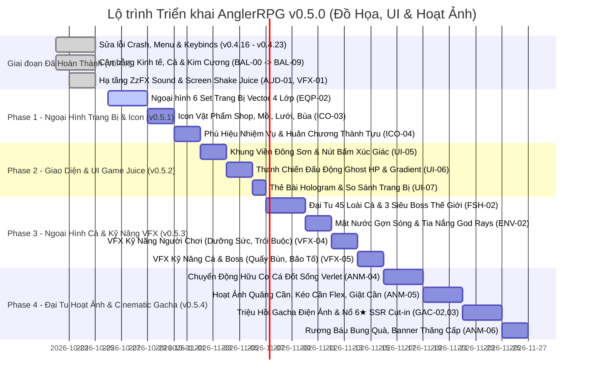

# KẾ HOẠCH PHÁT TRIỂN & THEO DÕI TÁC VỤ (ROADMAP & TASK TRACKER)
> **Dự án:** AnglerRPG  
> **Cập nhật:** 22/10/2026  
> **Trạng thái tài liệu:** Đang hoạt động (Active Tracker)

---

## 📌 BẢNG TỔNG HỢP MỨC ĐỘ ƯU TIÊN (PRIORITY MATRIX)

| ID | Nhóm công việc | Hạng mục | Mức độ ưu tiên | Trạng thái |
| :--- | :--- | :--- | :---: | :---: |
| **BUG-01** | Sửa lỗi | Crash khi bấm Quay lại từ màn hình Trang bị (Use-After-Free) | **P0 (Khẩn cấp)** | ✅ Đã khắc phục triệt để |
| **BUG-02** | Sửa lỗi | Chuẩn hóa hệ thống nút Quay lại Menu & khắc phục lỗi vòng lặp | **P0 (Khẩn cấp)** | ✅ Đã khắc phục triệt để |
| **BUG-03** | Sửa lỗi | Phím kỹ năng QWER không nhận & thiếu phản hồi trên tài khoản mới | **P0 (Khẩn cấp)** | ✅ Đã khắc phục triệt để |
| **BUG-04** | Sửa lỗi | Thoát Gacha ra game HUD bấm mục bất kì có khả năng crash | **P0 (Khẩn cấp)** | ✅ Đã khắc phục triệt để |
| **BUG-05** | Sửa lỗi | Lỗi chữ bị đè xuyên Modal Xóa Dữ Liệu & Hitbox Data Tab bị lệch | **P0 (Khẩn cấp)** | ✅ Đã khắc phục triệt để |
| **BUG-06** | Sửa lỗi | Danh sách phím bấm tràn (overflow) ra ngoài Box cài đặt & đè Header/Tabs | **P0 (Khẩn cấp)** | ✅ Đã khắc phục triệt để |
| **NEW-01** | Tính năng | Bản tin cập nhật trực quan tại Menu chính (không che HUD, không tự bật) | **P0 (Theo yêu cầu)** | ✅ Đã hoàn thành |
| **SET-01** | Tính năng | Game HUD: Nút Cài đặt & Cửa sổ Settings Modal | **P1 (Quan trọng)** | ✅ Đã hoàn thành |
| **SET-02** | Tính năng | Drag chuột chỉnh âm lượng & Tắt âm Nhạc nền (BGM) và SFX độc lập | **P1 (Quan trọng)** | ✅ Đã hoàn thành |
| **SET-03** | Tính năng | Toàn bộ 14 Keybinds (Kéo dây, 4 Kỹ năng, 9 Quickslots) & Chống trùng phím | **P1 (Quan trọng)** | ✅ Đã hoàn thành |
| **SET-04** | Tính năng | Chế độ hiển thị: Toàn màn hình / Cửa sổ & Phím tắt F11 toàn cục | **P1 (Quan trọng)** | ✅ Đã hoàn thành |
| **SET-05** | Tính năng | Chuyển Xuất/Nạp dữ liệu vào Settings & Tự động đặt tên file Timestamp | **P1 (Quan trọng)** | ✅ Đã hoàn thành |
| **SET-06** | Giao diện | Bố cục Single-Column Scrollable List & Nâng cấp UI Setting Vibe Game Fantasy | **P1 (Giao diện)** | ✅ Đã hoàn thành |
| **HUD-01** | Trải nghiệm| Random bản tin Ticker khi vào HUD & Xóa phím cứng + Chú thích Cài đặt | **P1 (Trải nghiệm)**| ✅ Đã hoàn thành |
| **MCP-01** | Công cụ | Custom Vector Studio MCP Server (Vẽ, Kiểm duyệt, Chuyển SVG sang LibGDX) | **P1 (Quan trọng)** | ✅ Đã hoàn thành |
| **GRP-01** | Đồ họa | Pipeline Đồ Họa Vector: Visual Quality Gate & CLI Runner (.agents/skills) | **P1 (Quan trọng)** | ✅ Đã hoàn thành |
| **GRP-02** | Đồ họa | Bổ Sung Bước Dọn Dẹp Sau Khi Tích Hợp (Post-Apply Cleanup) Vào Pipeline | **P1 (Quan trọng)** | ✅ Đã hoàn thành |
| **SET-07** | Đồ họa | Đại Tu Ngoại Hình Toàn Bộ Set Trang Bị Thời Không (Trượng, Dây, Lưỡi) | **P1 (Quan trọng)** | ✅ Đã hoàn thành |
| **BAL-00** | Cân bằng | Thiết Lập Hạ Tầng Pipeline Mô Phỏng & Cân Bằng Game (Mesa, SimPy, SciPy, SymPy) | **P1 (Quan trọng)** | ✅ Đã hoàn thành |
| **BAL-01** | Cân bằng | Cân bằng Kinh Tế, Cửa Hàng & Đặt Trần Lợi Nhuận Cho Lưới/Bùa | **P2 (Cân bằng)** | ✅ Đã hoàn thành |
| **BAL-02** | Cân bằng | Cân bằng Sức mạnh Máu Cá & 3 Boss Thế Giới (850 HP, 2200 HP, 5500 HP) | **P2 (Cân bằng)** | ✅ Đã hoàn thành |
| **BAL-03** | Cân bằng | Cân bằng Vòng quay Sự Kiện (Rate-up 50% & Chia đều 33.3% 3 món Lạc Hồng) | **P2 (Cân bằng)** | ✅ Đã hoàn thành |
| **BAL-04** | Cân bằng | Cân bằng Tiến trình EXP & Mở khóa Bản đồ (Bỏ cấp số nhân x10) | **P1 (Quan trọng)** | ✅ Đã hoàn thành |
| **BAL-05** | Cân bằng | Cố Định Rarity 6★ Thần Khí Lạc Hồng & Khóa Chặt Khỏi Roll Không Nổ | **P1 (Quan trọng)** | ✅ Đã hoàn thành |
| **BAL-06** | Cân bằng | Đại Tu Cân Bằng Chỉ Số 42 Loài Cá Thường (Common, Uncommon, Rare, Epic) Cả 3 Bản Đồ | **P1 (Quan trọng)** | ✅ Đã hoàn thành |
| **BAL-07** | Cân bằng | Cân Bằng Toàn Diện Nguồn Kiếm Kim Cương (Cá Hiếm, Rương Ngày/Tuần, Sự Kiện, Thành Tựu) | **P1 (Quan trọng)** | ✅ Đã hoàn thành |
| **BAL-08** | Tính năng | Bổ Sung Thưởng Kim Cương Sổ Tay Thủy Tộc (Fish Catalog) & Khắc Phục Lỗi SFX sfx_button | **P1 (Quan trọng)** | ✅ Đã hoàn thành |
| **UPD-01** | Tính năng | Module Auto-Updater Tự Động Cập Nhật Trực Tuyến & Tự Động Khởi Động Lại 1-Click | **P1 (Quan trọng)** | ✅ Đã hoàn thành |
| **TIM-01** | Tính năng | Dịch Vụ Đồng Bộ Thời Gian Thực Chuẩn Quốc Tế & Chống Gian Lận Tua Giờ (TimeSyncService) | **P1 (Quan trọng)** | ✅ Đã hoàn thành |
| **SEC-01** | Bảo mật  | Rà Soát & Ẩn Toàn Bộ File Nhạy Cảm, Save Game, Cache, Credentials Khỏi GitHub | **P1 (Bảo mật)**   | ✅ Đã hoàn thành |
| **AUD-01** | Âm thanh | Bộ Tổng Hợp Âm Thanh Thủ Tục ZzFX Java Synthesizer & Fallback Safety Net Không Cần File | **P1 (Quan trọng)** | ✅ Đã hoàn thành (Bước 1) |
| **VFX-01** | Trải nghiệm| Easing & Screen Shake Controller ("Game Juice" Rung Giật Màn Hình & Popup Nảy Mượt) | **P1 (Trải nghiệm)**| ✅ Đã hoàn thành (Bước 2) |
| **GAS-01** | Gameplay | Gameplay Ability System (GAS) Chuẩn Hóa Bộ 4 Kỹ Năng QWER, Cooldown & Hiệu Ứng Buff/Debuff | **P1 (Gameplay)**   | ✅ Đã hoàn thành (Bước 3) |
| **BUG-08** | Sửa lỗi  | Lỗi Kỹ năng Dưỡng Sức (space deal dmg) & Trói Buộc (kéo dây vẫn tăng tension) | **P0 (Khẩn cấp)**   | ✅ Đã khắc phục triệt để |
| **QST-01** | Sự kiện  | Bỏ thưởng đơn lẻ nhiệm vụ sự kiện, chuyển thành huy hiệu trạng thái & gom quà vào Rương Mốc | **P1 (Quan trọng)** | ✅ Đã hoàn thành |
| **ACH-01** | Cân bằng | Cân bằng phần thưởng 48 mốc thành tựu (2-30 KC), sửa target 5000 và đồng bộ SaveManager | **P1 (Cân bằng)**   | ✅ Đã hoàn thành |
| **SKL-01** | Kỹ năng  | Viết lại chú thích động theo cấp & đưa thông tin Cooldown/Thể lực xuống đáy tooltip | **P1 (Trải nghiệm)**| ✅ Đã hoàn thành |
| **UI-03**  | Giao diện| Tinh giản văn bản trang bị (xóa "(Max Tension)", "xịn") & Icon Vector Tiền tệ Catalog | **P1 (Giao diện)**  | ✅ Đã hoàn thành |
| **UI-04**  | Giao diện| Giãn cách dock tiền tệ Sổ Tay Thủy Tộc & Đồng nhất chuẩn Icon Đồng Vàng | **P1 (Giao diện)**  | ✅ Đã hoàn thành |
| **SKL-02** | Kỹ năng  | Khắc phục lỗi font ô vuông `[]` & căn chỉnh Cooldown tránh đè nút Nâng Cấp | **P1 (Trải nghiệm)**| ✅ Đã hoàn thành |
| **KEY-01** | Hệ thống | Cơ chế tự động hoán đổi phím (Auto-Swap) & Quét phím phần khớp IME/Unikey | **P0 (Khẩn cấp)**   | ✅ Đã hoàn thành |
| **BAL-09** | Cân bằng | Cân bằng lực căng dây khi kéo cá (Reeling Tension) & Sàn kháng lực kéo (25%) | **P1 (Quan trọng)** | ✅ Đã hoàn thành |
| **FSH-03** | Tính năng| Hiển thị chi tiết cơ chế tác động của 20 kỹ năng cá trong Sổ Tay Thủy Tộc | **P1 (Trải nghiệm)**| ✅ Đã hoàn thành |
| **QST-02** | Nhiệm vụ | Đại tu kho nhiệm vụ Ngày/Tuần (12 ngày, 7 tuần), triệt tiêu trùng lặp yêu cầu| **P1 (Quan trọng)** | ✅ Đã hoàn thành |
| **SHD-01** | Đồ họa   | Simplex Noise GLSL Water Shader: Mặt Nước Sóng Lấp Lánh & Khúc Xạ Ánh Sáng Chân Thực | **P2 (Đồ họa)**     | 📋 Kế hoạch (Bước 4) |
| **EQP-02** | Đồ họa   | Đại tu ngoại hình toàn bộ 6 Set Trang Bị (Cần, Dây, Lưỡi) chuẩn 4 lớp Vector 3D      | **P1 (Đồ họa)**     | 📋 Kế hoạch v0.5.0 |
| **ICO-03** | Đồ họa   | Vector hóa 100% vật phẩm Tiệm Tạp Hóa (Mồi câu, Lưới, Bùa may mắn, Đá mài, Vé)       | **P1 (Đồ họa)**     | 📋 Kế hoạch v0.5.0 |
| **ICO-04** | Đồ họa   | Bộ Phù hiệu Vector Nhiệm vụ, Sự kiện & Huân chương Thành tựu 3D Hải Trình             | **P1 (Đồ họa)**     | 📋 Kế hoạch v0.5.0 |
| **FSH-02** | Đồ họa   | Đại tu ngoại hình 45 loài cá & 3 Siêu Boss Thế Giới (Dual-tone, Mắt 3D, Vây mềm)     | **P1 (Đồ họa)**     | 📋 Kế hoạch v0.5.0 |
| **ENV-02** | Đồ họa   | Môi trường mặt nước gợn sóng sinh động, rạn san hô, cá bơi nền & Tia nắng (God Rays) | **P1 (Đồ họa)**     | 📋 Kế hoạch v0.5.0 |
| **UI-05**  | Giao diện| Khung viền kỳ ảo mạ đồng Đông Sơn & Bộ nút bấm xúc giác 3 trạng thái phản hồi âm     | **P1 (Giao diện)**  | 📋 Kế hoạch v0.5.0 |
| **UI-06**  | Giao diện| Thanh trạng thái chiến đấu động (Ghost HP bar, Gradient Tension bar rung chấn)       | **P1 (Giao diện)**  | 📋 Kế hoạch v0.5.0 |
| **UI-07**  | Giao diện| Thẻ bài trang bị phát quang ánh kim Hologram & So sánh chỉ số tức thì (Stat Diff)    | **P1 (Giao diện)**  | 📋 Kế hoạch v0.5.0 |
| **VFX-04** | Kỹ năng  | Bộ hiệu ứng thị giác chiêu thức cần thủ (Dưỡng Sức hoa sen, Trói Buộc xích hư không) | **P1 (Trải nghiệm)**| 📋 Kế hoạch v0.5.0 |
| **VFX-05** | Kỹ năng  | Bộ hiệu ứng kỹ năng cá & Boss (Bứt Tốc, Quấy Bùn mờ màn hình, Cuồng Nộ, Giật Điện)  | **P1 (Trải nghiệm)**| 📋 Kế hoạch v0.5.0 |
| **ANM-04** | Hoạt ảnh | Chuyển động hữu cơ của cá (Đốt sống đa khớp Verlet uốn lượn, quẫy đuôi, nhảy vọt)   | **P1 (Hoạt ảnh)**   | 📋 Kế hoạch v0.5.0 |
| **ANM-05** | Hoạt ảnh | Bộ hoạt ảnh thao tác cần thủ (Quăng cần, Cần uốn cong vật lý khi kéo, Giật cần, Dùng đồ)| **P1 (Hoạt ảnh)**| 📋 Kế hoạch v0.5.0 |
| **GAC-02** | Gacha    | Hoạt ảnh triệu hồi Gacha điện ảnh (Vòng trận pháp đại dương, sao băng đổi màu phẩm)  | **P1 (Hoạt ảnh)**   | 📋 Kế hoạch v0.5.0 |
| **GAC-03** | Gacha    | Cắt cảnh nổ bảo vật xịn SSR (Màn hình vỡ kính, Rồng Vàng/Chim Lạc bay lượn, God Rays)| **P1 (Hoạt ảnh)**   | 📋 Kế hoạch v0.5.0 |
| **ANM-06** | Hoạt ảnh | Hoạt ảnh rương báu bật nắp bung tài nguyên, Banner Thăng Cấp & Pháo hoa kim tuyến   | **P1 (Hoạt ảnh)**   | 📋 Kế hoạch v0.5.0 |

---

## 🚨 PHẦN I: DANH SÁCH LỖI ĐÃ XÁC ĐỊNH & PHƯƠNG ÁN XỬ LÝ

### 1. BUG-01: Lỗi bấm vào phần Trang bị (EquipmentScreen) sau đó ấn Quay lại thì bị crash game
- **Hiện tượng:** Người chơi từ màn chơi chính hoặc Menu vào `EquipmentScreen`, nhấn nút `← QUAY LẠI` hoặc phím `ESC` thì game bị văng / sập (Crash).
- **Nguyên nhân kỹ thuật (Root Cause):**
  - Trong `EquipmentScreen.java` dòng 110: Hàm `render(float delta)` gọi `update(delta)`.
  - Trong `update()` khi phát hiện nút Back / ESC: Game gọi `game.setScreen(previousScreen);` và gọi `dispose();` (giải phóng tài nguyên OpenGL `sr.dispose()`).
  - Sau khi `update()` return, hàm `render()` **không có lệnh dừng** (`if (game.getScreen() != this) return;`). Luồng tiếp tục chạy đến dòng 125 và 134, cố gắng gọi `sr.setProjectionMatrix` và `sr.begin(...)` trên đối tượng `ShapeRenderer` đã bị giải phóng (`disposed`).
  - Hậu quả: LibGDX ném ra ngoại lệ `GdxRuntimeException: ShapeRenderer cannot be used after being disposed` gây crash game ngay lập tức.
- **Phương án khắc phục:**
  - Bổ sung lệnh kiểm tra `if (game.getScreen() != this) return;` ngay sau `update(delta);` tại `EquipmentScreen.java`.
  - Đảm bảo logic dọn dẹp biến đệm hoạt động an toàn trước khi chuyển cảnh.

---

### 2. BUG-02: Chuẩn hóa hệ thống nút quay lại Menu & khắc phục triệt để lỗi vòng lặp
- **Hiện tượng:** Người chơi bị rơi vào vòng lặp điều hướng giữa màn chơi và bản đồ do nút góc trên bên trái ở màn chơi dẫn sang Bản đồ (`MapScreen`), trong khi ở Bản đồ nút quay lại lại đưa về màn chơi, không có cách nào bấm chuột để thoát về Menu chính.
- **Nguyên nhân:**
  - Nút góc trái HUD trong `GameHUD.java` hiển thị nhãn `"BẢN ĐỒ"` và kích hoạt `new MapScreen()`.
  - Trong khi đó phím ESC lại đưa về `MainMenuScreen`, dẫn tới bất nhất giữa thao tác chuột và phím.
- **Phương án khắc phục (Đã thực hiện):**
  - Chuẩn hóa nút góc trên bên trái trên Game HUD thành `← MENU`: Bấm chuột hoặc phím ESC đều lưu game và trở về Menu chính (`MainMenuScreen`).
  - Nút ở giữa khi `State.IDLE`: `"RA KHƠI CÂU CÁ"` chuyên trách mở `MapScreen`.
  - Nút `← QUAY LẠI` (hoặc ESC) tại `MapScreen`: Quay lại màn chơi (`State.IDLE`), loại bỏ 100% hiện tượng vòng lặp luẩn quẩn.

---

### 3. BUG-03: Kỹ năng QWER hoạt động trên máy Dev nhưng người khác tải về không dùng được
- **Hiện tượng:** Trên máy phát triển test phím Q, W, E, R bình thường, nhưng gửi bản build cho người khác chơi thì bấm phím kỹ năng không có tác dụng.
- **Nguyên nhân tiềm ẩn:**
  1. **Tài khoản mới chưa có kỹ năng trang bị (Unassigned Slots):**
     - Khi một người chơi mới mở game lần đầu, mảng `equippedActives` có 4 ô rỗng (`null`).
     - Người chơi chưa mở bảng kỹ năng `SkillTreeScreen` để gán kỹ năng vào phím, hoặc đã cộng điểm nhưng chưa nhấn `Mặc Vào` (Equip) vào ô tương ứng.
     - Khi bấm phím Q/W/E/R, hệ thống kiểm tra `player.getEquippedActives()[i] == null` nên không kích hoạt gì cả, và không có thông báo HUD giải thích.
  2. **Xung đột bộ gõ tiếng Việt (Unikey / EVKey):**
     - Đa phần người dùng máy tính tại Việt Nam bật Unikey ở chế độ gõ `Telex` hoặc `VNI`.
     - Bộ gõ can thiệp vào các phím `W`, `E`, `R` (ví dụ `W` biến thành `ư`, `EE` thành `ê`, `R` là dấu hỏi trong VNI), khiến hệ thống GLFW/LWJGL3 không bắt được sự kiện `Input.Keys.W`, `Input.Keys.E`, `Input.Keys.R`.
  3. **Không hỗ trợ chuột trực tiếp:**
     - Nếu người chơi không quen dùng phím hoặc phím bị kẹt bộ gõ, họ cần click trực tiếp vào icon kỹ năng trên HUD.
- **Phương án khắc phục:**
  - **Tự động trang bị (Auto-Equip Default):** Mặc định khi người chơi học kỹ năng chủ động đầu tiên (hoặc khởi đầu game), tự động gán kỹ năng đó vào Slot Q (Slot 0).
  - **Phản hồi HUD:** Khi bấm phím mà ô trống, hiển thị Floating Text nhẹ: *"Ô phím chưa gắn kỹ năng!"*.
  - **Keybind tự do:** Cho phép đổi phím trong phần Settings sang các phím số 1, 2, 3, 4 hoặc Z, X, C, V để tránh bị Unikey bắt chữ.
  - **Hỗ trợ Click chuột mượt mà:** Đảm bảo click chuột trái vào ô kỹ năng trên HUD luôn kích hoạt kỹ năng 100%.

---

### 4. BUG-04: Thoát khỏi màn hình Gacha ra game HUD bấm vào một mục bất kì có khả năng crash
- **Hiện tượng:** Người chơi sau khi mở và đóng màn hình Gacha (`GachaScreen`), quay lại Game HUD (`PlayScreen`), nếu bấm vào một nút bất kì trên thanh điều hướng (Nhiệm vụ, Kỹ năng, Gacha, Cửa hàng, Trang bị...) thì game có tỷ lệ bị crash sập ngay lập tức (Crash JVM văng ra ngoài kèm sinh file `hs_err_pid*.log`).
- **Phân tích nhật ký Crash Dump (hs_err_pid5316, 14896, 20736, 26596 tại thời điểm 13:33 - 13:39):**
  - Cả 4 file log crash JVM mới nhất ghi nhận lỗi vi phạm truy cập bộ nhớ native: `EXCEPTION_ACCESS_VIOLATION (0xc0000005)`.
  - Stack trace chỉ ra điểm sập tại `ntdll.dll!RtlAllocateHeap` và `msvcrt.dll!memcpy` bên dưới lời gọi JNI của LibGDX:
    `BufferUtils.newDisposableByteBuffer` → `new ShapeRenderer()`
- **Nguyên nhân gốc rễ (Root Causes):**
  1. **Tạo và Hủy `ShapeRenderer` liên tục (Native Heap Fragmentation / Driver Conflict):**
     - Mỗi Screen (`GachaScreen`, `EquipmentScreen`, `QuestScreen`, `SkillTreeScreen`, `ShopScreen`,...) hiện đều tự `new ShapeRenderer()` khi khởi tạo và gọi `sr.dispose()` khi đóng.
     - `ShapeRenderer` trong LibGDX cấp phát bộ đệm Direct Byte Buffer trong C heap (`malloc`). Việc liên tục cấp phát và giải phóng các vertex buffer OpenGL qua JNI trên Windows 11 với card đồ họa (đặc biệt AMD Radeon 780M / Intel iGPU) dẫn tới phân mảnh hoặc xung đột quản lý bộ nhớ native của `msvcrt.dll`/`ntdll.dll`.
  2. **Tác động liên đới từ lỗi Use-After-Free của BUG-01:**
     - Khi `EquipmentScreen` gọi `dispose()` nhưng luồng render không dừng (`update` không chặn), các lệnh vẽ tiếp tục ghi dữ liệu vertex vào vùng đệm native C đã bị free, làm hỏng bảng điều khiển heap (`heap chunk headers`) của Windows. Bất kỳ lệnh `new ShapeRenderer()` nào sau đó đều sẽ dính `0xc0000005` trong `RtlAllocateHeap`.
  3. **Thiếu chặn click xuyên màn hình (`framesToSkip <= 0`):**
     - Tại `PlayScreen.java` dòng 222, cụm click mở các màn hình (`hud.isShopClicked`, `isEquipmentClicked`...) **không có điều kiện `framesToSkip <= 0`**, dẫn đến việc click chuột từ nút Quay lại của GachaScreen có thể kích hoạt ngay tức khắc một lệnh chuyển cảnh khác khi frame chưa ổn định.
- **Phương án khắc phục triệt để:**
  1. **Chia sẻ một instance `ShapeRenderer` duy nhất (Singleton / Shared Resource):**
     - Khởi tạo `ShapeRenderer` một lần duy nhất tại `FishingRPG.java` (giống như `batch`, `font`, `titleFont`).
     - Tất cả các Screens (`PlayScreen`, `GachaScreen`, `EquipmentScreen`, `ShopScreen`, `SkillTreeScreen`, `QuestScreen`, `EventScreen`, `MapScreen`, `MainMenuScreen`) tái sử dụng chung `game.shapeRenderer`, tuyệt đối không `new` hay `dispose()` riêng lẻ tại từng Screen.
     - Chỉ gọi `game.shapeRenderer.dispose()` duy nhất 1 lần khi toàn bộ game thoát tại `FishingRPG.dispose()`.
  2. **Bảo vệ `framesToSkip <= 0` trên toàn bộ nút HUD:**
     - Bổ sung `framesToSkip <= 0 &&` trước các sự kiện click mở Screen tại dòng 222 và dòng 186 của `PlayScreen.java`.
  3. **Khắc phục triệt để BUG-01 (ngắt render ngay khi chuyển cảnh).**

### 6. BUG-06: Danh sách cuộn phím bấm (Controls Tab) tràn ra ngoài Hộp thoại Cài Đặt
- **Hiện tượng:** Khi mở tab PHÍM BẤM và cuộn danh sách (hoặc ở vị trí mặc định), các thẻ phím bấm, viền và nút trồi ngược lên đè qua thanh Tabs, tiêu đề "CÀI ĐẶT TRÒ CHƠI", và tràn xuống đè nút "ĐẶT LẠI MẶC ĐỊNH", nút "ĐÓNG", lòi ra ngoài khung viền đáy dialog.
- **Nguyên nhân kỹ thuật (Root Cause):**
  1. `ShapeRenderer` trong LibGDX tích lũy vertices trong buffer nội bộ (`ImmediateModeRenderer20`). Khi gọi `ScissorStack.pushScissors` rồi vẽ shapes bằng `sr.rect`, sau đó gọi ngay `ScissorStack.popScissors()`, `popScissors()` đã tắt `GL_SCISSOR_TEST` trong OpenGL trước khi `sr.end()` kịp gửi vertex buffer sang GPU. Kết quả là toàn bộ shapes được vẽ mà không hề có Scissor clipping.
  2. Các vòng lặp vẽ 14 phím và 2 header banners thiếu cơ chế Hard Bounds Culling, dẫn đến việc mọi hàng dù có toạ độ Y nằm ngoài vùng nhìn (`y > 497` hoặc `y < 213`) vẫn bị đẩy vào hàng đợi render và nhận hover/click chuột.
  3. Thiếu khung viền recessed phân định box cuộn trực quan.
- **Phương án khắc phục:**
  1. Thêm `sr.flush()` trước `pushScissors` và ngay trước `popScissors()` để toàn bộ shapes cuộn được vẽ sang GPU trong khi `GL_SCISSOR_TEST` đang kích hoạt.
  2. Bổ sung tính toán `Viewport` (qua `getViewport().getScreenX()...`) chuẩn xác cho `ScissorStack.calculateScissors`.
  3. Áp dụng Hard Bounds Culling (`rY + rowH >= boxBottom && rY <= boxTop`) cho cả `drawControlsTabShapes`, `drawControlsTabTexts`, và `handleInput`.
  4. Vẽ khung hộp chìm (recessed panel) định hình rõ ràng khu vực danh sách cuộn.

---

## ⚙️ PHẦN II: HỆ THỐNG CÀI ĐẶT (SETTINGS SYSTEM)

### 1. Giao diện & Vị trí Cài đặt (HUD & Main Menu)
- **Vị trí tích hợp:**
  - Thêm Icon bánh răng ⚙️ (Settings) trên thanh HUD ở `PlayScreen` và trên `MainMenuScreen`.
  - Mở dạng Popup Modal phủ kính mờ (Glassmorphism), không làm ngắt luồng game đột ngột.

### 2. Thiết lập Âm thanh (Audio Settings)
- **Thanh trượt Nhạc nền (BGM Volume):** Điều chỉnh từ 0% đến 100% (Bước nhảy 5%).
- **Thanh trượt Hiệu ứng (SFX Volume):** Điều chỉnh từ 0% đến 100%.
- **Nút Mute nhanh:** Tắt/Bật toàn bộ âm thanh chỉ với 1 click.
- **Lưu trữ tự động:** Ghi nhớ giá trị vào `Preferences` và áp dụng ngay lập tức qua `AudioManager`.

### 3. Tùy chỉnh Phím bấm (Keybind Remapping)
- **Giao diện đổi phím:** Danh sách các thao tác kèm ô hiển thị phím hiện tại:
  - *Kéo dây / Giằng co:* Mặc định `SPACE`
  - *Kỹ năng 1 (Slot Q):* Mặc định `Q`
  - *Kỹ năng 2 (Slot W):* Mặc định `W`
  - *Kỹ năng 3 (Slot E):* Mặc định `E`
  - *Kỹ năng 4 (Slot R):* Mặc định `R`
  - *Phím tắt vật phẩm 1 - 9:* Mặc định `Phím 1` $\rightarrow$ `Phím 9`
- **Cơ chế gán phím:** Nhấp vào ô $\rightarrow$ Chờ người chơi nhấn phím mới $\rightarrow$ Kiểm tra trùng phím $\rightarrow$ Cập nhật và lưu vào cấu hình.

### 4. Thiết lập Hiển thị & Màn hình (Display Settings)
- **Chế độ màn hình:** Chuyển đổi giữa `Cửa sổ (Windowed)` và `Toàn màn hình (Fullscreen)`.
- **Độ phân giải (Resolutions):**
  - `1280 x 720` (Chuẩn HD - Tỷ lệ 16:9 gốc)
  - `1600 x 900` (HD+)
  - `1920 x 1080` (Full HD)
  - `Không viền (Borderless Windowed / Desktop Mode)`

### 5. Quản lý Dữ liệu Save trong Settings (Data Management)
- **Di chuyển tính năng Xuất/Nạp:** Chuyển toàn bộ 2 nút `Xuất Dữ Liệu` và `Nạp Dữ Liệu` từ Menu chính vào tab `Dữ liệu` bên trong Modal Cài đặt.
- **Quy tắc đặt tên file sao lưu thông minh (Anti-overwrite Timestamp):**
  - Tên file xuất ra sẽ tự động kèm ngày, tháng, năm, giờ, phút, giây:
    `angler_save_yyyyMMdd_HHmmss.json`
    *Ví dụ:* `angler_save_20261022_143015.json`
  - Đảm bảo mỗi lần xuất là một bản snapshot riêng biệt, không bao giờ vô tình ghi đè làm mất file lưu cũ của người chơi.

### 6. Bố cục Single-Column Scrollable List & Nâng cấp UI Setting Vibe Game Fantasy (SET-06)
- **Tái cấu trúc Tab Phím Bấm:**
  - Quy tụ toàn bộ 14 thao tác (Kéo dây + 4 Kỹ năng + 9 Quickslots) vào một danh sách cuộn dọc liền mạch duy nhất (Single-column list).
  - Tích hợp thanh cuộn Fantasy RPG Scrollbar: Hỗ trợ kéo thả chuột (drag), lăn bánh xe chuột, và phím mũi tên Lên/Xuống.
  - Sử dụng `ScissorStack` cắt khung chính xác theo camera, tránh tràn nội dung ra ngoài.
- **Nâng cấp thẩm mỹ chuẩn Vibe Game Fantasy RPG:**
  - Khung viền kép mạ vàng, 4 góc đính họa tiết Corner Ornaments 2 tầng với đá quý.
  - Hàng thẻ phím bấm làm bằng kính Obsidian Glass cao cấp với dải phản quang specular, hiệu ứng viền neon cyan/amber khi hover.
  - Khi bấm đổi phím, nút bấm phát sáng aura vàng pulsing rực rỡ, kèm cơ chế chống trùng phím (Anti-collision protection) phát âm thanh lỗi `sfx_fail` và hiển thị cảnh báo đỏ nếu trùng.
  - Nâng cấp đồng bộ các Tab Âm thanh (bàn trộn âm studio), Hiển thị (2 thẻ mode lớn kèm F11 tip) và Dữ liệu (3 thẻ action lớn theo mã màu).

### 7. Đại Tu Ngoại Hình Toàn Diện Set Trang Bị Thời Không (SET-07)
- **Vấn đề đồ họa cũ:**
  - `drawThoiKhongRod`: Vòng hào quang lớn quá khổ (`r * 1.30f`), thân cần đơn điệu, đầu trượng bị đẩy lệch sang `cx + r * 0.55f` dẫn đến tràn viền và lệch tâm nghiêm trọng trong modal.
  - `drawThoiKhongLine`: Chỉ gồm các vòng tròn đồng tâm phẳng, không có khối cuộn dây cước hoặc vệt chuyển động không-thời gian.
  - `drawThoiKhongHook`: Mắt xỏ dây bị vòng tròn đen che phủ toàn bộ hình thể, ngạnh móc tỷ lệ không đồng đều.
- **Phương án nâng cấp thẩm mỹ & Tái cấu trúc ShapeRenderer:**
  - Chuẩn hóa hệ quy chiếu tương đối `scale = (r * 2f) / 128f`, đưa tâm hình học về chuẩn xác `(cx, cy)`.
  - **Trượng Thời Gian (Chrono Staff):** Bánh răng thiên văn 12 khắc giờ Astrolabe, kim đồng hồ xoay vát nhọn, trục titan bọc đai vàng hoàng gia, lõi ngọc lam Cyan Opal và 2 tầng hào quang tinh vân pulsing.
  - **Sợi Dây Xuyên Thấu (Transdimensional Line):** Cuộn dây Tachyon đa tầng dạng đĩa thiên hà, 8 vòng sóng năng lượng cộng hưởng gradient đa sắc, chùm vệt photon lượng tử xuyên không-thời gian.
  - **Lưỡi Câu Hư Không (Void Singularity Hook):** Đường cong tô-pô vòng Möbius dải xoắn kép, ngạnh móc mạ Chrome sắc bén và hố đen Singularity tím huyền bí phát quang.
  - Cả 3 asset đạt điểm kiểm duyệt Visual Quality Gate 100/100 PASSED.

---

### 8. Bổ Sung Bước Dọn Dẹp Sau Khi Tích Hợp Vào Pipeline Đồ Họa (GRP-02)
- **Vấn đề phát sinh:** Trong quá trình thiết kế và chuyển đổi vector asset, nhiều file ảnh render xem trước tạm (`old_*`, `temp_*`, `test_*`, `preview_*`) và các file snapshot dữ liệu được sinh ra, gây chiếm dụng bộ nhớ và làm rác cây thư mục git.
- **Phương án giải quyết (Đã hoàn thành):**
  - Bổ sung lệnh CLI `python scripts/vector_pipeline.py clean` hỗ trợ các chế độ:
    * `--target intermediate`: Dọn dẹp toàn bộ file so sánh cũ, file thử nghiệm và nháp tạm thời.
    * `--target asset --asset <name>`: Dọn dẹp tài nguyên trung gian của một asset cụ thể sau khi tích hợp.
    * `--target previews`: Dọn dẹp sạch sẽ toàn bộ thư mục `assets/vectors/previews`.
    * `--target all`: Dọn dẹp toàn diện cả file preview trung gian và các snapshot file lưu test trong root.
  - Tích hợp công cụ MCP `cleanup_pipeline_files` trong server `vector-studio`.
  - Chuẩn hóa quy trình 5 bước trong `vector-graphics-designer` và `game-graphics-pipeline`.

---

## ⚖️ PHẦN III: CÂN BẰNG TOÀN DIỆN (GAME BALANCING)

### 1. Cân bằng Kinh tế & Phần thưởng Nhiệm vụ (Economy Rebalance)
- **Vấn đề:** Hiện tại Kim Cương (KC) nhận từ nhiệm vụ ngày, nhiệm vụ tuần và câu cá Boss quá dễ dãi, dẫn đến việc người chơi tích được hàng nghìn KC rất nhanh và quay gacha không giới hạn.
- **Điều chỉnh:**
  - **Nhiệm vụ ngày:**
    - Mỗi nhiệm vụ thông thường: Giảm từ `5 - 10 KC` xuống `1 - 2 KC` + tăng thêm `Vàng (Gold)` và `XP`.
    - Rương năng động ngày (100 điểm): Giảm từ `20 KC` xuống `5 - 10 KC` + tặng kèm `1x Vé Quay Tiêu Chuẩn`.
  - **Nhiệm vụ tuần:**
    - Mỗi nhiệm vụ tuần: Giảm từ `15 - 25 KC` xuống `5 - 8 KC`.
    - Rương năng động tuần (100 điểm): Giảm từ `100 KC` xuống `30 - 40 KC` + tặng kèm `1x Vé Quay Cao Cấp`.
  - **Thành tựu (Achievements):**
    - Giữ các mốc thành tựu là nguồn KC danh giá, nhưng phân cấp theo độ khó (mốc đầu 5 KC, mốc sau 15-30 KC).

### 2. Cân bằng Sức mạnh Trang bị vs Độ khó của Cá (Combat Balance)
- **Vấn đề:** Chỉ số trang bị cấp cao (đặc biệt là đồ Epic, Thần Thoại và Set Lạc Hồng) cộng dồn quá nhiều sát thương kéo và dòng phụ, khiến cá kể cả Boss bị kéo cạn máu chỉ trong 2-3 giây, mất đi trải nghiệm câu cá kịch tính.
- **Điều chỉnh Sức mạnh Cá:**
  - Tăng lượng máu (`maxHp`) của cá theo độ hiếm và bản đồ:
    - *Cá Thường (Common):* Máu x1.0
    - *Cá Hiếm (Uncommon/Rare):* Máu tăng từ +30% → +60%
    - *Cá Epic:* Máu tăng từ +80% → +150%
    - *Cá Thủy Quái / Boss:* Máu tăng từ +150% → +300%
  - Tăng nhịp độ bứt tốc và đổi trạng thái (Kéo ↔ Nghỉ ngơi) của cá để người chơi phải nhấp nhả phím Space khéo léo.
  - Tăng độ khó của các hiệu ứng kỹ năng cá (Bứt tốc x2 lực kéo, Quẫy bùn, Phun mực làm mờ tầm nhìn).
- **Điều chỉnh Chỉ số Trang bị:**
  - Điều chỉnh lại công thức sát thương của Cần câu: Giảm bớt tỷ lệ nhân tuyến tính quá lớn ở cấp cường hóa cao.
  - Cân bằng lại 3 bộ phận:
    - **Cần Câu:** Tập trung vào Sát thương kéo (`Base Pull Damage`) và Cơ hội Bạo kích (`Crit Rate`).
    - **Dây Cước:** Tập trung vào Sức căng tối đa (`Max Line Tension`) và Kháng đứt dây (`Pull Reduction`).
    - **Lưỡi Câu:** Tập trung vào Độ nhạy cắn câu (`Bite Time`) và Giữ mồi (`Bait Retention`).

### 3. Cân bằng Vòng quay Sự Kiện (Event Gacha Balance)
- **Vấn đề:** Tỷ lệ xuất hiện của các trang bị giới hạn sự kiện cần minh bạch và đồng đều với trang bị cùng bậc để người chơi cảm thấy công bằng.
- **Điều chỉnh:**
  - **Cơ chế Rate-Up cân bằng:**
    - Trong vòng quay Sự Kiện, khi trúng bậc 6★ (Thần Khí): Tỷ lệ ra đúng trang bị sự kiện (Set Thần Khí Lạc Hồng: Cần, Dây, Lưỡi) chiếm **50%** tổng tỷ lệ 6★. 3 món sự kiện có tỷ lệ chia đều nhau (33.3% mỗi món).
    - Các món thường cùng phẩm cấp chia nhau 50% còn lại.
  - **Cơ chế Bảo hiểm (Pity System):**
    - Giữ mốc bảo hiểm 80 lượt chắc chắn có 1 món 6★.
    - Đảm bảo tỷ lệ quay hiển thị chính xác trong bảng xác suất (Loot Table Modal).

### 4. BAL-05: Cố Định Rarity 6★ Thần Khí Lạc Hồng & Khóa Chặt Khỏi Roll Không Nổ
- **Vấn đề:** Set Thần Khí Lạc Hồng trước đây có nguy cơ xuất hiện ngẫu nhiên trong Vòng quay Thường (`rollGacha`) với phẩm cấp rác (Common, Uncommon, Rare) hoặc lọt vào các lượt quay không nổ của sự kiện, gây phá vỡ tính độc bản và cao cấp của set Thần Khí.
- **Giải pháp:**
  - Thiết lập bất biến mã hóa: Mọi món đồ thuộc Set Lạc Hồng luôn cố định phẩm cấp 6★ `Rarity.LIMITED_PREMIUM`.
  - Loại bỏ hoàn toàn Set Lạc Hồng khỏi danh sách quay của Vòng quay Thường.
  - Trong Vòng quay Sự Kiện: Set Lạc Hồng chỉ có thể xuất hiện khi nổ 6★ (`LIMITED_PREMIUM`). Tuyệt đối không lọt vào roll thường/roll xịt.
  - Tự động chuẩn hóa và nâng cấp độ hiếm cho mọi món Lạc Hồng trong rương đồ người chơi khi nạp save game.

### 5. BAL-06: Đại Tu Cân Bằng Chỉ Số 42 Loài Cá Thường Cả 3 Bản Đồ
- **Vấn đề:** Chỉ số Máu (HP) của cá Common/Uncommon trước đây quá thấp (25 - 50 HP), khiến người chơi khi trang bị cần câu bậc trung có thể giật chết cá chỉ trong 1 - 2 giây, làm mất đi tính tương tác giằng co.
- **Giải pháp:**
  - Chuẩn hóa TTK theo từng cấp độ: Common (8 - 14s), Uncommon (15 - 22s), Rare (22 - 32s), Epic (35 - 50s).
  - Tăng chỉ số Máu và Lực kéo cho toàn bộ 42 loài cá thuộc Ao Làng, Bãi Biển và Đảo Xa.
  - Tăng tỷ lệ thưởng Vàng và EXP tương xứng với độ khó và thời gian giằng co.

### 6. BAL-07: Cân Bằng Toàn Diện Nguồn Kiếm Kim Cương (Chống Lạm Phát Currency)
- **Vấn đề:** Kim Cương (KC) là tiền tệ cao cấp phục vụ Gacha, nhưng trước đây bị lạm phát nghiêm trọng từ mọi nguồn (Cá hiếm rơi 100%, mỗi 10 con cá thưởng 5 KC, Rương ngày 20 KC, Rương tuần 100 KC, Nhiệm vụ sự kiện 55 KC/ngày, Thành tựu thưởng tới 10,000 KC). Người chơi F2P kiếm được hơn 5,000 – 7,000 KC/tháng (tương đương 3 – 4 chu kỳ bảo hiểm Pity), khiến gacha mất hoàn toàn giá trị quý hiếm.
- **Giải pháp đã thực hiện:**
  - **Rơi từ Câu Cá (`FishingManager`):** Cá Rare giảm từ 100% xuống 20% tỷ lệ rơi 1 KC; cá Epic rơi 1–2 KC; Boss rơi 3–5 KC (trần nhân lưới thưởng thêm tối đa 2 KC).
  - **Nội tại Tiến trình (`PlayerProgression`):** Thưởng thăng cấp 2 KC (riêng mốc 5 cấp thưởng 10 KC); mốc câu cá chuyển thành mỗi 25 con cá thưởng +3 KC (thay vì 10 con +5 KC).
  - **Rương Nhiệm vụ (`QuestScreen`):** Rương Ngày chuẩn hóa 10 KC (thay vì 20); Rương Tuần chuẩn hóa 40 KC (thay vì 100).
  - **Sự Kiện (`EventManager`):** Nhiệm vụ sự kiện giảm từ 10–20 KC xuống 3–8 KC; Mốc 4/6 thưởng 10 KC (thay vì 20); Điểm danh tháng tổng 135 KC (thay vì 215).
  - **Thành Tựu (`QuestManager`):** Tinh chỉnh toàn bộ bậc thành tựu từ 5 KC đến tối đa 500–600 KC cho mốc tối thượng cuối game (thay vì 2,000 – 10,000 KC).
  - **Kết quả:** Đưa lượng Kim Cương F2P trung bình về mức chuẩn **1,700 – 2,300 KC/tháng (~85 – 118 lượt quay)**, đạt chính xác 1–1.2 chu kỳ Pity/tháng.

---

### 9. BAL-08: Bổ Sung Thưởng Kim Cương Sổ Tay Thủy Tộc (Fish Catalog) & Khắc Phục Lỗi Âm Thanh SFX
- **Vấn đề:** 
  1. Trong Sổ Tay Thủy Tộc (`CatalogScreen`), các bộ sưu tập trước đây chỉ thưởng Vàng và XP, chưa có nguồn thưởng Kim Cương milestone một lần (one-time completion reward) đặc trưng của các tựa game RPG sưu tập.
  2. Bị lỗi âm thanh `[AudioManager] Could not load SFX: sfx_button` do thiếu tệp `assets/audio/sfx/sfx_button.wav`, đồng thời `AudioManager` không có cơ chế cache null khiến ngoại lệ bị quăng và log lỗi bị spam liên tục mỗi khi tương tác chuột.
- **Giải pháp đã thực hiện:**
  - **Thưởng Hoàn Thành Bộ Sưu Tập (`CollectionDatabase` & `CatalogScreen`):**
    - Bổ sung trường `rewardDiamonds` cho toàn bộ 15 bộ sưu tập cả 3 bản đồ:
      * **Ao Làng:** 10, 15, 20, 35, 60 KC (Tổng 140 KC).
      * **Bãi Biển:** 15, 20, 25, 40, 70 KC (Tổng 170 KC).
      * **Đảo Xa:** 20, 25, 35, 50, 100 KC (Tổng 230 KC).
      * Tổng thưởng trọn đời từ hoàn thành 15 bộ sưu tập: **540 Kim Cương**.
  - **Thưởng Khám Phá Lần Đầu Từng Loài Cá:**
    - Mỗi khi câu được loài cá mới lần đầu, ô cá trong Sổ Tay mở khóa tag phát sáng `+X 💎 NHẬN`:
      * Common: +2 KC
      * Uncommon: +3 KC
      * Rare: +5 KC
      * Epic: +10 KC
      * Boss: +25 KC
    - Người chơi có thể bấm trực tiếp vào từng ô cá để nhận hoặc bấm nút **★ NHẬN TẤT CẢ ★** ở góc trên bên phải để nhận đồng loạt toàn bộ thưởng cá và bộ sưu tập.
  - **Giao Diện Sổ Tay & Lưu Trữ Dữ Liệu:**
    - Bổ sung thanh dock hiển thị số dư Vàng và Kim Cương trực tiếp trên thanh công cụ Sổ Tay.
    - Lưu trạng thái `claimedFishCatalog` vào Save/Load của `SaveManager.java` an toàn và tương thích ngược.
  - **Khắc Phục Lỗi Âm Thanh SFX (`AudioManager`):**
    - Sinh tệp âm thanh click chuột cơ khí cao cấp `assets/audio/sfx/sfx_button.wav` (44.1kHz, 16-bit PCM).
    - Cải tiến `AudioManager.java` kiểm tra tệp bằng `fh.exists()`, cache `null` vào `sfxMap` khi không tìm thấy để triệt tiêu vĩnh viễn việc ném `GdxRuntimeException` và spam log.
    - Bổ sung alias tự động tương thích: `"button_click"` -> `"sfx_button"`, `"victory"` -> `"sfx_success"`.

---

## 🎨 PHẦN II: KẾ HOẠCH CHI TIẾT v0.5.0 - ĐẠI TU TOÀN DIỆN ĐỒ HỌA, GIAO DIỆN & HOẠT ẢNH

### 1. Nâng Cấp Ngoại Hình Trang Bị & Icon Hệ Thống (EQP-02, ICO-03, ICO-04)
- **EQP-02 - Ngoại hình 6 Set Trang Bị (Rods, Lines, Hooks) theo chuẩn 4 lớp Vector 3D:**
  - *Set Vực Thẳm (4★ Epic Abyssal):* Thân cần chitin đen tuyền nứt phát quang sinh học xanh ngọc (`#06b6d4`), đầu cần vây gai sắc nhọn, dây tơ nhện biển phát sáng, lưỡi câu xương rồng vực sâu ma mị.
  - *Set Hải Tặc & Hoàng Gia (3★-4★ High Seas):* Cần gỗ sồi bọc vàng cướp biển, đầu mỏ neo rèn đồng cổ, dây tơ tằm bện chỉ vàng, lưỡi câu hoàng gia dát ngọc ruby đỏ.
  - *Set Băng Giá (2★-3★ Glacial Frost):* Thân cần tinh thể băng lục giác trong suốt phản quang tuyết, dây cước sương giá trắng buốt, lưỡi câu thạch băng vĩnh cửu sắc như dao cạo.
  - *Set Tập Sự & Thợ Săn (1★-2★ Rustic Coastal):* Cần tre uốn cong mộc mạc quấn dây gai, dây thừng bện tay, lưỡi câu sắt gỉ cổ điển phong cách ngư dân làng chài.
- **ICO-03 - Vector hóa 100% vật phẩm Tiệm Tạp Hóa (Shop Items & Consumables):**
  - *Mồi câu (Baits):* Mồi trùn biển uốn lượn, Mồi tôm phát quang biển sâu, Mồi cá con lấp lánh vảy bạc, Mồi Thần Lạc Hồng đóa sen ngậm tiên châu.
  - *Lưới đánh cá (Nets):* Lưới đay dân dã quấn phao gỗ, Lưới cước tơ tằm trong suốt, Lưới bạc gia cường khoen thép, Lưới vàng hoàng gia dát ngọc.
  - *Bùa may mắn (Talismans):* Bùa giấy điều son chữ Hán-Nôm linh ứng, Bùa ngọc bội xà cừ phát ánh cầu vồng, Bùa Thần Tài Kim Ngân đính chuông đồng cổ.
  - *Đá mài, Bình thuốc & Nước tăng lực:* Khối đá mài thạch anh phát tia lửa, Bình hồ lô / lọ thuốc thủy tinh phát bọt khí ma thuật sủi tăm.
  - *Vé Gacha:* Vé Thường xanh lam kim tuyến, Vé Sự Kiện Hoàng Kim Lạc Hồng viền cánh sen đỏ rực.
- **ICO-04 - Bộ Phù hiệu Vector Nhiệm vụ, Sự kiện & Huân chương Thành tựu 3D:**
  - 8 Huân chương Thành tựu 3D phong cách Thần thoại Biển: Huân chương Cần Thủ (2 cần bắt chéo), Huân chương Vua Biển (vương miện sóng nước rồng ngậm ngọc), Huân chương Thợ Săn Kho Báu (núi vàng & kim cương phát sáng), Huân chương Kình Ngư (cá quẫy sóng lớn).
  - Phù hiệu Nhiệm vụ ngày/tuần: Cuộn giấy da hải trình la bàn cổ, Mỏ neo vinh dự, Rương báu mở nắp phát quang.

---

### 2. Hiện Đại Hóa Giao Diện & UI Game Juice (UI-05, UI-06, UI-07)
- **UI-05 - Khung Viền Kỳ Ảo & Bộ Nút Bấm Xúc Giác (Fantasy Oceanic Frames & Tactile Buttons):**
  - Bo góc mềm mại cho toàn bộ Modal/Dialog với viền kim loại đồng thau chạm khắc hoa văn Đông Sơn và sóng biển ở 4 góc.
  - Nút bấm 3 trạng thái rõ rệt (Normal gradient sâu, Hover viền hào quang phát sáng, Pressed thụt 2px kèm âm thanh cơ khí nảy).
  - Thanh cuộn (Scrollbar) phong cách cổ điển có con trượt hình mỏ neo/giọt nước.
- **UI-06 - Thanh Trạng Thái Chiến Đấu Động (Dynamic Combat Gauges & Juice):**
  - *Thanh Máu Cá (HP Bar):* Bổ sung thanh "Ghost HP" đỏ thẫm tụt dần sau khi trúng đòn, viền nứt phát tia lửa khi máu dưới 20%.
  - *Thanh Lực Căng (Tension Bar):* Đổi màu theo dải màu liên tục Gradient (Xanh lục an toàn -> Vàng cảnh báo -> Đỏ cam nguy hiểm -> Đỏ tím rung lắc chớp nháy kèm tia điện giật khi trên 90%).
  - *Thanh Thể Lực (Stamina Bar):* Hiệu ứng bọt khí sủi tăm lấp lánh khi đang hồi thể lực.
- **UI-07 - Thẻ Bài Trang Bị Phát Quang & So Sánh Chỉ Số Tức Thì (Card Hologram & Stat Diff):**
  - Hiệu ứng tia sáng quét xiên Hologram (Shimmer Sweep) trên các trang bị 5★ Thời Không và 6★ Lạc Hồng.
  - So sánh trực tiếp với trang bị đang đeo khi di chuột trong túi đồ (+X màu xanh ngọc, -Y màu đỏ san hô).

---

### 3. Ngoại Hình Cá & Môi Trường Đại Dương (FSH-02, ENV-02)
- **FSH-02 - Đại Tu Ngoại Hình 45 Loài Cá & 3 Siêu Boss Thế Giới:**
  - Tô màu đổ khối 2 mảng sáng tối (Dual-tone shading) cho toàn bộ 45 loài cá, tạo cảm giác thân cá tròn trịa, bóng mượt dưới nước.
  - Con ngươi mắt cá có phản quang 3D (đốm sáng trắng + viền mống mắt màu cam/vàng/xanh biếc).
  - Vây lưng, vây đuôi, vây ngực xòe mềm mại với các tia gân bán trong suốt.
  - 3 Siêu Boss:
    * *Thủy Quái Sông Hồng:* Râu rồng dài uốn lượn, mai rùa đá cổ rêu phong bọc ngọc bích, vảy rồng phát sáng cam rực.
    * *Cá Mập Cổ Đại Megalodon:* Hàm răng 3 hàng sắc nhọn, vết sẹo chiến tích ngang mình, mắt phát ánh đỏ hung tợn.
    * *Leviathan Vực Thẳm:* Thân rồng biển đen tím khổng lồ, vương miện san hô phát quang sinh học, rãnh thở phụt bọt khí tím.
- **ENV-02 - Môi Trường Nước Sinh Động & Hiệu Ứng Khúc Xạ (Dynamic Water & Ambient Fauna):**
  - Mặt nước gợn sóng biến dạng theo hàm điều hòa (Sin/Cos multi-layer water wave).
  - Rạn san hô và rong biển uốn lượn nhịp nhàng theo dòng chảy đáy biển.
  - Đàn cá nhỏ bơi lội ngẫu nhiên làm nền, tia nắng mặt trời xiên qua mặt nước (God Rays).

---

### 4. Ngoại Hình Kỹ Năng & Hiệu Ứng Chiến Đấu (VFX-04, VFX-05)
- **VFX-04 - Bộ Hiệu Ứng Chiêu Thức Người Chơi (Player Active Skill VFX):**
  - *Dưỡng Sức:* Đài sen ngọc nở rộ dưới chân cần thủ, các cánh hoa sen hồng và lá ngọc bay lên xoay tròn hồi phục thể lực.
  - *Trói Buộc:* Vòng xích hắc ám từ hư không hoặc dây leo rong biển phát quang siết chặt lấy cá, làm rung giật và đóng băng mặt nước xung quanh.
  - *Phá Giáp:* Búa sét / Mũi kích năng lượng giáng sấm sét thẳng xuống đầu cá, tạo vết nứt vảy phát tia lửa điện và văng mảnh giáp vỡ vụn.
  - *Lướt Dây:* Cần thủ giật dây tạo luồng gió xoáy và bọt nước xé toạc mặt nước, dây câu hóa thành tia chớp xanh lơ rạch đường dài trắng xóa.
  - *Kéo Mạnh / Giật Kép:* Vệt chém bán nguyệt song song màu vàng kim xé toạc sóng nước.
- **VFX-05 - Bộ Hiệu Ứng Kỹ Năng Thủy Quái & Boss (Fish Skills VFX):**
  - *Bứt Tốc:* Luồng nước xoáy dài sau đuôi cá, bọt khí cuồn cuộn phản chiếu tia sáng.
  - *Quấy Bùn:* Đám mây bùn đục ngầu loang ra che khuất màn hình, làm mờ thanh HP và che dấu chuyển động của cá.
  - *Lặn Sâu:* Cá biến thành bóng đen chìm xuống vực sâu kèm các vòng xoáy nước hút vào tâm.
  - *Sóng Thần:* Cột sóng khổng lồ dâng trào kèm rung chấn màn hình (Camera Shake).
  - *Cuồng Nộ:* Cá rực lửa đỏ thẫm, mắt đỏ ngầu, gai lưng dựng đứng kèm sóng âm chấn động phát tán theo vòng tròn.
  - *Giật Điện:* Các tia sét xanh lơ/vàng giật liên hồi từ mang cá lan dọc theo dây câu về phía người chơi.

---

### 5. Đại Tu Hoạt Ảnh Thao Tác & Chuyển Động (ANM-04, ANM-05)
- **ANM-04 - Chuyển Động Hữu Cơ Của Cá (Verlet/Multi-Segment Fish Movement):**
  - Mô phỏng xương sống uốn lượn nhiều đốt (Multi-segment spine): Đầu -> Thân -> Đuôi vẫy có độ trễ sóng tự nhiên, loại bỏ hoàn toàn cảm giác xoay đuôi cứng nhắc.
  - Khi cá *IDLE:* Bơi lội lững lờ nhịp nhàng, thỉnh thoảng liệng người nghiêng vây ngực.
  - Khi cá *PULLING* (Giằng co): Cá quay đầu về hướng ngược lại, đuôi quẫy điên cuồng tần số cao, bọt nước tóe trắng xóa quanh vây.
  - Khi cá *NHẢY VỌT* (Jump): Cá phóng vút lên khỏi mặt nước, uốn cong mình trên không trung, rơi xuống tạo vòng sóng lan tỏa (Ripple wave).
- **ANM-05 - Bộ Hoạt Ảnh Thao Tác Cần Thủ (Casting, Reeling, Striking & Consuming):**
  - *Quăng Cần (Casting Animation):* Cần thủ vung cần ra sau -> Thân cần uốn cong tích lực -> Vung mạnh về phía trước -> Phao câu bay theo quỹ đạo parabol rơi xuống nước -> Vòng sóng nước bung nở (Splash).
  - *Kéo Cần (Rod Flex Physics & Reeling):* Thân cần câu cong cong chịu tải tỉ lệ thuận với lực căng Tension (Tension càng cao cần càng cong gập), cuộn cước quay tít kèm tiếng lách cách cơ khí.
  - *Giật Cần (Strike Hookset):* Khi cá cắn câu, hiệu ứng "HIT!" bùng nổ, cần giật ngược lên tạo tiếng rít dây xé gió, camera rung nhẹ tạo cảm giác cắn mồi dính chắc.
  - *Dùng Vật Phẩm (Consumables Animation):* Uống nước tăng lực / ném bùa -> Hiệu ứng vòng sáng bốc lên toàn thân (Buff aura shimmer).

---

### 6. Hoạt Ảnh Gacha Điện Ảnh & Nổ Vật Phẩm Xịn (GAC-02, GAC-03, ANM-06)
- **GAC-02 - Hoạt Ảnh Triệu Hồi Gacha Điện Ảnh (Cinematic Summoning Vortex):**
  - Cổng triệu hồi đại dương mở ra giữa biển đêm với vòng tròn ma pháp chiêm tinh xoay tròn.
  - 10 vì sao băng rơi xuống từ bầu trời đại dương lướt vào trận pháp.
  - Bầu trời chuyển màu theo phẩm cấp cao nhất của lượt quay:
    * Lam tuyền (3★) -> Tím hoàng hôn (4★) -> Vàng kim rực rỡ (5★ Thời Không) -> Đỏ son Lạc Long Quân & Cánh Chim Lạc (6★ Thần Khí Lạc Hồng)!
- **GAC-03 - Hoạt Ảnh Nổ Vật Phẩm Xịn SSR (Cinematic SSR Reveal Cut-in):**
  - Khi mở ra trang bị 5★ hoặc 6★: Màn hình tối sầm lại, hiệu ứng "Kính vỡ" chớp sáng toàn màn hình.
  - Chim Lạc vỗ cánh bay lượn quanh bảo vật hoặc Rồng Vàng uốn lượn, các cánh hoa sen nở bung kèm chùm tia sáng God Rays 360 độ.
  - Tên vật phẩm hiện ra với hiệu ứng dập nổi ánh kim chấn động màn hình cùng tiếng chuông đồng sấm truyền uy nghiêm.
- **ANM-06 - Hoạt Ảnh Rương Báu, Banner Thăng Cấp & Pháo Hoa (Juicy Rewards):**
  - Rương báu rung lắc 3 nhịp trước khi nắp rương bật mở, các đồng vàng và kim cương bay vút theo hình cánh cung vào thanh tài nguyên.
  - Banner "THĂNG CẤP!" nảy bật (Bounce In), các hạt kim tuyến vàng (Confetti) rơi lả tả.

---

## 📅 LỘ TRÌNH THỰC HIỆN ĐỀ XUẤT (EXECUTION ROADMAP)

---

> 💡 *File này sẽ được cập nhật liên tục khi từng tác vụ được hoàn thành.*
